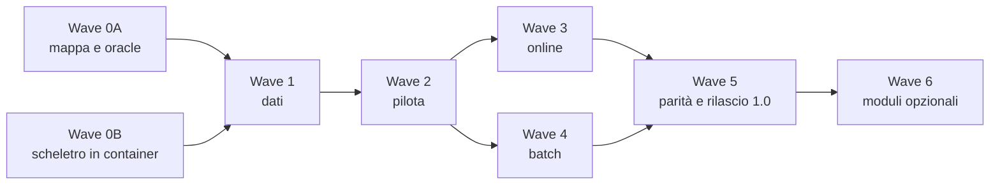

# Piano delle wave

Piano operativo della migrazione di CardDemo, e **fonte unica** per numerazione delle wave e dipendenze. Perfeziona `paper/piano-migrazione-carddemo-java.md`, che resta come proposta di partenza. Le differenze sono elencate in fondo, con il motivo.

Versione 2 (27 novembre 2026): la versione 1 è stata contestata da Codex prima di essere proposta. I 23 rilievi, il prompt usato e l'esito di ciascuno sono in `paper/data/reviews/2026-11-27-piano-wave/`.

## Perimetro

| Gruppo | Programmi | Quanti |
| --- | --- | ---: |
| Online CICS di base | `COSGN00C`, `COMEN01C`, `COADM01C`, `COACTVWC`, `COACTUPC`, `COCRDLIC`, `COCRDSLC`, `COCRDUPC`, `COTRN00C`–`02C`, `COBIL00C`, `CORPT00C`, `COUSR00C`–`03C` | 17 |
| Batch di base | `CBTRN01C`–`03C`, `CBACT01C`–`04C`, `CBCUS01C`, `CBSTM03A`/`B`, `CBEXPORT`, `CBIMPORT` | 12 |
| Utility | `CSUTLDTC`, `COBSWAIT` | 2 |
| Moduli opzionali (Db2, MQ, IMS) | 13 programmi in `app/app-*` | 13 |

Il prodotto di base (31 programmi) viene consegnato e rilasciato **prima** di affrontare i moduli opzionali.

Il confine non è netto come le cartelle fanno pensare: i menu di base espongono già voci che portano ai moduli opzionali (`COPAUS0C` in `COMEN02Y`, `COTRTLIC` e `COTRTUPC` in `COADM02Y`). Cosa accade selezionandole nella versione 1.0 è una decisione del gate umano, da prendere in Wave 0A e da registrare come deviazione dichiarata.

## Vista d'insieme

| Wave | Scopo | Issue (ordine di grandezza) | Parallelismo | Si chiude quando |
| --- | --- | ---: | --- | --- |
| 0A | Capire il legacy e costruire l'oracle | 17 (8 nella prima versione del piano, 12 nella seconda) | parziale | l'oracle rigenera i golden con un comando |
| 0B | Scheletro Java che gira in container | 4 | in parallelo a 0A | `docker compose up` porta su un'applicazione vuota ma sana, CI verde |
| 1 | Schema e caricamento dati | 13 | alto (una tabella per issue) | i dati di esempio sono in PostgreSQL, verificati contro le fixture |
| 2 | Pilota: una fetta batch e una online, da capo a fondo | 3–4 | no | due test di parità verdi e template di issue ritarato |
| 3 | Online | 35–40 | letture in parallelo, scritture in sequenza per tabella | ogni caso della matrice di comportamento è un test verde |
| 4 | Batch | ~15 | scenari batch in sequenza, utility in parallelo | gli scenari Java riproducono i golden record per record |
| 5 | Parità end-to-end, rilascio 1.0 | 4 | no | percorso completo verde da clone pulito; release e DOI |
| 6 | Moduli opzionali | da definire | tre filoni indipendenti | deciso dopo la Wave 5 |

I numeri di issue sono previsioni, non impegni. Le durate non si stimano qui: la Wave 2 serve anche a misurare quanto costa davvero una issue, e da lì si proietta il resto.

## Wave 0A — mappa e oracle (brownfield, sola lettura)

Rischio che controlla: migrare qualcosa che non si è capito, o non avere un riferimento contro cui dire "è uguale".

| # | Issue | Dipende da | Esecutore |
| --- | --- | --- | --- |
| 0A-1 | Banco di prova containerizzato degli strumenti di analisi; manifesto dei sorgenti; comando unico estendibile | — | Sonnet |
| 0A-2 | Inventario e grafo delle dipendenze | 0A-1 | Sonnet |
| 0A-3 | Contratto dati campo per campo (copybook, record definiti nei programmi, chiavi VSAM) | 0A-1 | Opus |
| 0A-4 | Oracle, parte 1: immagine GnuCOBOL, compilazione dei batch, avvio con parametri | 0A-1 | Opus |
| 0A-5 | Fixture dai dati di esempio: decodifica verificata e caricamento nell'oracle | 0A-3, 0A-4 | Opus |
| 0A-6 | Fixture mirate: casi che i dati di esempio non coprono | 0A-5 | Opus |
| 0A-7 | Grafo dei flussi batch da JCL, README, script e scheduler | 0A-2 | Sonnet |
| 0A-8 | Equivalenti in container delle utility mainframe (`SORT`, `IDCAMS`, GDG, orologio) | 0A-4 | Opus |
| 0A-9 | Golden dei singoli job batch | 0A-5, 0A-6, 0A-8 | Opus |
| 0A-10 | Golden degli scenari batch concatenati, compresa la riesecuzione | 0A-9, decisione sugli scenari | Opus |
| 0A-11 | Matrice di comportamento online: formato e pilota su `COSGN00C` | 0A-2, 0A-3 | Opus |
| 0A-12 | Chiusura della wave: registro delle decisioni e riallineamento delle issue a valle | tutte | Fable + gate umano |

**Aggiornamento del 27 novembre 2026, dopo il merge di 0A-1.** La contestazione delle specifiche ha mostrato che 0A-2, 0A-3 e 0A-4 contenevano ciascuna più lavori indipendenti. Sono state ristrette e ne sono nate altre issue (numeri di GitHub):

| # | Issue | Dipende da | Stato |
| --- | --- | --- | --- |
| #2 | 0A-2: inventario strutturale e dipendenze statiche (`COPY`, `CALL`, JCL, transazioni) | #1 | in corso |
| #22 | 0A-2b: collegamenti `EXEC CICS` nel grafo | #2 | bloccata |
| #3 | 0A-3: censimento dei tracciati e contratto dati fisico | #1 | in corso |
| #23 | 0A-3b: record sentinella e regole di codifica dei campi | #3 | bloccata |
| #4 | 0A-4: immagine GnuCOBOL, compilazione e avvio degli 11 batch compilabili | #1 | in corso |
| #24 | 0A-4b: routine esterne dell'oracle (`COBDATFT`, `MVSWAIT`, `CEEDAYS`) | #4 | bloccata |
| #25 | 0A-4c: `CBSTM03A`, `CBEXPORT`, `CBIMPORT` nell'oracle | #4 | bloccata |
| #21 | 0A-1b: completezza dei verdetti e controlli di `analysis/` in CI | #1, #14 | bloccata |

Le dipendenze a valle si leggono di conseguenza: #5 (fixture) dipende anche da #23; #9 (golden dei job) anche da #24 e #25; #7 (flussi batch) e #11 (matrice online) anche da #22. La Wave 0A passa da 12 a 17 issue. Nella Wave 0B, #19 è stata aperta e chiusa come superata (vedi registro delle approvazioni, voce 13). Sempre nella 0B, #15 conteneva quattro consegne indipendenti ed è stata divisa: #15 (test di integrazione con PostgreSQL reale), #26 (confini tra moduli, dipendenze vietate, tipi in virgola mobile), #27 (copertura e SpotBugs), #28 (SonarQube in locale), in sequenza. La Wave 0B passa da 4 a 7 issue; #16 (contratti condivisi) dipende da #26 anziché dall'intera vecchia #15.

**Aggiornamento delle 15:10 UTC del 27 novembre 2026.** Mergiate: #1, #4, #13, #14, #15 (PR #18, #29, #17, #20, #33). In correzione: #2, #3, #21. Issue nate dopo l'aggiornamento precedente:

| # | Issue | Dipende da | Stato |
| --- | --- | --- | --- |
| #24 | 0A-4b: routine `COBDATFT` dell'oracle (ristretta: prima comprendeva tre routine) | #4 | in corso |
| #36 | 0A-4e: routine `MVSWAIT` | #24 | bloccata |
| #37 | 0A-4f: routine `CEEDAYS` | #24 | rinviata |
| #25 | 0A-4c: `CBSTM03A` nell'oracle (da riscrivere dopo #24) | #24 | bloccata |
| #38 | 0A-4g: `CBEXPORT` e `CBIMPORT` | #25 | bloccata |
| #35 | 0A-4d: esito delle acquisizioni di configurazione; controlli dell'oracle in CI | #24 | bloccata |
| #26 | 0B-3b: confini tra moduli, database vietati, tipi in virgola mobile | #15 | in corso |
| #34 | 0B-3e: limiti di tempo e processi figli | #26 | bloccata |

Le issue che toccano `oracle/build/` vanno in sequenza, perché condividono gli stessi file: #24, #25, #35, #36, #38. La Wave 0A conta ora 22 issue, la 0B 8.

Dopo 0A-1, le issue 0A-2, 0A-3 e 0A-4 lavorano su cartelle disgiunte e possono procedere insieme. 0A-1 fornisce anche il meccanismo con cui ogni issue aggiunge i propri controlli nella propria cartella, senza toccare file condivisi.

Due oracle, di forza diversa, e il paper lo dichiara:
- **Batch: oracle eseguibile.** I programmi COBOL originali girano sotto GnuCOBOL in container; i loro output sono il riferimento. Non è z/OS: ogni differenza nota (rappresentazione binaria, ordine di collazione, chiavi alternative con duplicati, record a lunghezza variabile) è dichiarata e, dove possibile, provata.
- **Online: oracle documentale.** CICS non è eseguibile con strumenti aperti. Il riferimento è una matrice di casi (stato in ingresso → esito atteso) ricavata dal sorgente, con riga citata, contestata dal Validatore e **approvata dal gate umano prima** dell'implementazione che dovrà soddisfarla.

Cose scoperte contestando il piano, che queste issue devono trattare esplicitamente:

- **I dati di esempio non bastano.** Non contengono i casi che distinguono un'implementazione giusta da una sbagliata. Esempio: `CBACT04C` calcola l'interesse mensile con una divisione assegnata a un campo a due decimali senza `ROUNDED`, quindi tronca; un Java che arrotonda passerebbe su valori senza frazioni di centesimo. Servono fixture costruite apposta (0A-6): frazioni di centesimo positive e negative, due carte sullo stesso conto, valori al limite.
- **Un abend è un risultato, non un errore del test.** `CBTRN02C` aggiorna saldi e categorie *prima* di scrivere la transazione; se la chiave esiste già il programma termina in errore con effetti parziali. Rieseguire il posting esercita proprio questo percorso. Il golden registra arresto, codice e stato dei file.
- **Non esiste un solo "ciclo giornaliero".** Lo scheduler Control-M chiama giornaliero il flusso `CLOSEFIL → TRANBKP → WAITSTEP → OPENFIL` e mensile quello degli interessi; lo script `run_full_batch.sh` salta `CREASTMT`. Dopo 0A-7 il gate umano sceglie quali scenari diventano riferimento.
- **Input nascosti.** `CBACT04C` riceve la data come parametro di sistema (struttura con lunghezza binaria), non dalla riga di comando; `CBTRN03C` legge un file di date che nessun job del ciclo crea; `TRANFILE` viene inizializzato con un record di 350 byte a zero, numericamente invalido.
- **Incoerenze già presenti nel legacy**, da registrare e non correggere: chiave di `CBEXPORT` diversa tra JCL e copybook; indice alternativo di `XREFFILE` con duplicati ammessi nel JCL ma non dichiarati nel programma.

Decisioni che questa wave porta al gate umano: portare o escludere `CBTRN01C`; triage dei job puramente mainframe; strumenti da adottare; scenari batch di riferimento; comportamento delle voci di menu verso i moduli opzionali.

## Wave 0B — scheletro in container (greenfield)

Rischio che controlla: agenti che divergono su struttura, convenzioni e modo di verificare.

| # | Issue | Esecutore |
| --- | --- | --- |
| 0B-1 | Progetto Maven multi-modulo (`carddemo-domain`, `-loader`, `-online`, `-batch`, `-parity`), build solo in container, CI verde | Sonnet |
| 0B-2 | Compose: PostgreSQL, servizio online, runner batch; healthcheck; smoke test da clone pulito | Sonnet |
| 0B-3 | Cancelli di qualità: test con Testcontainers, JaCoCo, ArchUnit (confini tra moduli), SonarQube Community | Sonnet |
| 0B-4 | Contratti condivisi: tipo per gli importi (`BigDecimal` con scala e arrotondamento espliciti), stato di conversazione (COMMAREA), collazione delle chiavi, convenzioni di errore | Opus |

0B-1 → 0B-2 → 0B-3 in sequenza; 0B-4 dopo 0B-1 e dopo 0A-3, perché i contratti si scrivono guardando i dati veri.

Da questa wave in poi esiste sempre un'applicazione che parte: ogni wave successiva aggiunge funzioni a qualcosa che gira, e si chiude con uno smoke test su `docker compose up`.

## Wave 1 — dati

- Una issue per tabella (11): `usrsec`, `account`, `card`, `card_xref`, `customer`, `transaction`, `daily_transaction`, `tran_cat_balance`, `disclosure_group`, `tran_type`, `tran_category`. Chiavi primarie e indici derivati dal contratto dati, non riprogettati.
- Loader delle fixture con controlli: numero di record, totali di controllo sui campi numerici, round-trip verso il formato a larghezza fissa.
- Verifica dell'ordinamento: una lettura per chiave da PostgreSQL restituisce i record nello stesso ordine del file indicizzato dell'oracle.

Parallelismo alto: le tabelle sono indipendenti. Esecutore: Sonnet, tranne il loader (Opus).

## Wave 2 — pilota

Due fette sottili portate fino in fondo prima di allargare:

- **Batch:** `READACCT` / `CBACT01C` → job Spring Batch, con parità byte per byte contro il golden.
- **Online:** `COSGN00C` (signon) → servizio, API e schermata, con ogni caso della matrice trasformato in test. Il login riuscito in COBOL passa il controllo ai menu, che arrivano nella wave successiva: il pilota verifica solo il confine (programma di destinazione e stato di conversazione consegnato), non il menu.

Serve a tre cose: provare che la catena issue → Esecutore → Validatore → merge funziona su entrambi i tipi di programma; ritarare il template di issue sui problemi incontrati; **misurare** tempo e costo di una issue, per proiettare le wave 3 e 4. Si chiude con una revisione umana del metodo, non solo del codice.

## Wave 3 — online

Ogni programma passa da due issue distinte, con un'approvazione in mezzo:

1. **Matrice di comportamento** del programma (solo documentazione, verificata da un controllo automatico e approvata dal gate umano).
2. **Implementazione**: servizio, endpoint, schermata, con ogni caso della matrice trasformato in test.

I programmi grandi si dividono ancora: `COACTUPC` supera le quattromila righe, con molte `COPY REPLACING` e più punti di rollback, e non entra in una sola issue. La matrice comprende i confini di transazione (`READ UPDATE`, `SYNCPOINT`, rollback), non solo l'ordine delle operazioni.

Ordine:

1. **Base, in sequenza:** menu `COMEN01C` e `COADM01C`, utility `CSUTLDTC`.
2. **Letture, in parallelo:** `COACTVWC`, `COCRDLIC`, `COCRDSLC`, `COTRN00C`, `COTRN01C`, `COUSR00C`.
3. **Scritture, mai due insieme sulla stessa tabella:** `COUSR01C`–`03C`, `COCRDUPC`, `COACTUPC`, `COTRN02C`, `COBIL00C`.
4. **`CORPT00C`** per ultimo: sottomette un job batch, quindi attende `CBTRN03C` dalla Wave 4.

Interfaccia: pagine web generate dal server, una per mappa BMS, nello stesso container del servizio. Stessi campi, stessi messaggi, stessi tasti funzione resi come comandi. Nessuna riprogettazione dell'esperienza d'uso.

## Wave 4 — batch

1. **Job dei flussi batch, in sequenza stretta** secondo gli scenari scelti in Wave 0A: blocco online/batch, `POSTTRAN` (`CBTRN02C`), `INTCALC` (`CBACT04C`), `TRANBKP`, `COMBTRAN`, `CREASTMT` (`CBSTM03A`/`B`), `TRANIDX`, `TRANREPT` (`CBTRN03C`). Ogni job si confronta prima con il proprio golden isolato, poi con lo snapshot dello scenario concatenato, compresa la riesecuzione e gli arresti con effetti parziali.
2. **In parallelo:** `READCARD`, `READCUST`, `READXREF`, `COBSWAIT`, `CBEXPORT`/`CBIMPORT`.

Le wave 3 e 4 avanzano insieme, con una regola del Selettore che le attraversa: una issue online e una batch che scrivono la stessa tabella non sono mai `in-progress` nello stesso momento.

## Wave 5 — parità end-to-end e rilascio 1.0

- Scenario completo in container: login → consultazioni → aggiornamento conto → nuova transazione → pagamento → ciclo batch → estratto conto e report, confrontato con i golden.
- Verifica di completezza: ogni programma, copybook e job di base risulta tradotto oppure escluso con decisione registrata.
- Prova di replica: clone pulito su una macchina diversa, solo Docker.
- Release `v1.0`, archiviazione su Zenodo, chiusura dei dati di tempo e costo per il paper.

## Wave 6 — moduli opzionali

Tre filoni indipendenti, in ordine di difficoltà crescente: tipi transazione su Db2 (già relazionale), inquiry via MQ (broker in container), autorizzazioni su IMS/Db2/MQ. Si pianifica dopo la Wave 5, con i costi misurati in mano. Il paper può uscire senza questa wave, dichiarandolo.

## Regole che valgono per tutte le wave

- Una specifica diventa `ready` solo dopo una **contestazione avversariale della specifica stessa** (Codex), non solo della PR: una specifica sbagliata costa più di un'implementazione sbagliata. La contestazione si fa nel momento in cui l'issue sta per diventare `ready`, non prima: nel frattempo le issue da cui dipende possono averla cambiata.
- Le issue sono numerate su GitHub nell'ordine del piano: #1–#12 sono 0A-1…0A-12, #13–#16 sono 0B-1…0B-4.
- Al termine di ogni wave: revisione umana dei contratti, riallineamento delle issue a valle, aggiornamento del paper.
- Codice e analisi entrano solo via PR con merge umano. Paper, piano e dati di misura sono aggiornati dal pianificatore direttamente su `main`.

## Cosa cambia rispetto alla proposta iniziale, e perché

| Proposta iniziale | Qui | Motivo |
| --- | --- | --- |
| 0B dopo il congelamento di 0A | 0A e 0B in parallelo (tranne i contratti condivisi) | lo scheletro non dipende dalla mappa; si accorcia il calendario senza rischio |
| Oracle = file di esempio, più eventuale runtime AWS | Oracle eseguibile con GnuCOBOL per i batch, matrice di comportamento per l'online | i soli dati di ingresso non dicono quale debba essere l'uscita; serve un riferimento |
| Analisi del legacy non specificata | Prima issue: prova degli strumenti esistenti | non reimplementare; SonarQube non copre il COBOL senza licenza |
| Dalla Wave 1 direttamente a online e batch | Wave pilota in mezzo | si scopre presto se metodo e template reggono, e si misura il costo unitario |
| Parità end-to-end insieme ai moduli opzionali, alla fine | Parità e rilascio del prodotto di base prima; opzionali dopo | IMS e MQ sono la parte più incerta: non devono tenere in ostaggio un risultato funzionante |
| "API REST ed eventuale UI sottile" | Una schermata per mappa, in ogni issue online | l'obiettivo è un'applicazione funzionante, usabile da una persona |
| Quattro rischi per il Validatore | Se ne aggiungono quattro: ordine di collazione (EBCDIC ordina le lettere prima delle cifre, ASCII il contrario), differenze GnuCOBOL / z/OS nell'oracle, confini di transazione CICS, effetti parziali prima di un abend | ciascuno può produrre una parità falsa |
| Un solo ciclo giornaliero | Scenari batch scelti dopo aver confrontato JCL, README, script e scheduler | le fonti non concordano sull'ordine né sulla frequenza |
| Golden dai soli dati di esempio | Anche fixture costruite apposta | i dati di esempio non esercitano troncamenti, duplicati e limiti |
| Un programma online = una issue | Matrice approvata, poi implementazione; i programmi grandi divisi | l'oracle dell'online va approvato prima del codice che lo deve soddisfare |
| Validatore solo sulle PR | Validatore anche sulle specifiche | l'errore più costoso è a monte |

## Stato delle issue della Wave 0 (aggiornato il 27 novembre 2026, 16:59 UTC)

Questa tabella sostituisce la colonna "Stato" delle tabelle precedenti, che restano come erano quando sono state scritte. Fonte: GitHub e `docs/registro-approvazioni.md`.

| # | Issue | Dipende da | Stato |
| --- | --- | --- | --- |
| #1 | 0A-1: strumenti di analisi | — | chiusa (PR #18) |
| #21 | 0A-1b: verdetti e controlli di `analysis/` in CI | #1, #14 | chiusa (PR #31) |
| #2 | 0A-2: inventario e dipendenze statiche | #1 | in revisione (PR #30: correzione mirata dopo il terzo giro) |
| #22 | 0A-2b: collegamenti `EXEC CICS` nel grafo | #2 | bloccata |
| #3 | 0A-3: contratto dati fisico | #1 | chiusa (PR #32) |
| #41 | 0A-2a: motivazione di `WS-DATE` nel contratto dati | #3 | chiusa (PR #42, senza Codex) |
| #23 | 0A-3b: regole di codifica dei campi e vettori di prova | #3, #4 | in corso |
| #43 | 0A-3c: sentinelle dei 15 tracciati dei copybook (divisa da #23) | #23 | bloccata |
| #4 | 0A-4: oracle GnuCOBOL, 11 batch | #1 | chiusa (PR #29) |
| #24 | 0A-4b: routine `COBDATFT` | #4 | chiusa (PR #39) |
| #25 | 0A-4c: `CBSTM03A` nell'oracle | #24 | in corso |
| #35 | 0A-4d: acquisizioni di configurazione; oracle in CI | #25 | bloccata |
| #36 | 0A-4e: routine `MVSWAIT` | #35 | bloccata |
| #37 | 0A-4f: routine `CEEDAYS` | — | rinviata |
| #38 | 0A-4g: `CBEXPORT` e `CBIMPORT` | #36 | bloccata |
| #5 | 0A-5: fixture dai dati di esempio | #3, #4, #23, #43 | bloccata |
| #6–#12 | 0A-6 … 0A-12 | vedi sopra | bloccate |
| #13 | 0B-1: scheletro Java | — | chiusa (PR #17) |
| #14 | 0B-2: Compose e smoke | #13 | chiusa (PR #20) |
| #15 | 0B-3: test con PostgreSQL reale | #14 | chiusa (PR #33) |
| #26 | 0B-3b: confini tra moduli, database vietati, tipi in virgola mobile | #15 | chiusa (PR #40) |
| #27 | 0B-3c: copertura (JaCoCo) e analisi statica (SpotBugs) | #26 | in corso |
| #34 | 0B-3e: limiti di tempo e processi figli | #27 (stesso file `verify.sh`) | bloccata |
| #28 | 0B-3d: SonarQube in locale | #27 | bloccata |
| #16 | 0B-4: contratti condivisi | #26, #3, #23 | bloccata (aspetta le regole di codifica di #23) |

Le issue sull'oracle condividono i file di `oracle/build/` e vanno in sequenza: #25 → #35 → #36 → #38. Le issue su `verify.sh` e sui POM vanno in sequenza: #27 → #34 → #28.

## Revisione del 27 novembre 2026, 22:53 UTC: prima il pilota (decisione dell'autore)

Alla fine del primo giorno l'autore ha scelto di **non chiudere la Wave 0 per intero prima di tradurre**. Si prepara subito solo ciò che serve al primo programma, lo si traduce e lo si confronta con l'originale; il resto della preparazione si fa man mano, subito prima del programma a cui serve. Motivo: oggi non si sa ancora se il metodo regge sulla traduzione vera, e conviene scoprirlo presto. Rischio accettato: accorgersi più tardi che a un programma serve qualcosa di non preparato; lo attenuano la mappa e l'oracle, che esistono già. Registro delle approvazioni, voce 86.

Questa sezione prevale sulle precedenti dove differiscono. In particolare la condizione "la Wave 0A si chiude quando l'oracle rigenera tutti i golden" è sostituita dal percorso qui sotto.

### Percorso al pilota batch (`READACCT` / `CBACT01C`), in fila

| Passo | Issue | Stato |
| --- | --- | --- |
| 1. Dati di esempio decodificati e verificati | #5 | chiusa (PR #56) |
| 2. File dei conti caricato nell'oracle | #53 (ristretta al solo file dei conti) | chiusa (PR #58) |
| 3. Output di riferimento di `CBACT01C` | #55 (divisa da #9) | in corso |
| 4a. Tabella dei conti in PostgreSQL | #59 | chiusa (PR #61) |
| 4b. Caricamento dei conti in PostgreSQL | #60 | in corso |
| 5. Test di parità di `CBACT01C` contro il golden, scritto prima della traduzione e rosso finché il Java non esiste | Wave 2: da aprire | — |
| 6. `CBACT01C` tradotto: il test del passo 5 passa, senza che l'Esecutore lo modifichi | Wave 2, pilota batch: da aprire | — |

I passi 5 e 6 applicano la catena del metodo (specifica → test → issue → implementazione agentica): due issue, due Esecutori diversi.

In parallelo, senza dipendenze dal percorso: codifica dei campi in Java (#54, chiusa con la PR #57), routine `MVSWAIT` (#36, chiusa con la PR #52). Stato aggiornato il 28 novembre 2026, 05:10 UTC.

### Percorso al pilota online (`COSGN00C`, accesso)

Matrice di comportamento del solo programma di accesso (#11), poi tabella degli utenti e traduzione. Parte dopo il pilota batch, o in parallelo se non si sovrappongono cartelle.

### Rinviato, da fare subito prima di ciò a cui serve

| Issue | Quando |
| --- | --- |
| #6 fixture mirate; #8 equivalenti delle utility mainframe; #9 golden degli altri job; #10 golden degli scenari concatenati | prima di ciascun job della wave batch |
| #7 grafo dei flussi batch; #46 bersagli CICS in variabile | prima della wave batch e della wave online |
| #38 `CBEXPORT`/`CBIMPORT`; #37 `CEEDAYS` | prima dei programmi che le usano |
| #16 contratti condivisi rimanenti (importi, stato di conversazione, transazioni, ordinamento, errori) | ciascuno prima del primo programma che lo richiede |
| #34 limiti di tempo e processi figli; #28 SonarQube; #45 residui degli script | quando non rallentano il percorso al pilota |
| #12 chiusura della Wave 0A | sostituita da una revisione dopo il pilota |

Dopo il pilota si rivede questo piano con i costi misurati di una traduzione vera.
