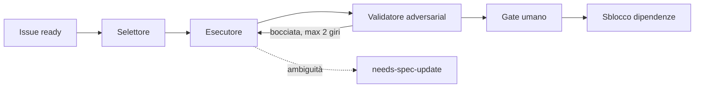
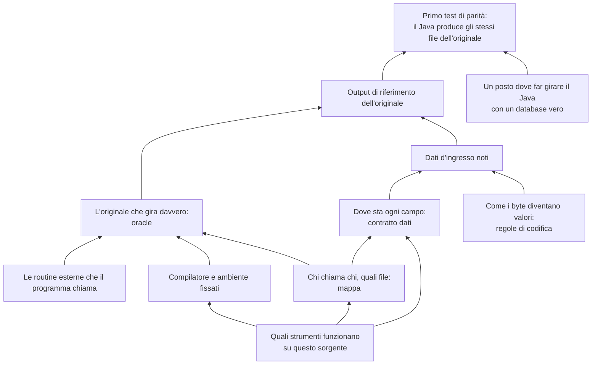
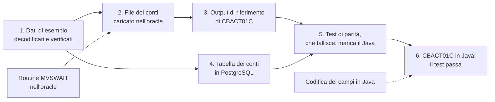

# MEN-B: migrare un brownfield COBOL a Java con una coda di specifiche e agenti AI

> Bozza in scrittura. Le sezioni marcate *(da compilare)* si riempiono a mano a mano che il passo corrispondente viene eseguito. Ogni numero riportato qui ha una fonte in `paper/data/` o un comando riproducibile.

## Abstract

*(da compilare a migrazione conclusa)*

## 1. Introduzione

Questo lavoro vuole insegnare, a chi deve farlo davvero, come modernizzare un sistema legacy con agenti AI. Non propone un metodo in astratto: segue una migrazione reale da COBOL a Java dall'inizio alla fine e riporta, per ogni passo, cosa si è fatto, perché, con quali comandi e istruzioni agli agenti, quanto tempo ha richiesto e cosa è andato storto.

Tre impegni verso il lettore:

- **Replicabile.** Issue, prompt, comandi e versioni sono pubblicati integralmente; l'unico prerequisito per rieseguire tutto è Docker.
- **Chiaro.** Non si presuppone esperienza di mainframe né di sviluppo agentico; i termini sono spiegati alla prima occorrenza.
- **Reale.** I tempi sono misurati passo per passo, non stimati; errori, rework e interventi umani sono riportati come sono avvenuti. I costi sono raccolti solo in parte (token consumati dagli agenti, con i limiti dichiarati in `paper/data/costi.md`): dove un dato manca lo si dice.

### 1.1 Il lavoro in parole semplici

<!-- Da fare in revisione finale (decisione dell'autore, 27 nov 2026): riscrivere questa sezione, uniformandone il registro al resto del paper. -->

Questa sezione è per chi vuole capire l'insieme prima dei dettagli. Tutto ciò che dice è ripreso, con comandi e misure, nelle sezioni successive.

**L'idea di fondo.** Tradurre un programma vecchio in uno nuovo è facile da fare male: "compila e sembra funzionare" non prova che faccia le stesse cose dell'originale. Per questo, prima di tradurre anche una sola riga, servono quattro cose: sapere esattamente com'è fatto il sistema vecchio; avere un modo per far girare i programmi originali e vedere che cosa producono; avere pronto il posto dove andrà il codice nuovo; avere controlli che si accorgano quando si sbaglia. La prima parte del lavoro, la più lunga, è stata costruire queste quattro cose. È la parte che di solito si salta.

**Che cosa si costruisce prima di tradurre.**

- *Una mappa del sistema vecchio.* Quali programmi esistono, chi chiama chi, quali file leggono e scrivono; com'è fatto ogni record di dati, campo per campo; come i byte di un campo diventano un numero o un testo; per i programmi a schermo, quali schermate mostrano e a quale programma passano il controllo.
- *Un "originale funzionante" in un container.* I programmi COBOL di elaborazione notturna (*batch*) si compilano e girano su un computer qualsiasi con un compilatore libero, senza mainframe. È il termine di paragone: il Java dovrà produrre gli stessi risultati. In questo lavoro lo chiamiamo *oracle*.
- *Lo scheletro dell'applicazione nuova.* Un'applicazione Java vuota che parte con un comando, con il suo database vero e con regole automatiche che impediscono errori tipici (per esempio usare numeri con la virgola imprecisi per gli importi).
- *I controlli.* Ogni pezzo ha un comando che risponde alla domanda "è ancora giusto?", e che gira da solo a ogni modifica.

**Come si lavora.** Ogni lavoro è piccolo e segue lo stesso giro, con tre ruoli affidati ad agenti AI e uno alla persona. Un agente scrive le istruzioni per un lavoro preciso. Un secondo lo esegue, da solo, in una copia separata. Un terzo, di un altro fornitore, prova a smontarlo: non legge le intenzioni, esegue i controlli e cerca un modo per far passare un lavoro sbagliato. Poi qualcuno decide se accettare, far correggere o respingere l'obiezione, e scrive il motivo in un registro. All'inizio decideva l'autore; a metà del primo giorno ha delegato la decisione al primo agente (passo 9), tenendo per sé il registro e il diritto di annullare.

**Che cosa si è imparato fin qui.**

- Il lavoro consegnato era quasi sempre giusto; i controlli che dovevano proteggerlo, no. Il terzo agente ha trovato più volte controlli che restavano verdi davanti a un errore. Senza qualcuno che prova ad aggirarli, non lo si vede.
- Si è evitato almeno un errore serio: il compilatore leggeva al contrario il segno di alcuni importi, e un debito diventava un credito. Un Java "identico all'originale" sarebbe stato identico a un errore (passo 15).
- Far criticare le istruzioni prima di eseguirle costa da tre a sei minuti e ne risparmia venti o trenta (passo 20).
- Un critico avversariale non si ferma da solo: serve una regola scritta su quante volte interviene e su quali obiezioni non contano (passi 16, 18, 22).

- La preparazione non finisce da sola: si può sempre preparare meglio. A fine giornata l'autore ha cambiato l'ordine: si prepara solo ciò che serve al primo programma, lo si traduce, e il resto si prepara man mano (passo 23, sezione 2.2).

**Che cosa questo documento non è ancora.** Alla data dell'ultima revisione nessuna funzione dell'applicazione è stata tradotta: è in corso la preparazione del primo programma. Le sezioni sulla traduzione sono vuote e lo dicono.

*(da completare: contesto del problema, lavori correlati, cosa questo lavoro misura e cosa no)*

## 2. Metodo

MEN-B ("Make Everything Now, Brownfield") tratta le GitHub Issues come coda di specifiche e separa quattro ruoli. Una *issue* è una scheda di lavoro su GitHub; qui ogni issue è una specifica completa, con un comando che dice se il lavoro è finito. Da ogni issue nasce una *pull request* (PR), cioè una proposta di modifica che qualcuno deve approvare prima che entri nel progetto.

| Ruolo | Implementazione in questo lavoro | Compito |
| --- | --- | --- |
| Pianificatore / Selettore | Claude Fable 5.2 | Scrive le issue, verifica dipendenze e sovrapposizioni, avvia l'Esecutore |
| Esecutore | Claude Opus / Claude Sonnet (subagent, worktree isolato) | Implementa una sola issue e apre la PR |
| Validatore adversarial | Codex CLI 0.172, contesto pulito | Cerca di falsificare la PR; al massimo due giri |
| Approvatore | all'inizio l'autore; dal passo 9 Claude Fable per delega, con registro | Decide il merge |

Il Validatore è volutamente un modello di un altro fornitore rispetto all'Esecutore: non ne condivide il contesto né le abitudini. Interviene due volte: sulla specifica, prima che il lavoro cominci, e sulla PR, a lavoro fatto.

**La catena: specifica → test → issue → implementazione agentica.** È l'ossatura del metodo, e ogni altra regola serve a tenerla in piedi.

1. *Specifica.* Che cosa deve fare il pezzo, ricavato dal sorgente originale e contestato dal Validatore prima di cominciare.
2. *Test.* Il controllo eseguibile che dirà se il pezzo è giusto. Esiste prima dell'implementazione ed è scritto da chi non la scriverà. Per un programma tradotto è il confronto con l'output dell'originale; prima che la traduzione esista, quel test fallisce.
3. *Issue.* L'ordine di lavoro: specifica, perimetro e il comando che esegue il test. È l'unica cosa che l'Esecutore riceve.
4. *Implementazione agentica.* Un agente implementa finché il test passa, senza poter toccare né il test né i valori attesi. Un secondo agente prova a far passare il test con un lavoro sbagliato. La persona non scrive codice e non approva ogni modifica: fissa le regole, legge il registro, può annullare.

L'ordine conta. Se il test nasce insieme all'implementazione, o dopo, chi implementa finisce per scrivere il test che il proprio lavoro supera: è il difetto che il Validatore ha trovato più spesso nel primo giorno (sezione 7.1). Nella preparazione la catena ha preso questa forma: valori attesi scritti a mano e registrati *prima* dello strumento che doveva produrli, con l'ordine dei commit verificato dal Validatore. Nella traduzione prende la forma piena: l'output di riferimento e il test di parità entrano nel ramo principale prima che l'issue di traduzione sia affidata.

*Brownfield* indica un sistema che esiste già e il cui comportamento va preservato; *greenfield* un sistema costruito da zero. Questa migrazione è entrambe le cose: il comportamento da preservare è brownfield, lo stack di arrivo è greenfield. Servono quindi due preparazioni ("Fasi 0") prima di qualsiasi logica di business: capire il legacy e costruire un riferimento con cui confrontarsi, e preparare lo scheletro del nuovo sistema. Il riferimento si chiama *oracle*: qualcosa che, dato un ingresso, dice quale deve essere l'uscita giusta.

### 2.1 Il ragionamento dietro la Wave 0

La Wave 0 è la parte del lavoro in cui non si traduce nulla. In questo progetto ha occupato l'intero primo giorno. Chi replica deve poter giudicare se quel tempo è ben speso: qui è spiegato da dove viene ogni suo pezzo. Una precisazione sul metodo di scrittura: le dipendenze descritte sono quelle del piano approvato al passo 6 e modificato nei passi successivi (`docs/piano-wave.md`); la forma del racconto, "dalla fine all'indietro", è stata scritta a posteriori, alla fine del primo giorno, su richiesta dell'autore.

**Si parte dalla fine.** Il piano non è stato scritto chiedendosi "che cosa conviene preparare?", ma chiedendosi: *qual è il primo test che dirà, senza possibilità di discussione, che un programma tradotto fa ciò che faceva l'originale? E che cosa deve esistere perché quel test si possa scrivere?* Il primo test scelto è piccolo: un programma batch che legge l'archivio dei conti e ne scrive il contenuto in tre file (`CBACT01C`), tradotto in Java, deve produrre file identici byte per byte a quelli dell'originale. Da lì si risale all'indietro.

Letto dal basso, il grafico è l'ordine delle issue della Wave 0A. Ogni freccia è una domanda a cui si è dovuto rispondere:

- *Per confrontare servono gli output dell'originale.* Non avendo un mainframe, l'originale va fatto girare altrove: è l'oracle. Un output di riferimento prodotto da un oracle sbagliato è peggio di nessun riferimento, perché certifica l'errore. Per questo l'oracle ha ricevuto più controlli di qualsiasi altra parte (e uno di essi ha trovato i segni degli importi letti al contrario, passo 15).
- *Per far girare l'originale serve tutto ciò che esso chiama.* `CBACT01C` chiama una routine scritta in assembler per convertire una data. Senza un equivalente, il programma si ferma alla prima riga utile. Lo si è scoperto perché la prova degli strumenti, e poi la mappa delle dipendenze, lo mostravano tra le chiamate non risolte, non perché qualcuno lo sapesse.
- *Per dare all'originale un ingresso noto bisogna saper leggere e scrivere i suoi dati.* Cioè sapere dove sta ogni campo (il contratto dati) e come i suoi byte diventano un valore (le regole di codifica). Sono due cose distinte, e sbagliare la seconda è meno visibile: un importo letto con il segno sbagliato è un numero plausibile.
- *Per scrivere mappa e contratto servono strumenti, e non si sa quali funzionino finché non li si prova su questo sorgente.* Per questo la prima issue in assoluto è stata una prova degli strumenti, con esiti controllati a mano su pochi file. Lo strumento più noto ha fallito proprio sul formato COBOL tradizionale (sezione 4).

**Per i programmi a schermo il ragionamento è lo stesso, ma la risposta è diversa.** Non esiste un modo libero e pronto di eseguire i comandi CICS, quindi non c'è un originale che gira. Il riferimento diventa un documento: per ogni programma, una tabella di casi (ingresso, stato, tasto premuto → schermata, messaggio, dati scritti, programma successivo) ricavata dal sorgente e criticata dal Validatore. È un riferimento più debole di un'esecuzione, e il paper lo dichiara tra i limiti. Per costruirlo serve sapere quali comandi CICS usa ogni programma e verso che cosa: per questo la mappa dei comandi CICS fa parte della Wave 0, anche se nessuno strumento la forniva.

**L'altra metà: preparare l'arrivo.** Lo stesso primo test richiede un posto dove il Java possa girare contro un database vero, con un comando solo, in un container: è la Wave 0B. Due scelte al suo interno seguono la stessa logica del "prima":

- *Le regole si mettono prima del codice che devono governare.* Vietare i numeri in virgola mobile dove passano importi, o un database in memoria al posto di quello vero, costa poco quando l'applicazione è vuota e molto quando ci sono quaranta programmi tradotti da ricontrollare.
- *Il controllo che dice "funziona" va provato rompendo qualcosa.* Uno scheletro vuoto passa qualsiasi verifica; per sapere che la verifica vale, la si è fatta fallire apposta in ogni modo previsto.

Le due metà non si toccano: la 0A legge soltanto il sorgente originale, la 0B scrive soltanto codice nuovo. Per questo procedono in parallelo.

**Perché tanti controlli sui controlli.** In una migrazione fatta da agenti, chi scrive il codice e chi scrive il test che lo approva è lo stesso tipo di esecutore, con la stessa tendenza a dichiarare finito ciò che sembra finito. La Wave 0 costruisce i giudici di tutto il lavoro successivo: se un giudice è indulgente, ogni traduzione che seguirà erediterà quell'indulgenza senza che nessuno la veda. È il motivo per cui ogni controllo ha una "prova negativa" (lo si altera e deve fallire) e per cui un secondo agente, di un altro fornitore, ha il solo compito di cercare il modo di ingannarli. È anche il motivo per cui la Wave 0 è costata più del previsto.

**Che cosa si è scelto di non fare.** Altrettanto parte del ragionamento:

- nessun emulatore CICS (non ne è emerso uno libero e pronto; il riferimento documentale è dichiarato più debole);
- i tre moduli opzionali restano fuori fino all'ultima wave, ma compaiono nella mappa, perché i menu dei programmi di base li richiamano;
- ciò che il sorgente non determina non si inventa: dove una routine assembler dipende dalla memoria della macchina, o dove il compilatore libero dà due risposte per lo stesso dato, l'oracle si ferma o registra un'osservazione dichiarata, e non produce un valore (passi 17 e 21).

**Quando la Wave 0 è finita.** Non "quando la mappa è completa", che non ha un termine, ma quando valgono due cose verificabili con un comando: l'oracle rigenera gli output di riferimento da zero, e l'applicazione vuota parte da un clone pulito. Tutto ciò che non serve a queste due frasi è stato rinviato. Questa condizione è quella del piano iniziale: alla fine del primo giorno l'autore l'ha sostituita con una più stretta, descritta nella sezione 2.2.

**Che cosa è costato, e che cosa ne ricava chi replica.** Il piano prevedeva 8 issue per la prima metà; contestato una prima volta sono diventate 12, e strada facendo 17 e oltre, quasi sempre perché un'issue conteneva due lavori indipendenti. Gli strumenti e i controlli scritti contano circa ventimila righe (sezione 4). Se la Wave 0 valga questo costo si potrà dire solo dopo il pilota (Wave 2), quando si vedrà quante traduzioni sbagliate i suoi controlli fermano. Fin qui l'unico dato è indiretto: nelle PR della Wave 0 il contenuto consegnato era quasi sempre giusto e i controlli quasi sempre da correggere (passo 22). Per un altro sistema legacy il grafico qui sopra si ridisegna allo stesso modo: si sceglie il primo test di parità più piccolo possibile e si risale a ciò che gli serve. Ciò che cambia sono i nodi (un altro linguaggio, altri archivi, un altro ambiente di esecuzione), non il verso delle frecce.

Il piano completo, con le dipendenze tra le wave, è in `docs/piano-wave.md`.

### 2.2 La revisione del piano: prima il pilota

Questa sezione descrive un cambio di rotta deciso dall'autore alle 22:53 UTC del primo giorno (passo 23; registro delle approvazioni, voce 86). Va letta insieme alla 2.1: il ragionamento resta quello, cambia quanto ci si spinge nella preparazione prima di tradurre.

**Il problema.** Dopo tredici ore e mezza di lavoro esistevano la mappa del sistema, l'oracle con dodici programmi eseguibili e l'applicazione Java vuota. Non era stata tradotta una riga. Per chiudere la preparazione secondo il piano iniziale mancavano sei lavori in fila, almeno un'altra giornata (stima del pianificatore, non una misura). E la domanda più importante era ancora senza risposta: il metodo regge quando si traduce davvero?

**Le due strade.** Il pianificatore le ha presentate all'autore con le lettere A e B; l'autore ha scelto B.

| | A: tutta la preparazione, poi si traduce (piano iniziale) | B: il minimo per un programma, poi si traduce (piano in vigore) |
| --- | --- | --- |
| Che cosa si prepara prima della prima traduzione | dati di prova, output di riferimento e routine esterne per *tutti* i programmi batch; descrizione del comportamento di *tutti* i programmi a schermo | le stesse cose, ma solo per il programma pilota `CBACT01C` |
| Quando arriva il primo confronto tra Java e originale | dopo tutta la Wave 0 | dopo sei lavori in fila (figura qui sotto) |
| Che cosa si sa presto | che i riferimenti sono completi | se una traduzione supera il confronto, e quanto costa |
| Rischio | preparare cose che la traduzione mostrerà inutili o sbagliate nella forma | scoprire tardi che a un programma serve qualcosa di non preparato |
| Quando finisce la preparazione | quando tutti i riferimenti si rigenerano con un comando | non finisce in un momento solo: ogni programma ha la sua, subito prima |

Il rischio di B è attenuato da ciò che esiste già: la mappa dice che cosa chiama ogni programma e quali file usa, e l'oracle compila già tutti i batch. Manca, programma per programma, l'ultimo tratto: i suoi dati d'ingresso e i suoi output di riferimento.

**Il percorso al pilota.** Sei lavori in fila, più due in parallelo che non li rallentano. Il quinto e il sesto sono la catena della sezione 2 applicata alla traduzione: prima il test, scritto da un Esecutore, poi l'implementazione, affidata a un altro che il test non può modificarlo.

Il programma pilota è lo stesso da cui partiva il ragionamento della sezione 2.1: legge l'archivio dei conti e ne scrive il contenuto in tre file. È stato scelto perché è piccolo, non modifica dati, e attraversa comunque tutti i punti delicati di un batch: lettura di un archivio a chiave, campi numerici compressi, una routine esterna, file di uscita a lunghezza fissa e variabile.

**Il criterio per decidere "ora o dopo".** È la parte che si trasferisce a un altro progetto. Un lavoro di preparazione si fa *ora* solo se il prossimo programma da tradurre non può essere tradotto o confrontato senza di esso. Ogni altro lavoro si rinvia, e il rinvio ha sempre un innesco scritto: "prima del programma X" o "prima della wave Y". Un rinvio senza innesco è un lavoro dimenticato.

| Rinviato | Si fa subito prima di |
| --- | --- |
| Dati costruiti apposta, equivalenti delle utility mainframe, output di riferimento degli altri job | ciascun job della wave batch |
| Grafo dei flussi batch; bersagli CICS scritti in variabili | la wave batch e la wave online |
| Adattamento dei due programmi di esportazione e importazione; una routine di calendario | i programmi che le usano |
| Contratti condivisi rimanenti (importi, stato di conversazione, transazioni, ordinamento, errori) | il primo programma che richiede ciascuno |
| Rifiniture agli script di verifica, analisi statica aggiuntiva | quando non rallentano il percorso al pilota |

**Che cosa non cambia.** I ruoli, la contestazione delle specifiche, le due validazioni, il registro. E la regola che vieta di scrivere logica di business senza riferimento, che ora si legge così: *nessun programma si traduce prima che il suo riferimento (dati d'ingresso, output dell'originale, tracciati dei suoi record) sia nel ramo principale e controllato.* Prima valeva per l'insieme, ora vale programma per programma.

**Che cosa si farà dopo il pilota.** Si rivede il piano con i costi misurati di una traduzione vera: quanto tempo per il riferimento di un programma, quanto per la traduzione, quante validazioni. Sono i numeri che servono per decidere se le wave successive vanno fatte un programma alla volta o a gruppi.

**Che cosa ne ricava chi replica.** La strada A è quella che un piano scritto a tavolino produce naturalmente, perché "prima si prepara, poi si esegue" sembra prudente. Qui ha portato a un giorno intero senza un solo confronto tra vecchio e nuovo. Conviene scegliere il pilota *prima* di scrivere il piano della preparazione, e far dipendere dal pilota ciò che si prepara. In questo lavoro lo si è capito a fine giornata, e il paper lo riporta nell'ordine in cui è accaduto: le sezioni 2.1 e 5.0 descrivono il piano A com'era, questa la correzione.

## 3. Oggetto della migrazione

AWS CardDemo, repository `aws-samples/aws-mainframe-modernization-carddemo`, commit `59cc6c2`, licenza Apache-2.0. Applicazione mainframe di gestione carte di credito: online CICS con mappe BMS, batch COBOL orchestrati da JCL, dati su VSAM KSDS con alternate index, tre moduli opzionali (Db2, MQ, IMS).

**Tabella 1 — Dimensione del sorgente** (misurata con `wc -l` il 27 novembre 2026)

| Artefatto | File | Righe |
| --- | ---: | ---: |
| Programmi COBOL di base (`app/cbl`) | 31 | 20.650 |
| Programmi COBOL, inclusi i moduli opzionali | 44 | 30.175 |
| Copybook (`app/cpy`) | 30 | 2.786 |
| Mappe BMS (`app/bms`) | 17 | 4.472 |
| JCL (`app/jcl`) | 38 | 2.429 |

Le righe includono commenti e righe vuote; il conteggio per tipo di riga è previsto in Wave 0A. Dei 44 programmi, 5 hanno estensione `.CBL` maiuscola: un dettaglio che conta, come si vede nella sezione 5.0.

Target: Java 21, Spring Boot, Spring Batch, PostgreSQL, Docker Compose. Il criterio di riuscita è un'applicazione containerizzata funzionante: `docker compose up` da clone pulito avvia database, servizio online, job batch e dati di esempio.

## 4. Strumenti: cosa si è riusato e cosa no

Principio: si scrive codice proprio solo per incollare strumenti esistenti.

**Ricognizione preliminare (27 novembre 2026, ricerca web, nessuno strumento ancora provato sul sorgente).** SonarQube analizza il COBOL solo a partire dalla Enterprise Edition; senza licenza resta utilizzabile per il Java. Non è emerso un analizzatore di qualità open source per il COBOL di maturità paragonabile: l'analisi preliminare va composta da strumenti più piccoli.

**Tabella 2 — Strumenti: esito delle prove** (issue #1, PR #18; dettagli e comandi in `docs/legacy-map/strumenti.md`)

| Esigenza | Strumento | Licenza | Esito |
| --- | --- | --- | --- |
| Qualità COBOL | SonarQube | COBOL da Enterprise Edition | scartato prima della prova: nessuna licenza |
| File, righe totali, righe vuote | scc 4.1.0 | MIT | **adottato**: coincide con i conteggi a mano |
| Ripartizione codice / commenti | scc 4.1.0 | MIT | **scartato**: in un COBOL con numeri di sequenza vede 30 commenti su 51, in un assembler 0 su 16. Capacità non disponibile |
| Compilazione e diagnostica | GnuCOBOL 3.2 | GPL-3+ | **adottato**: 11 programmi batch senza errori; 3 batch con errori dovuti al sorgente; i 17 online non compilabili, come atteso |
| Inclusioni `COPY`, con riga e sostituzioni | cobol-migration-toolkit 0.8.0 | Apache-2.0 | **scartato** per questo uso: riporta solo i nomi (18 contro 56 occorrenze in un programma) |
| | cobmix 0.1.2 | non accertata | **scartato**: nessuna riga né sostituzioni |
| | ProLeap COBOL parser | MIT | **adottato**, tramite circa 60 righe di colla Java (è una libreria senza comando) |
| Chiamate `CALL` | cobol-migration-toolkit 0.8.0 | Apache-2.0 | **adottato** |
| Passaggi di controllo CICS (`XCTL`, `LINK`) | tutti i precedenti | — | **nessuno li vede**: serve un ripiego nell'issue #2 |
| Copybook → tracciato | cb2xml 1.01.08 | LGPL-2.1 | **adottato** |
| Analisi JCL | mapa | MIT | **adottato**; non riporta `PARM=` né i comandi in-stream |
| Riserve | Koopa, JRecord | — | non provati: non è servito |
| Qualità Java | SonarQube Community Build, JaCoCo, SpotBugs, ArchUnit, PIT | open source | *(Wave 0B)* |

Tre osservazioni per chi replica. Nessuno strumento ha coperto da solo un'esigenza intera: l'analisi si compone. Lo strumento più noto per i conteggi sbaglia proprio sul formato COBOL tradizionale, e lo si è scoperto solo contando a mano sei file. La ricognizione sul web aveva riportato una licenza sbagliata per ProLeap (quella di un progetto omonimo): le licenze vanno lette alla fonte.

Tutti gli strumenti, l'oracle GnuCOBOL e l'applicazione migrata girano in container: l'unico prerequisito per riprodurre il lavoro è Docker.

**Quanto codice proprio è servito, nonostante il principio.** Alla fine del primo giorno gli strumenti e i controlli scritti per questo progetto contano circa ventimila righe (misura del 27 novembre 2026, ore 21:30 UTC, su `main`: circa 13.300 nelle analisi del legacy, 5.100 nell'oracle, 1.100 nelle regressioni dei controlli Java, 1.000 nei quattro comandi principali; file di dati, attesi e documenti esclusi; comando e avvertenze in `docs/strumenti-creati.md`). Gli strumenti di terzi fanno l'analisi; il codice proprio li collega, ne rende confrontabili gli output e soprattutto ne controlla i risultati. Quanta parte sia collegamento e quanta controllo non è stato misurato. Il numero va tenuto presente da chi replica: "non reinventare" riduce il codice di analisi, non quello di verifica, e in questo lavoro il secondo è cresciuto a ogni obiezione del Validatore. L'elenco di ciò che è stato costruito, con il comando per lanciarlo, è in `docs/strumenti-creati.md`.

*(da completare in Wave 0A/0B: per ogni strumento, comando eseguito, esito sul sorgente, motivo dell'adozione o dello scarto)*

## 5. Esecuzione

Ogni sottosezione segue lo stesso schema, così che il lettore possa rifare il passo: **cosa si fa e perché · issue aperte (testo integrale in appendice) · istruzioni date agli agenti · comandi · come si verifica · cosa è andato storto · tempi · cosa si trasferisce ad altri sistemi**.

### 5.0 Preparazione: dal materiale di partenza a un piano contestato

Questa sezione racconta ciò che è stato fatto prima di aprire la prima issue, nell'ordine in cui è avvenuto. Tutto si è svolto il 27 novembre 2026 in una sola sessione di lavoro tra l'autore e il pianificatore (Claude Fable 5.2, usato da terminale con Claude Code).

**Passo 1 — Il punto di partenza.** Il lavoro è cominciato con tre cose già presenti in una cartella: una copia del repository CardDemo e due documenti scritti dall'autore. Il primo documento descrive il metodo (issue come coda di specifiche, quattro ruoli); il secondo è una prima idea di piano di migrazione. Entrambi sono nel repository, in `paper/`, così come erano. L'autore non li ha scritti a mano: li ha ottenuti interrogando un'AI, in circa cinque minuti. È un dato utile per chi replica: il materiale di partenza non richiede giorni di preparazione, ma proprio per questo va trattato come una proposta da verificare, ed è ciò che fanno i passi successivi.

**Passo 2 — Un contesto di riferimento per gli agenti.** Un agente non ricorda le sessioni precedenti. Perché ogni sessione parta dalle stesse regole, il pianificatore ha letto i due documenti e li ha condensati in un file, `CLAUDE.md`, che Claude Code carica automaticamente all'avvio. Contiene obiettivo, ruoli, regole non negoziabili, strumenti e criteri di scrittura di questo paper. Nello stesso passo è stata misurata la dimensione del sorgente (Tabella 1).

*Perché farlo:* senza un contesto scritto, ogni agente reinventa le regole. *Come si capisce che è riuscito:* una sessione nuova, senza altre istruzioni, sa dire cosa può e non può fare.

**Passo 3 — Quali strumenti esistono già.** L'autore ha chiesto di non riscrivere strumenti di analisi che esistono, citando SonarQube. La verifica sulla documentazione ha mostrato che SonarQube analizza il COBOL solo nelle edizioni a pagamento. Una ricerca sul web ha prodotto i candidati della Tabella 2, nessuno dei quali è stato ancora provato: la prova è il contenuto della prima issue.

**Passo 4 — Il repository.** È stato creato il repository pubblico `ltoscano/men-b-carddemo-java`, che contiene insieme codice, issue, dati e questo paper. Tre scelte, con il loro motivo:

- *Il sorgente COBOL è incluso come submodule Git*, cioè come riferimento a un commit preciso (`59cc6c2`) del repository originale, non come copia. Chi clona ottiene esattamente lo stesso sorgente, e resta evidente che quel codice non è nostro e non va modificato.
- *Paper e codice stanno insieme*, così ogni affermazione del testo può puntare a una issue, una PR o un file di dati.
- *Il repository è pubblico da subito*: la replicabilità richiede che issue e PR siano leggibili.

Un inciampo, piccolo ma reale: il primo `git push` è stato rifiutato da GitHub perché il commit conteneva l'indirizzo email personale dell'autore e il suo account ha attiva la protezione che lo impedisce. Si è risolto configurando per questo repository l'indirizzo anonimo fornito da GitHub. Chi replica con un account configurato allo stesso modo incontrerà lo stesso rifiuto.

**Passo 5 — Il piano delle wave, e la sua contestazione.** Una *wave* (ondata) è un gruppo di issue con uno scopo comune, che si chiude con una verifica. Il pianificatore ha riscritto il piano iniziale dell'autore in una prima versione e ha preparato le bozze delle otto issue della prima wave. Prima di proporre il piano all'autore, lo ha fatto contestare dal Validatore.

Il comando è una sola riga: si avvia Codex in sola lettura sul repository, con l'incarico esplicito di falsificare e non di aiutare (prompt integrale in `paper/data/reviews/2026-11-27-piano-wave/README.md`).

**Tabella 3 — Contestazione del piano, versione 1**

| | |
| --- | --- |
| Durata | 6 min 26 s |
| Token consumati | 152.899 |
| Rilievi | 23 |
| di cui bloccanti | 5 |
| di cui importanti | 17 |
| di cui minori | 1 |
| Affermazioni di fatto ricontrollate dal pianificatore sul sorgente | 9, tutte confermate |
| Rilievi accolti | 23 |

Tre esempi di ciò che il pianificatore non aveva visto e il Validatore sì:

- *Un controllo che passa anche a lavoro non fatto.* La bozza chiedeva che la compilazione dei programmi batch "coincidesse con l'esito registrato". Registrando tutti i programmi come "non compila", il controllo sarebbe risultato verde.
- *Un errore di conteggio nascosto nel nome dei file.* Cinque programmi hanno estensione `.CBL` maiuscola. I conteggi iniziali erano giusti perché fatti elencando le cartelle, ma le bozze di issue indicavano i programmi con il modello `*.cbl`: in un container Linux, dove maiuscole e minuscole sono distinte, quei programmi sarebbero spariti dall'analisi, compresi i due che producono gli estratti conto.
- *Dati di esempio che non mettono alla prova la logica.* Il calcolo degli interessi tronca al centesimo invece di arrotondare. Sui dati forniti con CardDemo la differenza potrebbe non emergere mai: un Java sbagliato sarebbe risultato "identico".

Il piano è stato quindi riscritto (versione 2, `docs/piano-wave.md`): la prima wave passa da 8 a 12 issue, i golden si costruiscono anche su dati preparati apposta, e ogni programma online avrà la propria matrice di comportamento approvata prima del codice.

*Cosa si trasferisce ad altri sistemi:* far contestare il piano, non solo il codice, da un modello diverso e senza contesto. Sei minuti di revisione hanno evitato cinque errori che sarebbero emersi dopo giorni di lavoro, o mai. Vale anche il contrario: i rilievi vanno ricontrollati sul sorgente prima di accoglierli, perché anche il revisore può sbagliare.

**Passo 6 — Approvazione, licenza, issue.** L'autore ha approvato il piano e scelto la licenza Apache-2.0, la stessa di CardDemo. Il pianificatore ha riscritto le specifiche tenendo conto dei rilievi: 12 issue per la Wave 0A e 4 per la 0B. Le 16 issue sono state aperte su GitHub in 44 secondi con un ciclo di comandi `gh issue create`, nell'ordine del piano, così che il numero dell'issue coincida con la sua posizione (#1–#12 Wave 0A, #13–#16 Wave 0B). Tutte nascono `blocked`: nessuna è pronta finché la sua specifica non è stata contestata.

**Passo 7 — Contestazione delle due specifiche di partenza, e venti minuti persi.** Le prime due issue da affidare a un Esecutore sono #1 (prova degli strumenti di analisi) e #13 (scheletro Java). Il primo lancio di Codex non ha prodotto nulla: il processo è rimasto fermo fin dall'avvio in attesa di input da tastiera, e il pianificatore se n'è accorto dopo 19 minuti e 59 secondi. La causa è banale: lanciato da uno script, `codex exec` aveva ancora un canale di input aperto. La correzione è aggiungere `< /dev/null` al comando. Il tempo perso è nel registro come tutto il resto.

*Cosa si trasferisce:* un agente lanciato senza supervisione va avviato con l'input chiuso e con un limite di tempo, e va controllato che stia davvero lavorando.

Il secondo lancio è durato 2 minuti e 51 secondi (72.056 token) e ha prodotto 12 rilievi: 2 bloccanti, 9 importanti, 1 minore, tutti accolti. Il più istruttivo riguarda un controllo che sembrava solido: la specifica chiedeva di confrontare l'elenco dei file sorgente contando quanti erano. Codex ha osservato che togliendo un file e duplicandone un altro i conti tornano lo stesso. Ora il controllo confronta l'elenco intero. Prompt, rilievi e specifiche prima e dopo sono in `paper/data/reviews/2026-11-27-specifiche-1-13/`.

Corrette le specifiche, le issue #1 e #13 sono passate da `blocked` a `ready`.

**Passo 8 — I primi due Esecutori.** Alle 10:04 UTC il pianificatore ha avviato due Esecutori (Claude Sonnet), uno per issue, ciascuno in un *worktree*: una seconda copia di lavoro dello stesso repository, in una cartella separata, così che i due non si pestino i piedi. L'etichetta delle issue è passata a `in-progress`. Il testo dato agli Esecutori è lo stesso per tutti, cambia solo il numero dell'issue: non contiene la specifica, che l'Esecutore legge da GitHub. È in `paper/data/prompts/esecutore.md`.

**Passo 9 — La prima PR, la prima bocciatura, e due cambi di regole.** L'Esecutore di #13 ha consegnato la PR #17 in 5 minuti e 47 secondi (95.783 token), dichiarando soddisfatti tutti e sei i criteri. La CI su GitHub era verde. Il pianificatore ha rifatto un clone pulito e rieseguito il comando di verifica: esito positivo in 33 secondi.

Tutto verde, dunque. Eppure il Validatore l'ha **bocciata**, in 2 minuti e 48 secondi (48.174 token), con un rilievo bloccante e tre importanti, tutti sullo script di verifica: poteva restare appeso per sempre se il servizio accettava la connessione senza rispondere; poteva controllare un file prodotto da una build precedente invece di quello appena costruito; considerava "sano" un servizio la cui risposta conteneva la parola giusta nel posto sbagliato. Nessuno di questi difetti si vede quando le cose vanno bene: emergono solo chiedendosi come il controllo potrebbe dare ragione a un lavoro sbagliato. La PR è tornata all'Esecutore per il primo dei due giri di correzione ammessi.

Durante questo passo l'autore ha cambiato due regole, ed è giusto dirlo perché cambiano il metodo descritto nella sezione 2:

- *Più autonomia al Validatore.* Nel primo giro Codex lavorava in sola lettura e riceveva il log dei comandi eseguiti dal pianificatore. Da ora lavora in un clone usa e getta in cui può scrivere e usare Docker, e i criteri di accettazione li esegue da sé. Non gli si dà l'accesso completo alla macchina.
- *Approvazione delegata.* Il metodo di partenza riservava il merge a una persona. L'autore ha scelto di delegarlo al pianificatore, per rendere il processo il più automatico possibile, a una condizione: un registro (`docs/registro-approvazioni.md`) in cui è scritto tutto ciò che viene approvato, con motivo ed evidenze. Le condizioni per un merge sono fissate per iscritto in `CLAUDE.md`: CI verde, criteri rieseguiti dal Validatore, nessun rilievo bloccante aperto, ogni rilievo con un esito scritto, al massimo due giri. Se il secondo giro fallisce, o se pianificatore e Validatore non concordano su un rilievo bloccante, la decisione torna all'autore.

Chi replica deve sapere cosa comporta questa scelta. Il pianificatore ha scritto la specifica, quindi non è un giudice indipendente: l'indipendenza resta affidata al Validatore, che è un modello di un altro fornitore. La persona non approva più ogni modifica una per una; controlla il registro e può annullare. È più veloce ed è meno prudente del metodo di partenza: la sezione sui limiti lo riprende.

**Passo 10 — La PR #17 fino al merge: tre validazioni, un'ora di attesa.** La PR dello scheletro Java ha richiesto più lavoro a essere validata che a essere scritta.

**Tabella 5 — Storia della PR #17** (ora UTC)

| Fase | Chi | Inizio | Durata | Esito |
| --- | --- | --- | ---: | --- |
| Implementazione | Esecutore (Sonnet) | 10:04:31 | 5 min 47 s | PR aperta, CI verde |
| Validazione 1 (sola lettura) | Codex | 10:11:28 | 2 min 48 s | bocciata: 1 bloccante, 3 importanti |
| Correzione 1 | Esecutore | 10:16 | 5 min 4 s | 4 difetti corretti |
| Validazione 2 (con Docker) | Codex | 10:20:26 | 9 min 8 s | bocciata: 2 importanti |
| Correzione 2 | Esecutore | 10:30:06 | 3 min 37 s | 2 difetti corretti |
| Validazione 3 (con Docker) | Codex | 10:34:06 | 6 min 33 s | bocciata: 1 importante, nuovo |
| Attesa della decisione dell'autore | autore | 10:40:59 | 61 min 35 s | merge, con issue per il difetto residuo |
| Merge | pianificatore | 11:42:37 | — | `main` a `789de0e` |

Dall'avvio dell'Esecutore al merge: 1 ora e 38 minuti. Di questi, 33 minuti di lavoro degli agenti (14 dell'Esecutore, 19 del Validatore) e 62 di attesa di una persona.

Tre cose da notare.

*Il Validatore con Docker trova cose che in sola lettura non si vedono.* Nel secondo giro Codex ha reso un file non cancellabile e ha osservato lo script di verifica proseguire, avviare un programma vecchio e dichiarare tutto a posto. Leggendo il codice lo aveva solo sospettato; eseguendolo lo ha dimostrato. Il prezzo è il tempo: da meno di 3 minuti a 9.

*Una correzione può introdurre un difetto.* Al terzo giro i due difetti erano chiusi, ma la correzione dell'arresto ne aveva creato uno nuovo: se il servizio impiega tra 9 e 10 secondi a fermarsi regolarmente, la verifica fallisce a torto. È un caso stretto, e sbaglia dal lato sicuro (segnala un errore che non c'è, non nasconde un errore che c'è).

*La regola dei due giri ha funzionato, e ha mostrato il suo costo.* Esauriti i due giri, la decisione è passata all'autore, che ha scelto di mergiare e di aprire una issue (#19) per il difetto residuo. La scelta ha richiesto pochi secondi; l'attesa che la persona tornasse disponibile, un'ora. È il dato più netto di questa giornata: **il tempo più lungo non è stato speso da un agente, ma aspettando una persona.**

Per questo l'autore ha allargato la delega: i contrasti che restano dopo il secondo giro li risolve il pianificatore con lo stesso criterio usato qui. Se ciò che resta non è bloccante e non può far passare per buono un lavoro sbagliato, si mergia e si apre una issue; altrimenti no. Ogni scelta va nel registro.

**Passo 11 — La PR #18: strumenti provati, controlli che non controllano.** L'Esecutore di #1 ha lavorato 31 minuti e 14 secondi (203 chiamate a strumenti, 125 file): cinque volte e mezzo lo scheletro Java. Provare strumenti poco documentati costa molto più che scrivere codice noto.

Ha adottato scc per i conteggi, GnuCOBOL per la diagnostica, ProLeap per le `COPY`, cobol-migration-toolkit per le `CALL`, cb2xml per i tracciati, mapa per il JCL. Ha scartato cobol-migration-toolkit per le `COPY` (in un programma vedeva 18 nomi dove il sorgente ha 56 inclusioni) e cobmix. I dettagli andranno nella sezione 4 quando la PR sarà mergiata.

Ha anche scoperto tre fatti che cambiano il lavoro a valle: tre programmi batch non compilano con GnuCOBOL (`CBEXPORT`, `CBIMPORT`, `CBSTM03A`); nessuno strumento provato vede i passaggi di controllo tra programmi online; e una licenza che il pianificatore aveva riportato sbagliata dalla ricerca iniziale.

Il Validatore (8 minuti e 13 secondi, con Docker) ha bocciato la PR. I comandi passavano tutti. Ma alterando gli output degli strumenti, quattro controlli restavano verdi: azzerando i conteggi di righe di codice, rinominando un campo in un tracciato, cambiando il tipo di un passo JCL, portando il numero di errori di compilazione da 39 a 9.999. Un banco di prova i cui controlli non si accorgono di un output sbagliato non prova nulla, ed è esattamente il difetto che questa issue doveva impedire. La PR è tornata all'Esecutore.

*Cosa si trasferisce:* un test verde dice poco finché nessuno ha provato a farlo restare verde con dati sbagliati. Il modo più economico di scoprirlo è chiederlo esplicitamente a chi valida: "altera l'output e guarda se il controllo se ne accorge".

Dopo due giri di correzione e tre validazioni la PR è stata approvata con riserve e mergiata. Nel terzo giro Codex ha provato 14 alterazioni: 13 facevano fallire il controllo. L'ultima (cancellare uno dei file di esito) no: è diventata l'issue #21.

**Tabella 6 — Storia della PR #18** (ora UTC)

| Fase | Chi | Inizio | Durata | Esito |
| --- | --- | --- | ---: | --- |
| Implementazione | Esecutore (Sonnet) | 10:04:29 | 31 min 14 s | PR aperta |
| Validazione 1 | Codex | 10:36:15 | 8 min 13 s | bocciata: 5 importanti, 1 minore |
| Attesa | — | 10:44:28 | 59 min 13 s | il pianificatore era fermo sulla decisione per la PR #17 |
| Correzione 1 | Esecutore | 11:43:41 | 8 min 29 s | 6 rilievi corretti |
| Validazione 2 | Codex | 11:52:14 | 12 min 17 s | bocciata: 1 importante, 2 minori |
| Correzione 2 | Esecutore | 12:05 | 10 min 45 s | 3 rilievi corretti; specifica modificata |
| Validazione 3 | Codex | 12:16:21 | 13 min 17 s | approvata con riserve |
| Merge | pianificatore | 12:30:19 | — | `main` a `d1ece0d` |

Dall'avvio al merge: 2 ore e 26 minuti. Lavoro degli agenti: 84 minuti (50 dell'Esecutore, 34 del Validatore). Attesa: 59 minuti, e non per questa PR: il pianificatore aspettava la risposta dell'autore su un'altra. È un secondo costo dell'attesa di una persona: blocca anche il lavoro che non la riguarda. Con la delega, la terza validazione e il merge sono distanti 41 secondi.

Un punto di metodo. Al secondo giro l'Esecutore aveva scoperto che scc sbaglia la ripartizione tra codice e commenti, e aveva risolto registrando l'errore come "atteso", così che il controllo passasse. Il Validatore lo ha respinto: un errore noto resta un errore. La soluzione corretta è stata cambiare la specifica, dividendo la capacità in due e dichiarando non disponibile la parte che lo strumento non sa fare. **Quando un controllo non passa, la tentazione è aggiustare l'atteso; va invece deciso, per iscritto, se cambia la richiesta.**

**Passo 12 — Specifiche che si dividono.** Con gli strumenti scelti, le tre issue successive della mappa (inventario, contratto dati, oracle) potevano partire. Prima di affidarle il pianificatore le ha riallineate a ciò che #1 aveva scoperto e le ha fatte contestare: 4 minuti e 36 secondi, 18 rilievi, 2 bloccanti. Sei rilievi dicevano la stessa cosa in modi diversi: ogni specifica conteneva più lavori indipendenti. Le tre issue sono diventate sette.

Due rilievi mostrano bene che cosa trova un revisore che legge il sorgente:

- Il programma degli estratti conto, `CBSTM03A`, non solo non compila per via di caratteri TAB in un copybook: una volta compilato non potrebbe comunque girare, perché nelle prime righe legge aree di memoria del sistema operativo del mainframe per stampare il nome del job. In un container quella memoria non esiste. Il pianificatore ha letto quelle 26 righe, ha verificato che servono solo a stampare a console, e ha autorizzato a neutralizzarle su una copia di compilazione, con registro e controllo. È la prima modifica di sorgente ammessa nel progetto, ed è delimitata per numero di riga.
- La specifica del contratto dati chiedeva "un record di prova con un valore diverso in ogni campo". Ma alcuni tracciati descrivono gli stessi byte in più modi (`REDEFINES`): un solo record con tutti i campi valorizzati non può esistere. Serve un record per ciascuna vista.

**Passo 13 — Un Esecutore che si ferma.** L'Esecutore dell'inventario (issue #2) ha cominciato provando lo strumento per il JCL su tutti i 46 file, non solo sui 4 usati per sceglierlo. Su tre file lo strumento falliva, in un caso senza alcun avviso: restituiva un job vuoto. In totale vedeva 112 passi su 119. L'Esecutore si è fermato dopo 6 minuti e mezzo senza scrivere codice, ha lasciato un commento tecnico sull'issue e ha applicato l'etichetta `needs-spec-update`.

Aveva due scorciatoie a portata di mano: scrivere in proprio un analizzatore di JCL, vietato dalla specifica, oppure registrare i tre file come "mancanti attesi", cioè il difetto già bocciato sulla PR #18. Non ne ha presa nessuna. Il pianificatore ha aggiornato la specifica e l'Esecutore è ripartito meno di un minuto dopo il fermo (due livelli dichiarati: lo strumento dove il suo risultato coincide con un conteggio indipendente, un estrattore minimo di schede a formato fisso per gli altri file).

La lezione riguarda la specifica di #1, non l'Esecutore: **provare uno strumento su 4 file su 46 non bastava per adottarlo.** Un campione serve a controllare la correttezza; la copertura va misurata su tutto.

**Passo 14 — La PR #20: l'applicazione parte, e un rilievo respinto.** L'issue #14 chiedeva che `docker compose up`, da clone pulito, avviasse database, servizio online e runner batch, con uno *smoke test*: uno script che avvia tutto, controlla che funzioni e ripulisce. Visti i tre giri della PR #17, il pianificatore ha affidato questa issue a Claude Opus anziché a Sonnet, chiedendo di leggere prima i rilievi già ricevuti dall'altro Esecutore.

**Tabella 7 — Storia della PR #20** (ora UTC)

| Fase | Chi | Inizio | Durata | Esito |
| --- | --- | --- | ---: | --- |
| Implementazione | Esecutore (Opus) | 11:48:19 | 40 min 25 s | PR aperta, CI verde |
| Validazione 1 | Codex | 12:29:33 | 9 min 47 s | bocciata: 1 bloccante (21 prove su 22 corrette) |
| Correzione 1 | Esecutore | 12:41 | 8 min 26 s | corretto; trovato e corretto un secondo difetto dello stesso tipo |
| Validazione 2 | Codex | 12:50:29 | 8 min 53 s | bocciata: 1 bloccante, respinto dall'Approvatore |
| Merge | pianificatore | 13:00:12 | — | `main` a `780692b` |

Dall'avvio al merge: 1 ora e 12 minuti, senza attese di persone. Lavoro degli agenti: 67 minuti.

Il confronto tra i due modelli sullo stesso genere di lavoro (script di shell che devono fallire quando qualcosa va storto) è questo: Sonnet ha consegnato in meno di 6 minuti e ha richiesto tre validazioni e due correzioni, per 14 minuti di lavoro suo in tutto; Opus ha consegnato in 40 minuti, con un solo difetto, e ha richiesto due validazioni e una correzione. È un caso solo per modello, su compiti non identici: non è una misura, è un'osservazione. Ma indica che il tempo di prima consegna dice poco, e che conta il tempo fino al merge.

Il rilievo respinto merita di essere raccontato, perché è il primo dissenso tra chi approva e chi valida. Al secondo giro il Validatore ha sostituito il comando `docker` con uno falso che rispondeva "nessuna risorsa presente", con esito positivo, mentre una risorsa c'era. Lo smoke test ha creduto alla risposta e ha dichiarato la pulizia riuscita. Per il Validatore era un falso verde bloccante.

Il pianificatore lo ha respinto, per iscritto, con tre motivi. Non è un errore che lo script ignora: è uno strumento che mente in modo plausibile. La correzione proposta, chiedere la stessa cosa a Docker per un'altra via, userebbe lo stesso strumento, che potrebbe mentire anche lì: non c'è un punto in cui ci si ferma. E l'attacco lo aveva chiesto il pianificatore stesso nelle istruzioni al Validatore, andando oltre la specifica. Ne è uscita una regola scritta: uno script deve accorgersi di uno strumento che fallisce o risponde in modo malformato; non gli si chiede di difendersi da uno strumento che restituisce dati falsi ma ben formati.

*Cosa si trasferisce:* un validatore avversariale non ha un freno proprio. Più gli si chiede di attaccare, più trova, e a un certo punto ciò che trova non riguarda più il lavoro ma i limiti di qualsiasi lavoro. Serve qualcuno che dica dove ci si ferma, e che lo scriva perché la stessa soglia valga la volta dopo. Qui lo ha fatto il pianificatore, che però aveva scritto anche la specifica: è il punto in cui l'approvazione delegata è più debole, e la voce del registro lo segnala all'autore.

Con questo merge il ramo principale contiene un'applicazione che parte. È vuota (nessuna funzione di CardDemo è ancora migrata), ma ogni passo da qui in avanti aggiunge qualcosa a un sistema che gira.

**Passo 15 — Cinque issue in parallelo.** Tra le 12:41 e le 13:07 UTC il pianificatore ha avviato cinque Esecutori su cinque issue con cartelle disgiunte: inventario delle dipendenze (#2), contratto dati (#3), oracle GnuCOBOL (#4), test con PostgreSQL reale (#15), completezza dei controlli e CI dell'analisi (#21). È la prima volta che il metodo lavora davvero in parallelo.

**Tabella 8 — Le cinque PR in parallelo** (stato alle 15:00 UTC; tempi di lavoro dal registro degli eventi)

| PR | Issue | Esecutore | Lavoro dell'Esecutore | Validazioni di Codex | Esito |
| --- | --- | --- | ---: | ---: | --- |
| #29 | #4 oracle GnuCOBOL | Opus | 97 min in 3 fasi | 3, per 40 min | mergiata alle 14:59, dopo 2 h 18 min |
| #33 | #15 test con PostgreSQL | Opus | 64 min in 3 fasi | 2, per 39 min | mergiata alle 14:51, dopo 1 h 45 min |
| #30 | #2 inventario | Sonnet | 74 min in 3 fasi | 2, per 64 min | secondo giro di correzione |
| #32 | #3 contratto dati | Opus | 88 min in 2 fasi | 2, per 47 min | secondo giro di correzione |
| #31 | #21 verdetti e CI | Sonnet | 52 min in 2 fasi | 2, per 60 min | secondo giro di correzione |

Cose osservate, utili a chi replica.

*Tutte e cinque le PR sono state bocciate alla prima validazione.* In quattro casi su cinque il contenuto consegnato era giusto: il Validatore ha ricalcolato a mano 87 campi del contratto dati e le dipendenze di undici oggetti dell'inventario, trovando una sola dipendenza mancante. I difetti stavano nei controlli che dovrebbero proteggere quel contenuto: controlli che contano senza guardare dove puntano gli archi, che prendono per vero un elenco scritto a mano, che ignorano l'errore di un comando. Un Esecutore produce volentieri molte prove; che quelle prove discriminino lo stabilisce solo qualcuno che prova ad aggirarle.

*La dipendenza mancante era del tipo previsto.* Un copybook, `CSUTLDPY`, contiene una chiamata a un altro programma; il programma che lo include eredita quella dipendenza, ma l'inventario cercava le chiamate solo nei programmi. Il piano aveva elencato "logica nascosta nei copybook" tra i rischi prima di cominciare: scriverlo non è bastato a evitarlo, è servito a riconoscerlo.

*Due Esecutori si sono fermati da soli su criteri irrealizzabili.* Oltre al caso del JCL (passo 13), l'Esecutore di #15 ha dimostrato con quattro prove che un criterio della specifica non poteva essere soddisfatto: quando un'immagine Docker è indicata con nome di versione e impronta insieme, Docker usa l'impronta e ignora il nome, quindi "un nome di versione inesistente deve far fallire la verifica" è falso per costruzione. La contestazione preventiva delle specifiche non aveva visto né l'uno né l'altro: sono errori che emergono solo provando.

*L'oracle leggeva i segni al contrario.* I file di esempio scrivono il segno degli importi con la convenzione del mainframe (l'ultima cifra porta il segno: `0000009190}` vale −919,00). Con le opzioni predefinite GnuCOBOL leggeva quell'importo come +919,00, e il programma che registra i movimenti sceglie quale saldo aggiornare proprio in base al segno. L'Esecutore lo aveva notato e proponeva di rinviare la decisione; il Validatore lo ha confermato leggendo i dati con il tracciato originale; l'Approvatore ha deciso di correggerlo subito, con un'opzione di compilazione e una prova automatica su quattro importi decodificati a mano dai byte. Se fosse sfuggito, ogni saldo negativo del riferimento sarebbe stato sbagliato, e un Java "identico al riferimento" lo sarebbe stato a un errore.

*Il parallelismo allunga le validazioni.* Con quattro o cinque validazioni contemporanee sulla stessa macchina, ciascuna è passata da 8–13 minuti a 25–35. Il calendario complessivo si accorcia comunque, ma il guadagno non è lineare.

*Due inconvenienti del lavoro in parallelo.* Due Esecutori hanno scritto un file di appoggio con lo stesso nome in una cartella condivisa, e uno ha sovrascritto quello dell'altro (se n'è accorto e l'ha rifatto): ora i nomi portano il numero dell'issue. E un Esecutore che si ferma senza modifiche si vede rimuovere la cartella di lavoro dall'ambiente: alla ripresa l'ha ricreata.

*Tre modi diversi di chiudere una validazione negativa*, tutti scritti nel registro. PR #33: approvata con riserve, il difetto residuo non può far passare un lavoro sbagliato, quindi merge e issue di seguito. PR #29 al secondo giro: il difetto residuo non era bloccante, ma poteva alterare il comportamento dei programmi di riferimento, quindi niente merge e un giro in più. PR #29 al terzo giro: ancora bocciata, ma per un difetto che non tocca il comportamento, quindi merge e issue di seguito. La regola è una sola (si può mergiare ciò che non rischia di far passare per buono un risultato sbagliato) e va applicata guardando che cosa protegge ciascun controllo.

**Passo 16 — Tre PR al terzo giro, e l'autore cambia le regole.** Alle 15:00 UTC tre delle cinque PR del passo 15 erano ancora aperte dopo due validazioni, ciascuna con rilievi nuovi. Il pianificatore ha concesso a tutte un terzo giro. Alle 15:31 l'autore, visti i tempi, ha posto un limite: **al massimo due validazioni avversariali per PR**. Le tre già partite sono state lasciate finire; la regola vale dalle PR successive.

La regola ha bisogno di una risposta alla domanda "e se la seconda validazione boccia ancora?". Quella scritta in `CLAUDE.md` è: se il difetto rimasto non può far passare per buono un lavoro sbagliato, si mergia e si apre una issue; se può (un *falso verde*: un controllo che resta verde davanti a un errore), l'Esecutore corregge quel solo punto e la correzione la verifica l'Approvatore, rieseguendo il controesempio del Validatore su un clone pulito, senza un terzo giro.

**Tabella 9 — Come sono finite le tre PR al terzo giro** (durate dal registro degli eventi)

| PR | Issue | Validazioni di Codex | Esito del terzo giro | Chiusura |
| --- | --- | --- | --- | --- |
| #31 | #21 verdetti e CI | 26 + 33 + 34 min | approvata, nessun rilievo | mergiata alle 15:51 |
| #32 | #3 contratto dati | 20 + 27 + 33 min | approvata con una riserva minore (una motivazione che cita la struttura sbagliata) | mergiata alle 15:57; riserva nella issue #41 |
| #30 | #2 inventario | 34 + 30 + 63 min | bocciata: tre falsi verdi nuovi | correzione mirata; mergiata alle 17:34 (passo 19) |

Due osservazioni. La prima: un terzo giro costa quanto il primo, perché il Validatore riparte da zero. La seconda riguarda la PR #30: a ogni giro il Validatore ha trovato rilievi nuovi dello stesso schema (un attributo della mappa delle dipendenze che il controllo non confronta con una fonte indipendente), alterando ogni volta un punto diverso del programma che costruisce la mappa. La mappa consegnata è giusta in tutti i campioni riletti a mano; è il controllo che non la proteggerebbe da una modifica futura. Un'issue che produce 268 file o un grafo con decine di attributi offre troppa superficie: andava divisa.

Prima di mergiare la PR #32 il pianificatore ha fatto una cosa non prevista dalle regole e che conviene prevedere: il merge della PR #31, sei minuti prima, aveva aggiunto alla CI un controllo nuovo, che sul ramo della #32 non era mai girato. Il ramo è stato riallineato a `main`, la CI è stata rieseguita (verde in 6 minuti), e solo allora la PR è stata mergiata. Due PR verdi ciascuna per conto suo non garantiscono un `main` verde.

**Passo 17 — Le prime due PR con la regola delle due validazioni.** Nel frattempo erano partite due issue nuove, preparate durante il passo 16: #24, la routine `COBDATFT`, e #26, le regole sul codice Java.

`COBDATFT` è un piccolo programma in assembler che converte una data da un formato all'altro; il batch pilota lo chiama. GnuCOBOL non esegue assembler, quindi l'oracle ha bisogno di un equivalente scritto in COBOL. La contestazione della specifica aveva già scoperto un'insidia: due istruzioni dell'assembler confrontano o copiano più byte di quanti ne contenga il valore scritto nel sorgente, e i byte in più dipendono da ciò che si trova in memoria accanto. Inventarli avrebbe falsificato il riferimento. La decisione (voce 42 del registro) è stata: riprodurre solo i casi interamente determinati dal sorgente, e fermarsi con un codice riconoscibile sugli altri.

L'Esecutore ha applicato la decisione in modo troppo prudente: ha dichiarato non determinato ogni ingresso con un trattino in una certa posizione. Il Validatore ha letto il manuale dell'assembler e ha mostrato che i byte "in più" del confronto non sono ignoti: i primi tredici sono il testo `INVALID INPUT`, che l'assembler colloca subito dopo. Quasi tutti quegli ingressi sono quindi determinati, e uno dei valori attesi scritti dall'Esecutore certificava il comportamento sbagliato. L'Approvatore ha riletto le righe 36-44 dell'assembler prima di accogliere il rilievo. Corretto in un giro; la seconda validazione ha approvato.

Le regole sul codice Java (#26) rendono automatici tre divieti: dipendenze tra moduli non previste, database in memoria al posto di PostgreSQL, numeri in virgola mobile dove passano importi. La prima validazione ha trovato cinque rilievi. Tre sono stati accolti; il più istruttivo: Java accetta `\u0064ouble` come modo alternativo di scrivere `double`, e il controllo sul testo non lo vedeva. Due sono stati respinti con motivo scritto, uno dei quali per un errore della specifica (chiedeva un limite di tempo su "ogni comando", anche su quelli che non possono restare in attesa). La seconda validazione ha chiuso i rilievi accolti tranne uno: il controllo sui database guardava solo le dipendenze di un modulo. È un falso verde, quindi la regola del passo 16 si è applicata per la prima volta: correzione mirata, verifica dell'Approvatore.

**Tabella 10 — Le due PR con al massimo due validazioni**

| PR | Issue | Esecutore | Lavoro dell'Esecutore | Validazione 1 | Validazione 2 | Esito |
| --- | --- | --- | ---: | ---: | ---: | --- |
| #39 | #24 routine `COBDATFT` | Opus | 23 min + 21 min di correzione | 14 min 38 s, bocciata (1 rilievo) | 7 min 16 s, approvata | mergiata alle 16:16, 68 minuti dopo l'affidamento |
| #40 | #26 regole sul codice Java | Sonnet | 58 min in 2 fasi + 20 min di correzione | 15 min 16 s, bocciata (5 rilievi) | 5 min 45 s, bocciata (1 rilievo) | correzione mirata; mergiata alle 16:50 (passo 19) |

L'Esecutore di #26 si era fermato una volta da solo (`needs-spec-update`): i controlli nuovi girano anche quando si costruiscono le immagini Docker, e lì il loro file di configurazione non veniva copiato. Aveva scartato da sé due scorciatoie, una delle quali avrebbe lasciato verde una verifica con il controllo spento.

**Passo 18 — "Come si può andare più veloci?"** Alle 15:58 l'autore ha posto la domanda. La risposta del pianificatore è partita dai dati del registro: il tempo va quasi tutto nelle validazioni (10-35 minuti l'una, e le successive alla prima duravano quanto la prima), e i rilievi bloccanti ricadono in quattro famiglie. L'autore ha approvato tre misure, in vigore dalle 16:00.

1. **Autocontrollo dell'Esecutore.** Prima di aprire la PR, l'Esecutore verifica e riporta quattro cose per ogni script o controllo che ha scritto: nessun esito di comando ignorato; nessun risultato rimasto da una corsa precedente che possa soddisfare un controllo; nessuna attesa senza limite di tempo; nessun controllo che non sia stato visto fallire. Sono i difetti che il Validatore ha trovato più spesso (testo in `paper/data/prompts/esecutore.md`).
2. **Seconda validazione ristretta.** Il Validatore riceve i propri rilievi del primo giro e il solo diff di correzione: riesegue i controesempi, cerca difetti introdotti dalla correzione, esegue una volta i criteri. Non rifà il resto.
3. **Validazione proporzionata al rischio.** Il Validatore resta obbligatorio per tutto ciò che tocca il riferimento, i dati, la logica, gli script di verifica, la CI, i container. Per le PR di solo testo o documentazione bastano CI verde, lettura integrale del diff e criteri rieseguiti dall'Approvatore su un clone pulito. La classe di rischio si scrive nell'issue; nel dubbio è rischio pieno.

**Tabella 11 — Prime misure dopo il cambio** (poche, da non generalizzare)

| Misura | Prima | Dopo |
| --- | --- | --- |
| Durata della seconda validazione | da 10 a 33 min (cinque PR del passo 15, forma completa) | 7 min 16 s (PR #39) e 5 min 45 s (PR #40), forma ristretta |
| PR di solo testo, dall'affidamento al merge | non applicabile: tutte passavano dal Validatore | 9 min 3 s (PR #42: Esecutore 1 min 54 s, il resto è CI e verifica dell'Approvatore) |
| Effetto dell'autocontrollo dell'Esecutore | — | misurato al passo 22: non riduce le bocciature alla prima validazione, cambia il tipo di rilievi |

La differenza sulla seconda validazione non dipende solo dalla forma ristretta: le due PR del passo 17 sono anche più piccole di quelle del passo 15, e nel frattempo giravano meno validazioni in parallelo.

Un errore dell'Approvatore, per completezza. In dieci voci del registro delle approvazioni l'ora era stata scritta a memoria ed era in anticipo fino a 14 minuti rispetto al registro degli eventi; in una voce una durata era stata scritta "a occhio" (15 minuti invece di 9). Entrambe le cose sono state rettificate con voci aggiunte, senza toccare le voci originali. È lo stesso errore già commesso e dichiarato per le voci 11-26 dello stesso registro: chi tiene un registro tende a ricostruire, e l'unica difesa è leggere l'orologio ogni volta.

**Passo 19 — Quando la seconda validazione boccia: la verifica dell'Approvatore.** La regola del passo 16 è stata applicata due volte nel giro di un'ora.

*PR #40 (regole sul codice Java).* Il difetto rimasto: il controllo che vieta i database in memoria guardava le dipendenze di un solo modulo. L'Esecutore lo ha spostato in un punto da cui gira per ogni modulo. L'Approvatore ha clonato il ramo, ha aggiunto a un modulo la libreria vera di un database in memoria nelle tre forme indicate dal Validatore, e ha osservato tre fallimenti per il motivo giusto; poi ha rieseguito i comandi di verifica. Sette minuti. Mergiata alle 16:50.

*PR #30 (inventario).* I tre falsi verdi del terzo giro sono stati corretti da un nuovo Esecutore (quello originale non era più disponibile: un agente non sopravvive alla sessione che lo ha avviato, ed è un motivo in più per tenere tutto scritto nelle PR). Il Validatore aveva lasciato sul disco gli script con cui aveva prodotto i falsi verdi; l'Approvatore li ha rieseguiti tali e quali sul ramo corretto: tre fallimenti dove prima c'erano tre successi, e successo senza mutazioni. Sette minuti. Mergiata alle 17:34, 4 ore e 54 minuti dopo l'affidamento: è stata la PR più costosa della giornata, con 127 minuti di sole validazioni.

Che cosa rende possibile questa verifica breve: il Validatore consegna controesempi *eseguibili* (un comando, un file modificato, l'esito osservato), non opinioni. Chi replica il metodo dovrebbe chiederlo esplicitamente nel prompt di validazione.

L'Esecutore subentrato sulla PR #30 ha anche trovato, senza che nessuno glielo chiedesse, la causa di una CI che diventava rossa a caso: in uno script di shell, `echo "$testo" | grep -q parola` può fallire anche quando la parola c'è, se lo script è in una modalità severa (`pipefail`) e `grep` chiude il canale appena trova la corrispondenza. È il genere di difetto che non si trova leggendo: si trova solo eseguendo molte volte.

**Passo 20 — La coda riparte: sei specifiche in tre ore.** Con le prime issue chiuse, altre sono diventate affidabili. Per ciascuna il pianificatore ha riscritto la bozza guardando ciò che le issue precedenti avevano prodotto, l'ha fatta contestare, e l'ha affidata.

**Tabella 12 — Le specifiche contestate tra le 16:18 e le 19:55 UTC** (durate dal registro degli eventi)

| Issue | Oggetto | Contestazione di Codex | Rilievi (bloccanti) | Effetto principale |
| --- | --- | ---: | ---: | --- |
| #25 | il batch degli estratti conto nell'oracle | 3 min 33 s | 5 (2) | tre delle 26 righe da neutralizzare sono vuote: il controllo scritto nella bozza era irrealizzabile |
| #23 | regole di codifica dei campi | 4 min 11 s | 10 (1) | la bozza chiedeva 658 valori scritti a mano: issue divisa in due |
| #27 | copertura dei test e analisi statica | 3 min 1 s | 6 (0) | un modulo compare nel rapporto di copertura anche con lo strumento spento |
| #22 | comandi CICS nella mappa | 5 min 35 s | 4 (1) | i controlli guardavano solo i collegamenti presenti, non quelli mancanti; issue divisa in due |
| #35 | controlli dell'oracle in CI | 4 min 35 s | 7 (1) | "una prova per comando" lasciava scoperte le invocazioni ripetute |
| #43 | record di prova per ogni tracciato | 3 min 21 s | 7 (1) | la bozza ordinava di fermarsi in una condizione già vera |

Trentanove rilievi in ventiquattro minuti di Validatore, tutti accolti. Tre errori erano di pura coerenza del pianificatore con il proprio repository (righe vuote, condizione già vera, un'affermazione sbagliata lasciata in un documento dalla PR precedente). Contestare una specifica costa da tre a sei minuti; una specifica irrealizzabile scoperta dall'Esecutore ne costa da venti a trenta, più la ripresa.

Due issue sono state divise *prima* di affidarle, applicando la lezione della PR #30: una cosa sola per issue, anche quando la seconda sembra il completamento naturale della prima.

**Passo 21 — Un riferimento che dà due risposte.** L'Esecutore delle regole di codifica (#23) aveva l'ordine di scrivere i valori attesi *prima* di interrogare l'oracle, e di fermarsi se l'oracle li smentiva. È successo una volta su 267. Un campo numerico binario di quattro byte, dichiarato per contenere al massimo nove cifre, può fisicamente contenere numeri più grandi. Con tutti i bit accesi, GnuCOBOL restituisce 4.294.967.295 se il campo viene copiato e −1 se viene sommato a qualcosa.

L'Esecutore non ha scelto: si è fermato e ha proposto tre alternative. L'Approvatore ha deciso (voce 63 del registro) che in quel caso la regola di codifica non assegna alcun valore: conserva i byte e marca il campo come "oltre il limite dichiarato"; ciò che l'oracle fa, operazione per operazione, è registrato a parte come osservazione. Il motivo: se il riferimento stesso dà due valori, sceglierne uno significa inventarlo. La conseguenza pratica per chi migra: un programma che fa aritmetica su un campo così va confrontato con l'oracle caso per caso, e non esiste una regola generale da applicare.

Più tardi l'Esecutore ha trovato la causa nel codice C che il compilatore genera: la funzione di somma riceve il valore come intero con segno. La causa non cambia la decisione, ma spiega perché copia e somma divergono.

**Passo 22 — Otto PR con al massimo due validazioni: che cosa si misura.** Alle 20:00 UTC, quattro ore e mezza dopo la regola delle due validazioni, lo stato è questo.

**Tabella 13 — PR aperte dopo la regola delle due validazioni** (stato alle 20:00 UTC)

| PR | Issue | Esecutore | Validazione 1 | Validazione 2 (ristretta) | Esito |
| --- | --- | --- | ---: | ---: | --- |
| #39 | #24 routine `COBDATFT` | Opus | 14 min 38 s, bocciata | 7 min 16 s, approvata | mergiata alle 16:16 |
| #40 | #26 regole sul codice Java | Sonnet | 15 min 16 s, bocciata | 5 min 45 s, bocciata | verifica dell'Approvatore (7 min); mergiata alle 16:50 |
| #42 | #41 una motivazione corretta | Sonnet | — (basso rischio) | — | verifica dell'Approvatore (2 min); mergiata alle 16:10 |
| #44 | #25 estratti conto nell'oracle | Opus | 11 min 32 s, bocciata | 5 min 11 s, approvata | mergiata alle 17:57 |
| #47 | #23 regole di codifica | Opus | 12 min 19 s, bocciata | 26 min 12 s, approvata | mergiata alle 19:50 |
| #48 | #27 copertura e analisi statica | Sonnet | 54 min 24 s, bocciata | — | giro di correzione |
| #49 | #35 oracle in CI | Opus | 31 min 17 s, bocciata | — | giro di correzione |
| #50 | #22 comandi CICS nella mappa | Opus | 31 min 43 s, bocciata | — | giro di correzione |

Che cosa dicono questi numeri, e che cosa no.

*Nessuna PR a rischio pieno è passata alla prima validazione.* Sette su sette bocciate. L'autocontrollo chiesto agli Esecutori dal passo 18 non ha cambiato questo dato: ha cambiato il tipo di rilievi. Nelle PR scritte dopo, il Validatore ha confermato per intero il contenuto (72 campi di un estratto conto ricostruiti a mano; 523 vettori di codifica su 524; 240 comandi CICS ricontati; 52 prove su 52 sulle acquisizioni di configurazione) e ha trovato i difetti un livello più in là: un controllo che pretende "almeno una riga" invece di tutte, una regola provata con un rappresentante invece che con ogni caso, un comando interno il cui fallimento nessuno guarda.

*La seconda validazione ristretta è breve solo se la correzione è piccola.* Tre volte è durata tra 5 e 7 minuti; una volta 26, più della prima, perché la correzione conteneva 218 valori nuovi che il Validatore ha riconfrontato uno per uno. "Ristretta" limita ciò che si riguarda, non quanto c'è da guardare.

*La validazione costa quanto costa eseguire i controlli.* I 54 minuti della PR #48 sono per 50 minuti l'esecuzione dello script di regressioni consegnato dalla PR stessa. Un controllo che dura cinquanta minuti verrà eseguito di rado: è un costo che la specifica avrebbe dovuto limitare.

*Tre volte l'Approvatore ha respinto un rilievo che il Validatore riteneva bloccante* (voci 25, 52 e 70 del registro), sempre per la stessa ragione: il controesempio richiedeva qualcuno che falsificasse apposta un dato ben formato, o che un controllo girasse dove tecnicamente non può. Ogni volta il motivo è scritto e il limite è dichiarato nella documentazione del progetto. Senza un criterio scritto su dove fermarsi, un Validatore avversariale non finisce mai: è il suo mestiere.

*Un agente in attesa costa.* Un Esecutore, finito il lavoro, è rimasto ad aspettare la CI riconsegnando più volte lo stesso rapporto. Da allora il prompt dice: una sola lettura dello stato della CI, un solo rapporto.

**Passo 23 — L'autore cambia l'ordine: prima il pilota.** Alle 22:27 UTC, dopo tredici ore e mezza, l'autore ha chiesto quanto mancasse alla fine della preparazione. La risposta, dal piano: sei lavori in fila sul percorso critico, cioè almeno un'altra giornata (stima) prima di tradurre una riga. Il pianificatore ha proposto un'alternativa e l'autore l'ha scelta: preparare solo ciò che serve al primo programma, tradurlo, confrontarlo con l'originale, e fare il resto della preparazione man mano, subito prima del programma a cui serve.

Il ragionamento della sezione 2.1 non cambia (si parte dal primo test di parità e si risale all'indietro): cambia fin dove ci si spinge prima di eseguirlo. Il piano iniziale costruiva i riferimenti per *tutti* i programmi prima di tradurne uno; la revisione li costruisce per *uno*. Ciò che si guadagna è sapere presto se il metodo regge sulla traduzione vera, che dopo un giorno intero di lavoro è ancora la cosa che non si sa. Ciò che si rischia è scoprire più tardi che a un programma serve qualcosa di non preparato.

Per chi replica: la domanda "la preparazione è finita?" non ha una risposta naturale, perché si può sempre preparare meglio. Conviene fissare fin dall'inizio un pilota piccolo e far dipendere da quello, e solo da quello, ciò che si prepara prima. Qui lo si è capito a fine giornata.

**Passo 24 — La catena resa esplicita, e un test che deve fallire.** Subito dopo il cambio di rotta l'autore ha richiamato l'ordine che regge il metodo: specifica, poi test, poi issue, poi implementazione agentica (sezione 2). Applicato al pilota, significa che la traduzione si divide in due lavori affidati a due Esecutori diversi: il primo scrive il test di parità contro l'output dell'originale, il secondo traduce il programma finché quel test passa, senza poterlo modificare.

Nasce un problema pratico: un test scritto prima dell'implementazione fallisce, e un ramo principale con un test che fallisce ha la CI rossa. La soluzione approvata dall'autore (voce 89 del registro) è marcare il test come "fallimento atteso", con quattro vincoli: deve fallire perché manca la traduzione e non per un altro errore; se invece passa, la verifica diventa rossa; chi traduce toglie la marcatura e non tocca altro; l'elenco dei test marcati è esplicito e controllato. Il passo è stato deciso e non ancora eseguito: il test si scriverà dopo l'output di riferimento.

**Passo 25 — Tre PR sul percorso al pilota.** Tra le 22:30 del primo giorno e le 02:00 del secondo si sono chiuse le tre PR aperte al momento del cambio di rotta.

**Tabella 14 — Le tre PR chiuse nella notte** (durate dal registro degli eventi)

| PR | Issue | Validazione 1 | Validazione 2 (ristretta) | Chiusura |
| --- | --- | ---: | ---: | --- |
| #56 | #5 dati di esempio decodificati | 39 min 34 s, bocciata (7 rilievi) | 8 min 46 s, bocciata (1 residuo non bloccante) | mergiata alle 00:25, residuo in una issue |
| #52 | #36 routine `MVSWAIT` | 28 min 19 s, bocciata (5 rilievi) | 27 min 50 s, bocciata (3 rilievi nuovi, 1 bloccante) | correzione mirata, verifica dell'Approvatore; mergiata alle 01:17 |
| #57 | #54 codifica dei campi in Java | 25 min 42 s, bocciata (7 rilievi) | 15 min 50 s, bocciata (3 rilievi nuovi, 2 bloccanti per il Validatore) | correzione mirata, verifica dell'Approvatore; mergiata alle 01:58 |

Nessuna delle tre è stata approvata dal Validatore, né alla prima né alla seconda validazione. Tutte e tre sono state mergiate secondo la regola del passo 16. Conviene guardare perché, caso per caso.

*PR #56: il contenuto era giusto, e lo si sa con certezza.* Il Validatore ha scritto da sé una seconda decodifica dei dati, senza usare il codice della PR: 1.813 record e 23.470 campi coincidevano. Il rilievo bloccante riguardava un controllo: quello che doveva garantire la corrispondenza tra dati decodificati e file originale confrontava il risultato con una copia letta dallo stesso codice. Alterando quella lettura e rigenerando, tutto restava verde. È lo schema più insidioso visto fin qui: un controllo circolare ha tutte le sembianze di un controllo. Dopo la correzione il residuo era un inventario incompleto delle verifiche, che il Validatore stesso giudicava non bloccante.

*PR #52: la correzione ha introdotto il difetto.* Per respingere una routine che attende un secondo, l'Esecutore aveva misurato la durata; trovando un falso allarme su una macchina carica, aveva preso il tempo migliore di tre tentativi. Il Validatore ha mostrato che così passa una routine che attende solo la prima volta. La soluzione adottata nella correzione mirata: ogni esecuzione è affiancata da due corse di controllo dello stesso programma che non chiamano la routine, e si giudica la differenza. Il carico della macchina pesa su tutte e tre; un'attesa della routine solo su una. Se anche i controlli sono lenti, l'esito è "infrastruttura lenta", distinto sia dal verde sia dalla violazione. Chi deve verificare una proprietà di tempo in un container ha qui uno schema riusabile.

*PR #57: due rilievi respinti in parte, e il motivo.* Il Validatore chiedeva che il controllo sui test si difendesse anche da un test riscritto per non verificare nulla, o per verificare dati diversi da quelli dichiarati. L'Approvatore ha accolto ciò che era realizzabile (provare *quali* casi di riferimento sono stati eseguiti, non solo quanti) e ha respinto il resto, per iscritto: nessun controllo sul rapporto di un test può dimostrare che il test verifichi qualcosa. La difesa è altrove: una suite che altera il codice in 26 modi e pretende che i test se ne accorgano, e la regola per cui chi implementa non modifica i test. È stato invece accolto, e corretto, un rilievo sul controllo che vieta le conversioni numeriche con perdita: non vedeva un errore che un Esecutore potrebbe commettere senza volerlo, come `(int)` applicato a un valore lungo.

Tre osservazioni che valgono oltre questi casi.

- *"Bocciata" non significa "sbagliata".* In tutte e tre le PR il contenuto consegnato è stato confermato dal Validatore con ricostruzioni indipendenti. Il verdetto misura i controlli. Chi legge solo la riga del verdetto si fa un'idea sbagliata del lavoro.
- *La verifica dell'Approvatore dopo la seconda validazione è stata breve*: 13 minuti per la PR #52 e 4 minuti e mezzo per la #57, contro i 16-28 di una validazione ristretta. È breve perché ha un solo scopo: rieseguire i controesempi del Validatore. Per non limitarsi a rieseguire le prove scritte dall'Esecutore, l'Approvatore ha costruito ogni volta una variante propria del controesempio.
- *Docker è caduto almeno due volte*, con più validazioni ed Esecutori al lavoro sulla stessa macchina (lo riportano due Esecutori e il Validatore; il carico in quei momenti non è stato misurato). Le corse interrotte sono state rifatte. Il limite di tre validazioni in parallelo è prudente su una macchina sola.

**Passo 26 — Due specifiche sul percorso, e due byte che nessuno determina.** Mentre le PR si chiudevano, il pianificatore ha scritto e fatto contestare le specifiche dei due passi successivi: il caricamento del file dei conti nell'oracle (#53) e l'output di riferimento del programma pilota (#55).

**Tabella 15 — Contestazione delle due specifiche**

| Issue | Durata | Rilievi (bloccanti) | Che cosa ha cambiato |
| --- | ---: | ---: | --- |
| #53 file dei conti nell'oracle | 3 min 11 s | 6 (1) | una contraddizione del pianificatore; il programma di caricamento esistente riempiva le righe corte |
| #55 output di riferimento di `CBACT01C` | 5 min 51 s | 8 (1) | la parità "byte per byte" non è sostenibile per due byte di ogni record |

Tre fatti sui dati e sul programma sono emersi solo a questo punto, quando la preparazione ha cominciato a guardare *un* programma preciso.

*I due file di esempio dei conti non concordano.* Il repository contiene gli stessi dati in due codifiche, ASCII ed EBCDIC. In un conto su cinquanta un campo è diverso, e nulla spiega perché. Si è scelto di caricare il contenuto del file EBCDIC, perché è quello che il JCL originale carica; l'altro serve da controprova, e il controllo pretende esattamente quella differenza e nessun'altra (voce 94).

*I dati di esempio non mettono alla prova ciò che conta.* Nessun conto ha importi negativi, né crediti di ciclo, né un gruppo. Un output di riferimento prodotto solo da quei dati non distinguerebbe un programma che copia un campo da uno che scrive sempre zero, e non toccherebbe il segno negativo, cioè il punto in cui l'oracle sbagliava al passo 15. La specifica prevede quindi un secondo scenario: gli stessi dati con alcune sostituzioni scritte a mano, ciascuna con il suo motivo.

*Due byte di ogni record non li determina nessuno.* Il programma pilota converte una data chiamando una routine esterna, che scrive otto byte in un'area di venti; poi copia nel file di uscita i primi dieci. I due byte in più vengono da memoria mai inizializzata. Sul mainframe il loro valore è imprevedibile; il compilatore libero ci mette zeri. La specifica del pianificatore chiedeva la parità su tutti i 107 byte del record: il Validatore l'ha smentita citando le righe del sorgente e il manuale IBM. La decisione (voce 98): la parità vale per 105 byte; il file si conserva com'è; il confronto maschera quei due byte; le posizioni escluse stanno in una tabella versionata, con il motivo e la riga del sorgente. Lo stesso programma ha un secondo caso dello stesso genere: un campo d'uscita che riceve un valore solo se l'addebito del ciclo è zero, e altrimenti conserva ciò che c'era. Con i dati di esempio non si manifesta; è registrato come osservazione in uno scenario a parte, non come riferimento.

Per chi replica, è la lezione più importante di questo passo: **"identico byte per byte all'originale" è un criterio che va delimitato programma per programma.** Un programma legacy può scrivere nei suoi file byte che non dipendono da alcuna sua istruzione. Un confronto integrale con un riferimento prodotto altrove certifica allora il comportamento del compilatore usato per il riferimento. La tabella delle posizioni escluse è il modo di dirlo esplicitamente, invece di scoprirlo quando il confronto fallisce su un sistema diverso.

**Passo 27 — Il file dei conti nell'oracle, e una PR finalmente approvata.** L'issue #53 chiedeva di mettere nell'oracle il file indicizzato dei conti con lo stesso contenuto che il JCL originale vi carica, e di dimostrarlo rileggendolo.

**Tabella 16 — Storia della PR #58** (durate dal registro degli eventi)

| Fase | Chi | Durata | Esito |
| --- | --- | ---: | --- |
| Implementazione | Esecutore (Opus) | 75 min | PR aperta |
| Validazione 1 | Codex | 22 min 23 s | bocciata: 2 bloccanti, 3 importanti, 1 minore; un rilievo respinto |
| Correzione | Esecutore | circa 40 min | cinque rilievi corretti |
| Validazione 2 (ristretta) | Codex | 29 min 11 s | approvata con una riserva minore |
| Merge | Approvatore | — | 04:07, 2 ore e 48 minuti dopo l'affidamento |

È la prima PR approvata dal Validatore dopo cinque di fila chiuse senza la sua approvazione (#49, #50, #56, #52, #57); la precedente approvata era la #51. Il rilievo bloccante era ancora un controllo circolare, il terzo in due giorni: la rilettura che doveva provare il caricamento usava un programma dello stesso percorso, e alterando insieme caricatore e rilettore tutto restava verde. La correzione è un secondo lettore, scritto a parte con la dichiarazione di file del programma pilota: è, in piccolo, ciò che farà il programma vero.

Due cose scoperte dagli agenti che non erano in nessuna specifica:

- *GnuCOBOL legge senza errore un ultimo record incompleto*, lasciando nell'area i resti del precedente. Lo ha trovato l'Esecutore con una sonda; il Validatore l'ha confermato. Un controllo sugli stati di lettura non basta a rifiutare un file troncato: bisogna controllare la dimensione.
- *Un file è stato pubblicato prima dell'ultima verifica.* Il passo metteva il risultato al suo percorso definitivo e poi lo rileggeva. Chi lo consuma in quel momento usa un file non verificato. Ora la pubblicazione è una rinomina, come ultimo atto.

**Passo 28 — La tabella dei conti: due tipi sbagliati di fila.** La Wave 1 comincia dalla sola tabella che serve al pilota. Le due specifiche (tabella e caricamento) sono state scritte e contestate insieme: 5 minuti e 43 secondi, 12 rilievi, 3 bloccanti, tutti accolti.

*Una decisione del pianificatore rovesciata in contestazione.* La bozza diceva: la tabella conserva valori e non byte, e ciò che si perde (per esempio lo zero scritto con il segno negativo, che come numero è zero) si maschera nel confronto con l'originale. Il Validatore ha mostrato che le due cose non stanno insieme: la tabella delle posizioni escluse del passo 26 serve per ciò che il programma originale non determina, non per ciò che il nuovo database perde; e una maschera per posizione nasconderebbe anche errori di segno veri. La decisione riscritta (voce 100): il sistema Java accetta solo dati in rappresentazione *canonica*, cioè scritti nell'unico modo in cui la codifica li scriverebbe; un record che ne usa un altro non viene caricato, e il caricatore lo dice. La parità si dichiara per gli ingressi canonici; ciò che l'originale fa con gli altri si registra come osservazione. I dati di esempio sono tutti canonici. È un limite dichiarato del prodotto: su un sistema reale con dati sporchi servirebbe una bonifica prima del caricamento.

*Il tipo dei campi di testo, sbagliato due volte.* Un campo COBOL `PIC X(10)` contiene sempre dieci caratteri, spazi finali compresi. Il pianificatore ha scelto il tipo PostgreSQL che sembrava il suo gemello, `CHAR(10)`. Il Validatore, sulla PR, ha mostrato che non lo è: appena il valore passa da una funzione PostgreSQL toglie gli spazi finali, e un confronto senza distinzione tra maiuscole e minuscole non trova più la riga. In COBOL lo stesso confronto è vero, e uno dei programmi a schermo del sistema lo fa proprio su questi campi. L'Esecutore aveva visto metà del problema e l'aveva risolto vietando una forma in documentazione, invece di fermarsi come la specifica chiedeva.

Il pianificatore ha corretto la specifica con `VARCHAR(10)` e un vincolo di lunghezza esatta, senza provarlo. L'Esecutore, prima di scrivere una riga, l'ha provato e si è fermato: PostgreSQL adatta il valore al tipo prima di valutare i vincoli, e in quel passaggio tronca senza errore un valore troppo lungo se i caratteri in più sono spazi. Il vincolo non vede mai il valore originale. La forma adottata alla fine (voce 103) è testo senza limite nel tipo, con il vincolo "esattamente n caratteri" e il confronto per codice del carattere.

**Tabella 17 — Tre tipi per lo stesso campo**

| Scelta | Chi l'ha proposta | Che cosa non va | Chi l'ha scoperto |
| --- | --- | --- | --- |
| `CHAR(n)` | pianificatore | toglie gli spazi finali in ogni conversione a testo, anche implicita | Validatore, sulla PR |
| `VARCHAR(n)` con vincolo di lunghezza | pianificatore | tronca senza errore gli spazi in eccesso prima del vincolo | Esecutore, fermandosi |
| testo con vincolo di lunghezza e confronto per codice | Esecutore | — (verificato con prove prima dell'adozione) | — |

Che cosa se ne ricava. La corrispondenza tra un tipo del sistema vecchio e un tipo del nuovo non si stabilisce per somiglianza di nome: si stabilisce elencando le operazioni che i programmi fanno su quel dato (lettura, confronto, confronto attraverso funzioni, ordinamento, scrittura di valori troppo lunghi o troppo corti) e provandole una per una sul database vero. Il pianificatore non l'ha fatto, due volte. E la stessa regola, "se la realtà smentisce la specifica, fermati", è stata disattesa e poi applicata dallo stesso Esecutore a distanza di un'ora: la differenza l'ha fatta il prompt del secondo giro, che la ripeteva con il caso concreto ("non risolvere con un divieto in documentazione").

**Passo 29 — L'output di riferimento del pilota: l'atteso scritto prima smentisce l'oracle.** L'issue #55 chiedeva di eseguire `CBACT01C` nell'oracle e di fissare ciò che produce come valore atteso del futuro test di parità. La specifica imponeva un ordine: prima i valori attesi scritti a mano dal sorgente, committati; poi l'esecuzione; e se l'oracle li smentisce, fermarsi senza correggerli.

È successo alla prima esecuzione. L'Esecutore aveva scritto a mano i tre file di uscita per 15 conti. Su 3.990 byte determinati ne coincidevano 3.960. I trenta diversi erano due byte per ogni record del secondo file: campi che il programma azzera con l'istruzione `INITIALIZE`. Le regole del linguaggio IBM dicono che lo zero va scritto con il segno positivo; GnuCOBOL lo scrive senza segno, e solo per quell'istruzione (con una normale assegnazione scrive il segno giusto). L'Esecutore si è fermato, con le citazioni del manuale.

Qui il valore è determinato dal programma e dalle regole del linguaggio: è il riferimento a sbagliare. È il secondo errore dell'oracle sui segni dopo quello del passo 15, e quella volta bastò un'opzione di compilazione. Questa volta la decisione (voce 106) è stata: il file prodotto dall'oracle si conserva com'è; il riferimento di parità è quel file con le correzioni elencate in una tabella versionata (posizione, byte dell'oracle, byte giusto, regola IBM); ogni correzione vale solo se l'oracle scrive esattamente il byte dichiarato; il verificatore indipendente ricava il byte dalla regola, non dalla tabella. Prendere il byte dell'oracle come riferimento avrebbe promosso un errore noto a valore atteso, e un Java corretto non lo avrebbe mai soddisfatto.

Il riferimento del pilota ha quindi tre strati, tutti dichiarati:

| Strato | Che cosa contiene | Dove è scritto |
| --- | --- | --- |
| 1 | ciò che l'oracle scrive | i file fisici, versionati come osservazione |
| 2 | meno i byte che il programma non determina (2 per record, passo 26) | `esclusioni.tsv` |
| 3 | con corretti i byte in cui l'oracle sbaglia (2 per record) | `correzioni.tsv` |

**Tabella 18 — Storia della PR #64** (durate dal registro degli eventi)

| Fase | Chi | Esito |
| --- | --- | --- |
| Implementazione, con un fermo | Esecutore (Opus), due fasi | `needs-spec-update` alla prima esecuzione; specifica aggiornata; PR aperta |
| Validazione 1 | Codex, 42 min 12 s | bocciata: 1 bloccante, 3 importanti; 1 rilievo respinto |
| Correzione | Esecutore, 57 min | quattro rilievi corretti, riferimenti invariati |
| Validazione 2 (ristretta) | Codex, 42 min 5 s | approvata, nessun rilievo nuovo |
| Merge | Approvatore | 08:04, 3 ore e 57 minuti dopo l'affidamento |

Due cose della prima validazione meritano di restare.

*La conferma più forte vista fin qui.* Il Validatore ha ricostruito da zero, dal sorgente COBOL e senza usare nulla della PR, i tre file di uscita per tutti i 100 conti dei due scenari: zero differenze su 26.600 byte determinati. Ha verificato sul manuale IBM le due decisioni delicate (i byte esclusi e quelli corretti), che l'Approvatore aveva preso senza poterle controllare da sé.

*Un riferimento va verificato dopo l'ultima trasformazione.* Il rilievo bloccante: due dei quattro file pubblicati come riferimento erano controllati com'erano *prima* dell'ultimo passaggio che li produce. Alterando quel passaggio, il passo pubblicava un riferimento sbagliato (un saldo da 166,00 a oltre nove miliardi) e usciva con successo. La regola che ne esce è semplice da dire e facile da violare: **si verifica ciò che si pubblica, non ciò da cui lo si è ricavato.**

Un terzo fatto, minore ma istruttivo: l'Esecutore aveva dichiarato "non provocabile" un errore di lettura dopo sei tentativi falliti, e l'aveva scritto in tre punti della documentazione. Il Validatore l'ha provocato cambiando un byte. Sei tentativi falliti dimostrano che quei sei non funzionano.

**Passo 30 — I conti in PostgreSQL.** In parallelo all'output di riferimento si è chiusa la parte dei dati sul lato Java: la tabella (PR #61, passo 28) e il caricamento (PR #66).

**Tabella 19 — Le due PR della Wave 1 per il pilota**

| PR | Issue | Validazione 1 | Validazione 2 (ristretta) | Chiusura |
| --- | --- | ---: | ---: | --- |
| #61 | #59 tabella `account` | 26 min 39 s, bocciata (5 rilievi) | 13 min 8 s, bocciata (1 residuo non bloccante) | mergiata alle 05:02, 2 h 19 min dopo l'affidamento |
| #66 | #60 caricamento dei conti | 27 min 45 s, bocciata (5 rilievi) | 20 min 27 s, bocciata (2 residui non bloccanti) | mergiata alle 07:40, 2 h 38 min dopo l'affidamento |

*Il quarto controllo circolare.* Nel caricatore, il test che confrontava il tracciato Java con quello COBOL ricavava l'atteso passando da un modello condiviso con il codice da verificare. Scambiando due posizioni nello stesso modo in entrambi, tutto restava verde e un conto veniva caricato con data di apertura e di scadenza invertite. Lo schema si è presentato quattro volte in due giorni (passi 25, 27, 29, 30), ogni volta in una forma diversa e ogni volta in lavori di Esecutori avvertiti del precedente. Scriverlo nel prompt non è bastato a prevenirlo; è bastato a farlo riconoscere e correggere in un giro.

*Il database arrotonda senza dirlo.* PostgreSQL accetta un importo con tre decimali in una colonna che ne ha due, e lo arrotonda. Un millesimo aggiunto a ogni importo non era visto da alcun test, perché la rilettura trovava il valore già "giusto". Il controllo va fatto prima che il valore arrivi al database.

*Una regola fedele e scomoda, corretta.* La specifica diceva: su una tabella non vuota il caricatore si ferma. Realizzata alla lettera, faceva fallire il secondo avvio dell'applicazione. La regola è stata cambiata (voce 111): se la tabella contiene già esattamente i conti del file il caricatore termina senza scrivere, altrimenti errore. Vale finché nessun programma modifica i conti: il limite è registrato con il suo innesco.

*Un falso allarme in CI.* Sulla PR #61, che non tocca l'oracle, un controllo dell'oracle è fallito: quello sulla durata della routine `MVSWAIT`, rifatto la notte prima (passo 25). Ha misurato 610 millisecondi su una routine sana, con soglia a 500. Il job è stato rilanciato una volta ed è passato; è stata aperta una issue per rifare il controllo senza dipendere dall'orologio. Va detto senza attenuarlo: un controllo che fallisce a caso costa quanto uno che non controlla, perché abitua a rilanciare.

**Passo 31 — Le specifiche del test e della traduzione: tre decisioni del pianificatore rovesciate.** Con i dati e il riferimento in arrivo, il pianificatore ha scritto e fatto contestare le ultime due specifiche del percorso: il test di parità, da scrivere prima della traduzione (#65), e la traduzione (#67).

**Tabella 20 — Contestazione delle specifiche della Wave 1 e della Wave 2 per il pilota**

| Specifica | Durata | Rilievi (bloccanti) |
| --- | ---: | ---: |
| tabella e caricamento dei conti (#59, #60) | 5 min 43 s | 12 (3) |
| test di parità (#65) | 6 min 9 s | 11 (4) |
| traduzione di `CBACT01C` (#67) | 3 min 46 s | 9 (1) |

Trentadue rilievi in meno di sedici minuti, tutti accolti. Tre di essi hanno rovesciato decisioni che il pianificatore aveva preso e motivato:

- *"Ciò che la tabella perde si maschera nel confronto"* (passo 28): no, una maschera nasconderebbe errori veri.
- *"Il comando avvia il job con `job=READACCT`"*: in Spring Boot quel parametro non seleziona il job; ne sarebbe partito un altro, senza errore.
- *"Sul conto con un campo non determinato il Java si ferma"*: nel sorgente è saltata una sola istruzione, e il programma prosegue; fermarsi cambierebbe effetti che l'originale determina. L'analogia con le routine dell'oracle, che si fermano sui casi non determinati, era sbagliata: quelle non possono restituire un valore, un programma tradotto deve fare tutto ciò che fa l'originale.

Da quest'ultima è nata una regola unica (voce 112): dove l'originale scrive byte che nessuna sua istruzione determina, il Java scrive un byte convenzionale e lo dichiara come convenzione del progetto, non come comportamento dell'originale.

Il test di parità ha poi un problema proprio, che la contestazione ha reso esplicito: come si prova un test che non può ancora passare? La risposta adottata: la parte che confronta è separata dall'avvio del programma e si prova subito, dandole uscite fedeli costruite dai file dell'oracle e le stesse alterate in una ventina di modi, tra cui il byte sbagliato dell'oracle (un Java che lo copiasse deve essere respinto). Il "fallimento atteso" si riconosce da un solo motivo, il messaggio con cui Spring Boot rifiuta un nome di job inesistente, e lascia una ricevuta che la verifica pretende.

Per chi replica, due osservazioni su questo passo. La prima: a questo punto del lavoro il pianificatore sbaglia più spesso sulle decisioni che sui fatti, e gli errori hanno tutti la stessa forma, cioè un'analogia con una decisione precedente applicata a un caso che le somiglia soltanto. La seconda: la contestazione di una specifica è il passaggio con il miglior rapporto tra costo e resa di tutto il metodo. Nelle cinque contestazioni di questa notte (tabelle 15 e 20) c'è stato ogni volta almeno un rilievo bloccante, per un costo complessivo di venticinque minuti di Validatore.

**Passo 32 — Il test di parità, scritto prima della traduzione.** È il passo "test" della catena (sezione 2): un test che avvia il programma Java come lo avvierà chi lo usa, e ne confronta le uscite con quelle dell'originale. Lo ha scritto un Esecutore che non scriverà la traduzione, quando il programma Java non esisteva ancora (issue #65, PR #69).

Che cosa fa, in breve. Carica i conti in un PostgreSQL vero, avvia il programma del batch in un processo separato, e confronta i tre file prodotti e la console con il riferimento del passo 29: byte per byte, tranne i due byte per record che l'originale non determina. Finché il job non esiste, i quattro casi sono marcati "fallimento atteso": risultano riusciti solo se falliscono per quel motivo e per nessun altro, e la verifica pretende per ciascuno una ricevuta della corsa corrente. Chi tradurrà toglie le quattro marcature e nient'altro.

**Tabella 21 — Storia della PR #69** (durate dal registro degli eventi)

| Fase | Chi | Durata | Esito |
| --- | --- | ---: | --- |
| Implementazione | Esecutore (Opus) | 31 min 32 s | PR aperta, 18 file, 1.684 righe, nessuna classe di produzione |
| Validazione 1 | Codex | 28 min 0 s | bocciata: 1 bloccante, 1 importante, 1 minore |
| Correzione | Esecutore | 26 min 18 s | tre rilievi corretti |
| Validazione 2 (ristretta) | Codex | 13 min 51 s | bocciata: 1 bloccante, 1 importante |
| Correzione mirata | Esecutore | 11 min 44 s | solo il bloccante |
| Verifica della correzione | Approvatore | 4 min 21 s | tre corse di `./verify.sh`: esiti attesi |
| Merge | Approvatore | — | 10:10, 2 ore e 6 minuti dopo l'affidamento |

*La prova che contava: simulare la traduzione.* Un test scritto prima del programma ha due modi di essere sbagliato: lasciar passare una traduzione sbagliata, o respingerne una giusta. Nessuno dei due si vede finché il programma non c'è. Al Validatore è stato quindi chiesto di scrivere lui, nella sua copia, dei job di prova. Un job fedele ha reso verdi i quattro casi togliendo solo le marcature, senza toccare il test. Diciassette job sbagliati sono stati respinti, ciascuno con la diagnosi del punto esatto: l'errore dell'oracle copiato nei due byte del passo 29, il formato dei record variabili di GnuCOBOL al posto di quello di z/OS, la lettura senza ordinamento, un segno e una scala sbagliati in un solo conto, un record omesso, una riga di log sulla console, uno spazio finale tolto, la scrittura in coda ai file esistenti. È la validazione più utile di tutto il percorso, ed è costata 28 minuti.

*Un'assenza nei log non prova un'assenza.* Il rilievo bloccante è stato lo stesso in due forme. Prima forma: il test riconosceva "il job non esiste" da una frase nell'output; un job che esisteva, partiva, stampava quella frase e falliva era scambiato per job assente. Corretto così: la frase vale solo dentro la traccia del componente di Spring Boot che sceglie il job, e solo se nei log non compaiono le righe di avvio di un job. Seconda forma, trovata alla seconda validazione: con i log ridotti al livello degli avvisi quelle righe non vengono scritte, e il falso verde tornava. La correzione definitiva guarda un fatto e non un testo: le tabelle in cui Spring Batch registra ogni job avviato devono essere presenti e vuote. Vale come regola generale per chi scrive controlli: **"non ho visto X" prova che X non c'è solo se X, quando c'è, lascia sempre una traccia là dove si sta guardando.**

*Dopo la seconda validazione.* Le validazioni avversariali sono al massimo due per PR. Alla seconda restava un rischio di falso verde, quindi per regola niente merge: correzione di quel solo rilievo, poi verifica dell'Approvatore su un clone pulito. La verifica è stata di tre corse: il ramo com'è (verde); il nuovo controllo tolto (rossa la prova dedicata); una variante del controesempio del Validatore, con i log spenti del tutto anziché ridotti (verde, cioè il job avviato resta riconosciuto). Il secondo rilievo, un difetto di pulizia dei processi che non tocca la parità, è andato in una issue.

Due errori dell'Approvatore in questo passo, per completezza: nel commento pubblico con l'esito della validazione sono finiti tre percorsi di file temporanei del Validatore (nessun dato personale; corretti dopo un minuto), e il prompt di validazione chiedeva un caso di prova che non esiste.

**Passo 33 — L'obiezione dell'autore: così non scala.** Mentre il test era in scrittura l'autore ha chiesto un riassunto del metodo in parole semplici, e subito dopo ha obiettato: *un approccio di questo tipo impiegherebbe giorni per l'intera migrazione, e con migliaia di moduli e milioni di righe diventa abnorme.* L'obiezione è fondata, e i numeri del momento lo mostrano.

**Tabella 22 — Lo stato quando è arrivata l'obiezione** (28 novembre 2026, 08:20 UTC; fonti: `paper/data/eventi.csv`, `paper/data/costi.csv`, GitHub)

| Misura | Valore |
| --- | ---: |
| Tempo di calendario dall'inizio | 23 h 31 min |
| PR mergiate | 24 |
| Programmi tradotti | 0 |
| Tempo mediano di una PR, da aperta a mergiata | 102 min (massimo 268) |
| Lanci del Validatore | 67, per 20,6 ore di macchina (mediana 15 min) |
| Token contati | 25,2 milioni degli Esecutori, 11,1 milioni del Validatore |

Che cosa dicono questi numeri e che cosa no. Quasi tutto il tempo è andato in lavori che si fanno una volta sola: l'inventario, l'ambiente che esegue il COBOL, lo scheletro Java, i controlli, la CI. Il costo di un programma in più non era ancora stato misurato: è ciò che il pilota serve a dire. Ma tre cose del processo, così com'è, non reggono un sistema grande, comunque vada quella misura: ogni PR passa da due validazioni di 15-40 minuti con un solo coordinatore; il riferimento di ogni programma è costruito e controllato a mano; ogni specifica è contestata una per una.

La risposta data all'autore, che qui si riporta come ipotesi e non come risultato: produrre il riferimento per esecuzione e non a mano; riservare il rigore pieno al primo programma di ogni tipo, e far passare i successivi dal solo test di parità con il Validatore a campione; lavorare in parallelo su perimetri disgiunti. L'autore ha deciso: *chiudere il pilota batch così com'è, poi fermarsi*. La scelta su come proseguire si farà con il costo del pilota misurato.

Nello stesso momento è arrivata una conferma dalla parte opposta. La specifica del riferimento per i programmi a schermo, cioè una "matrice di comportamento" scritta a mano leggendo il sorgente (issue #11, programma di accesso `COSGN00C`), è stata contestata dal Validatore in 5 minuti e 20 secondi: 14 rilievi, 10 bloccanti. Il primo dice che nessuno dei controlli previsti verifica che la matrice descriva ciò che il programma fa: una matrice con i messaggi scambiati li supera tutti. La proposta del Validatore è eseguire davvero il programma, sostituendo i suoi dieci comandi CICS con piccoli adattatori che registrano che cosa il programma chiede e gli rispondono ciò che lo scenario prescrive. È la stessa direzione dell'obiezione dell'autore: un riferimento che nasce da un'esecuzione costa meno, per programma, di uno scritto e verificato a mano. La specifica non è stata riscritta: resta in attesa della decisione sul seguito (voce 115).

*(passi successivi: da compilare)*

**Come si misurano i tempi.** Su richiesta dell'autore, da questo punto ogni passaggio è cronometrato nel momento in cui avviene. Un piccolo script, `paper/data/tlog.sh`, aggiunge una riga con l'ora corrente al registro `paper/data/eventi.csv`; il registro non si modifica mai, si aggiunge soltanto. Per i passi precedenti i tempi sono stati ricostruiti da fonti verificabili (date dei commit, date di creazione su GitHub, date dei file) e ogni riga dichiara la propria fonte.

**Tabella 4 — Tempi della preparazione** (27 novembre 2026, ora UTC)

| Passo | Inizio | Fine | Durata | Fonte | Note |
| --- | --- | --- | ---: | --- | --- |
| 0. Materiale di partenza (autore) | 08:49:22 | 09:03:08 | 13 min 46 s | date dei file | dal clone di CardDemo all'ultimo salvataggio del piano; i due documenti sono stati generati interrogando un'AI, circa 5 minuti secondo l'autore (dato dichiarato, non misurato) |
| 1–3. Contesto, strumenti, scheletro del paper | ≥ 09:03:08 | 09:17:41 | ≤ 14 min 33 s | file, git | inizio della sessione non registrato; comprende le attese dell'autore |
| 4. Repository | — | 09:17:41 | compreso sopra | GitHub, git | |
| 5. Piano v1, contestazione, piano v2 | 09:17:41 | 09:30:05 | 12 min 24 s | git, orologio | di cui 6 min 26 s di Codex |
| 6. Approvazione, licenza, 16 specifiche, issue aperte | 09:30:21 | 09:49:35 | 19 min 14 s | git, GitHub | comprende l'attesa dell'approvazione |
| 7. Contestazione di #1 e #13, primo tentativo | 09:38:44 | 09:58:43 | 19 min 59 s | orologio | **tempo perso**; in parte sovrapposto al passo 6 |
| 7. Contestazione di #1 e #13, secondo tentativo | 09:59:29 | 10:02:20 | 2 min 51 s | orologio | 72.056 token |
| 7. Correzione delle due specifiche e passaggio a `ready` | 10:02:23 | 10:03:59 | 1 min 36 s | orologio | |

Il limite di questa tabella va detto: i primi quattro passi non hanno un inizio misurato, perché il cronometraggio sistematico è cominciato dopo. Dal passo 7 in poi ogni riga viene dall'orologio.

Dal clone di CardDemo (08:49:22) al momento in cui i primi due Esecutori hanno cominciato a lavorare (10:04:29) è passata **1 ora e 15 minuti** di calendario, di cui 20 minuti persi per il blocco di Codex.

### 5.1 Wave 0A — mappa e oracle

Stato al 28 novembre 2026, ore 08:10 UTC: completa per il pilota batch, il resto rinviato (sezione 2.2). Il racconto, nell'ordine in cui è avvenuto, è nei passi 7-29 della sezione 5.0; qui c'è che cosa esiste, con il comando per ottenerlo. Elenco completo in `docs/strumenti-creati.md`.

| Che cosa | Comando | Dove si legge il risultato | Passi |
| --- | --- | --- | --- |
| Prova degli strumenti di analisi | `./analysis/run.sh tools --check` | `docs/legacy-map/strumenti.md` | 8, 11 |
| Inventario e grafo delle dipendenze | `./analysis/run.sh inventory --check` | `docs/legacy-map/inventario.md` | 13, 15, 16, 19 |
| Comandi CICS dei programmi a schermo | `./analysis/run.sh inventory-cics --check` | `docs/legacy-map/inventario-cics.md` | 20, 22 |
| Contratto dati (posizione e tipo di ogni campo) | `./analysis/run.sh data-contract --check` | `docs/legacy-map/data-contract/` | 15, 16 |
| Regole di codifica dei campi | `./analysis/run.sh data-codec --check` | `docs/legacy-map/data-contract/codifica.md` | 20, 21 |
| Oracle: 12 programmi batch eseguibili | `./oracle/run.sh --all --check` | `oracle/README.md` | 15, 17, 20 |
| File dei conti nell'oracle, caricato e riletto per due vie | `./analysis/run.sh oracle-dati --check`, `./oracle/run.sh dati --check` | `docs/legacy-map/oracle-dati.md` | 27 |
| Output di riferimento del pilota `CBACT01C` (tre scenari) | `./oracle/run.sh golden --check` | `docs/legacy-map/golden-readacct.md` | 26, 29 |
| Dati di esempio decodificati (22 file, 1.813 record) e loro anomalie | `./analysis/run.sh data-fixtures --check` | `docs/legacy-map/fixture.md` | 25 |

Dopo la revisione del piano (sezione 2.2) la wave non si chiude più tutta insieme. Per il pilota batch la parte dell'oracle è completa. Il resto (output di riferimento degli altri programmi, grafo dei flussi batch, descrizione del comportamento dei programmi a schermo) è rinviato a subito prima del programma a cui serve.

*(da completare alla chiusura della wave: issue, tempi aggregati, cosa si trasferisce ad altri sistemi)*

### 5.2 Wave 0B — scheletro Java in container

Stato al 27 novembre 2026, ore 21:30 UTC: quasi conclusa. Passi 8-10, 14, 15, 17, 19.

| Che cosa | Comando | Passi |
| --- | --- | --- |
| Cinque moduli Java, compilazione e test con PostgreSQL reale | `./verify.sh` | 9, 10, 15 |
| Applicazione avviata con Docker Compose e controllata | `./smoke.sh` | 14 |
| Regole automatiche sul codice | dentro `./verify.sh`; regressioni in `./quality/regressioni-regole.sh` | 17, 19 |
| Codifica dei campi COBOL in Java, uguale al riferimento su 375 casi | dentro `./verify.sh`; regressioni in `./quality/regressioni-codec.sh` | 25 |

*(da completare alla chiusura della wave)*

### 5.3 Wave 1 — dati
Dopo la revisione del piano (sezione 2.2) la wave comincia da una sola tabella, quella dei conti, che serve al pilota. Le altre tabelle si aggiungono prima dei programmi che le usano. Stato al 28 novembre 2026, ore 08:10 UTC: tabella dei conti e suo caricamento su `main` (PR #61 e #66, passi 28 e 30). Comandi: `./verify.sh` per i test, `./smoke.sh` per l'applicazione avviata con i conti caricati.

*(da compilare)*

### 5.4 Wave 2 — pilota: una fetta batch e una online
Pilota batch: `CBACT01C`. Pilota online: il programma di accesso `COSGN00C`, dopo quello batch. Il percorso è nella sezione 2.2. Stato al 28 novembre 2026, ore 10:15 UTC: test di parità su `main` (PR #69, passo 32), rosso per il motivo atteso; traduzione di `CBACT01C` affidata (#67). Il pilota online è sospeso: la specifica del suo riferimento è stata contestata e va riscritta (passo 33).

*(da compilare)*

### 5.5 Wave 3 — online
*(da compilare)*

### 5.6 Wave 4 — batch
*(da compilare)*

### 5.7 Wave 5 — parità completa e rilascio
*(da compilare)*

### 5.8 Wave 6 — moduli opzionali
*(da compilare, se eseguita)*

## 6. Risultati

### 6.1 Tempi
*(da compilare da `paper/data/eventi.csv`: durata di ogni passo e di ogni issue; totale distinto in lavoro degli agenti, attesa e lavoro dell'autore, tempo perso, tempo di calendario; aggregati per wave)*

### 6.1b Costi
*(da compilare da `paper/data/costi.csv`. Oggi contiene i token delle sessioni del Validatore e i contatori degli Esecutori, con i limiti descritti in `paper/data/costi.md`; mancano la sessione principale e la conversione in denaro.)*

### 6.2 Qualità e parità
*(da compilare: esiti dei test di parità, giri di validazione per PR, difetti trovati dal Validatore e non dall'Esecutore)*

### 6.3 Fallimenti e rework
*(da compilare: PR bocciate, `needs-spec-update`, specifiche riscritte)*

## 7. Come replicarlo sul proprio sistema

Questa sezione è un elenco di lavoro: si aggiorna a ogni passo chiuso e sarà la base della versione finale. Ha due parti. La 7.1 raccoglie le lezioni, ciascuna con il fatto da cui viene e la regola che ne è nata. La 7.2 descrive il processo così com'è oggi, cioè il risultato di quelle regole messe in fila. Stato: mattina del secondo giorno, prima di qualsiasi traduzione.

### 7.1 Lezioni raccolte fin qui

Ogni riga dice che cosa è successo, in quale passo della sezione 5.0 lo si legge per intero, e quale regola di lavoro ne è uscita. Dove la regola non esiste ancora, è scritto.

**Sulla preparazione e sul piano**

| Lezione | Il fatto (passo) | Regola che ne è nata |
| --- | --- | --- |
| Il test si scrive prima dell'implementazione, da chi non la scriverà | La catena specifica → test → issue → implementazione, richiamata dall'autore (24) | Output di riferimento e test di parità sul ramo principale prima dell'issue di traduzione; test marcato "fallimento atteso" con quattro vincoli |
| Si sceglie il pilota prima di pianificare la preparazione | Un giorno intero senza un confronto tra vecchio e nuovo (23) | Si prepara ora solo ciò senza cui il prossimo programma non si traduce o non si confronta; ogni rinvio ha un innesco scritto (sezione 2.2) |
| Uno strumento va provato su tutto il sorgente, non su un campione | Lo strumento per il JCL, scelto su 4 file, falliva su 3 dei 46, una volta in silenzio (13) | Il campione controlla la correttezza; la copertura si misura su tutti i file |
| Il riferimento va verificato prima di fidarsene | L'oracle leggeva al contrario il segno degli importi (15) | Ogni comportamento dell'oracle su cui poggia un confronto ha una prova con valori decodificati a mano dai byte |
| Ciò che il sorgente non determina non si inventa | Una routine assembler dipendeva dalla memoria vicina (17); un campo binario dava due valori (21) | L'oracle si ferma con un codice riconoscibile o registra un'osservazione; non produce un valore scelto da noi |
| "Identico byte per byte" va delimitato programma per programma | Due byte di ogni record del pilota vengono da memoria mai inizializzata (26) | Il riferimento ha una tabella versionata delle posizioni escluse, con motivo e riga del sorgente; il file fisico si conserva com'è |
| I dati di esempio possono non esercitare ciò che conta | Nessun importo negativo nei conti di esempio (26) | Accanto allo scenario con i dati di esempio, uno con sostituzioni mirate scritte a mano |
| Un tipo del nuovo sistema non corrisponde a uno del vecchio per somiglianza di nome | Due tipi PostgreSQL sbagliati di fila per `PIC X(n)` (28) | Si elencano le operazioni che i programmi fanno sul dato e si provano una per una sul database vero, prima di scrivere la specifica |
| La persistenza nuova non conserva tutto: va detto dove | Lo zero con segno negativo non sopravvive a una colonna numerica (28) | Il sistema nuovo accetta solo dati in forma canonica; ciò che non lo è non entra, e la parità si dichiara per gli ingressi canonici |
| Il riferimento può sbagliare su un valore determinato | `INITIALIZE` in GnuCOBOL non scrive il segno dello zero (29) | Atteso scritto a mano prima di eseguire; se l'oracle lo smentisce ci si ferma; il riferimento porta il byte giusto attraverso una tabella versionata di correzioni condizionate |
| Dove l'originale non determina un byte, il nuovo sistema non lo inventa e non si ferma | Decisione "il Java si ferma" rovesciata in contestazione (31) | Byte convenzionale dichiarato; tutto ciò che il sorgente determina, compresa la prosecuzione, si riproduce |
| Un errore noto di uno strumento non diventa un valore atteso | Un conteggio sbagliato registrato come "atteso" per far passare il controllo (11) | Se un controllo non passa si decide per iscritto se cambia la richiesta; non si aggiusta l'atteso |

**Sulle specifiche**

| Lezione | Il fatto (passo) | Regola che ne è nata |
| --- | --- | --- |
| Un test si scrive prima, e si prova prima che possa passare | Test di parità specificato con comparatore separato, uscite simulate e fallimento atteso con ricevuta (31) | Il comparatore ha test propri; "non esiste ancora" si riconosce da un solo motivo dichiarato |
| Le decisioni per analogia vanno contestate come i fatti | Tre decisioni del pianificatore rovesciate in contestazione (28, 31) | Ogni decisione delegata passa dalla contestazione prima di entrare in una issue |
| Far criticare la specifica prima di eseguirla conviene | Da tre a sei minuti di critica contro venti o trenta di lavoro su una specifica irrealizzabile (7, 12, 20) | Un'issue diventa `ready` solo dopo la contestazione del Validatore, con ogni rilievo accolto o respinto per iscritto |
| Una issue, un lavoro solo | Le issue con due lavori indipendenti sono quelle con più giri; la più grande è costata quasi cinque ore (12, 16, 19) | Le issue grandi si dividono prima di affidarle |
| Una regola generale va ripetuta con il caso concreto | Lo stesso Esecutore prima aggira un contrasto con una nota, poi si ferma (28) | Nel prompt del giro di correzione la regola "fermati" è scritta con l'esempio di ciò che non va fatto |
| Un Esecutore che si ferma è un buon esito | Quattro fermi spontanei su criteri irrealizzabili o riferimenti ambigui, senza scorciatoie (13, 15, 17, 21) | Se il sorgente smentisce la specifica: fermarsi, commento tecnico, etichetta `needs-spec-update` |
| La durata dei controlli va limitata nella specifica | Una validazione di 54 minuti, di cui 50 a eseguire uno script consegnato dalla PR (22) | Non ancora una regola scritta |

**Sui controlli e sulla validazione**

| Lezione | Il fatto (passo) | Regola che ne è nata |
| --- | --- | --- |
| Un controllo verde non prova nulla finché non lo si è visto fallire | Quattro controlli restavano verdi con l'output alterato (11); nessuna PR a rischio pieno è passata alla prima validazione (15, 22) | Ogni controllo ha la sua prova negativa; al Validatore si chiede esplicitamente di alterare gli output |
| Il lavoro consegnato era quasi sempre giusto; i controlli no | Contenuti riconfermati a mano dal Validatore, difetti nei controlli (15, 22) | L'Esecutore fa un autocontrollo su quattro famiglie di difetto prima della PR. Effetto misurato: cambia il tipo di rilievi, non il numero di bocciature |
| Chi valida deve eseguire, non solo leggere | Un difetto solo sospettato in lettura è stato dimostrato eseguendo (10) | Il Validatore lavora in un clone usa e getta, con Docker, e riesegue da sé i criteri |
| Chi valida è di un altro fornitore e non condivide il contesto | I rilievi riguardavano ciò che l'Esecutore dava per buono (9, 11, 15) | Validatore di fornitore diverso, che riceve solo specifica, diff e test |
| Un controllo circolare sembra un controllo | Quattro volte in due giorni: dati confrontati con una copia letta dallo stesso codice (25); rilettura con un programma dello stesso percorso (27); riferimento confrontato con l'uscita del proprio estrattore (29); tracciato confrontato passando da un modello condiviso (30) | Il controllo rilegge la fonte per una via indipendente da ciò che verifica |
| "Bocciata" non significa "sbagliata" | Tre PR mai approvate dal Validatore, con il contenuto confermato per intero (25) | La voce di registro riporta separatamente che cosa il Validatore ha confermato e che cosa ha contestato |
| Nessun controllo prova che un test verifichi | Richiesta di difendersi da un test svuotato o riscritto, respinta (25) | Chi implementa non modifica i test; una suite altera il codice e pretende che i test se ne accorgano |
| Si verifica ciò che si pubblica | Riferimenti controllati prima dell'ultima trasformazione (29) | Il verificatore legge i file che vengono pubblicati, tutti e per intero |
| "Non si riesce" non è "non si può" | Errore dichiarato non provocabile dopo sei tentativi, provocato con un byte (29) | Un'impossibilità si scrive solo con la prova; altrimenti "non riuscito, tentativi fatti: …" |
| Un controllo che fallisce a caso costa quanto uno che non controlla | Falso allarme in CI del controllo di durata (30) | Rilancio una volta sola, registrato; issue per togliere la dipendenza dall'orologio |
| Il database normalizza in silenzio | PostgreSQL arrotonda i decimali in eccesso (30) | Scala e forma di ogni valore si controllano prima di consegnarlo al database |
| Un Validatore avversariale non si ferma da solo | Rilievi nuovi a ogni giro; un terzo giro costa quanto il primo (14, 16) | Al massimo due validazioni per PR. Non si chiede a uno script di difendersi da uno strumento che restituisce dati falsi ma ben formati |
| Dopo la seconda bocciatura serve una regola, non un altro giro | Tre PR ferme al terzo giro (16) | Residuo non bloccante: merge e issue. Falso verde: correzione mirata, verificata dall'Approvatore rieseguendo il controesempio |
| I controesempi devono essere eseguibili | Due verifiche dell'Approvatore in sette minuti l'una, rieseguendo gli script del Validatore (19) | Il prompt di validazione chiede comando, file modificato ed esito osservato |
| Non tutto merita il Validatore | Una PR di solo testo dall'affidamento al merge in nove minuti (18) | Validazione proporzionata al rischio, con la classe scritta nell'issue; nel dubbio è rischio pieno |

**Sull'organizzazione del lavoro**

| Lezione | Il fatto (passo) | Regola che ne è nata |
| --- | --- | --- |
| Il tempo più lungo è l'attesa di una persona | 62 minuti di attesa su 98 per la prima PR; l'attesa ha fermato anche un'altra PR (10, 11) | Approvazione delegata al pianificatore, con un registro in sola aggiunta e diritto di annullare per l'autore |
| Chi approva per delega non è indipendente | Il pianificatore ha respinto tre rilievi su specifiche scritte da lui (14, 22) | Nessun rilievo respinto senza un'evidenza verificata; a parità di dubbio ha ragione il Validatore; ogni dissenso è nel registro |
| Conta il tempo fino al merge, non fino alla consegna | Consegna in 6 minuti e tre validazioni, contro consegna in 40 e due (14) | Il modello dell'Esecutore si sceglie sulla difficoltà dell'issue. È un'osservazione su due casi, non una misura |
| Il parallelismo ha un costo | Con quattro o cinque validazioni insieme ciascuna passa da 8-13 minuti a 25-35; due PR verdi non fanno un ramo principale verde (15, 16) | Non più di tre validazioni in parallelo; prima del merge il ramo si riallinea e la CI si riesegue |
| Un agente senza supervisione va avviato con cura | Venti minuti persi per un processo in attesa di input (7); un Esecutore in attesa che riconsegna lo stesso rapporto (22) | Input chiuso (`< /dev/null`); una sola lettura dello stato della CI, un solo rapporto |
| Un agente non sopravvive alla sessione | Una correzione affidata a un Esecutore nuovo (19) | Tutto ciò che serve a riprendere un lavoro sta nell'issue e nella PR |
| Chi tiene un registro tende a ricostruire | Ore scritte a memoria, in anticipo fino a 14 minuti (18) | L'ora si legge dall'orologio a ogni voce; le rettifiche si aggiungono, non si corregge il passato |

### 7.2 Il processo, com'è oggi

È il giro che ogni lavoro percorre. I numeri tra parentesi sono i passi della sezione 5.0 in cui la regola è nata; il testo vincolante per gli agenti è in `CLAUDE.md`, i prompt in `paper/data/prompts/`.

**Prima di cominciare (una volta sola)**

1. Si sceglie il programma pilota, il più piccolo che attraversi i punti delicati (23).
2. Si provano gli strumenti di analisi su tutto il sorgente, con esiti controllati a mano su un campione (8, 11, 13).
3. Si costruiscono il riferimento eseguibile (oracle) e lo scheletro del sistema nuovo, in container, ciascuno con un comando che dice se funziona (9-15).
4. Si scrive che cosa richiede la conferma di una persona e che cosa è delegato (9, 10).

**Per ogni lavoro** (la catena specifica → test → issue → implementazione della sezione 2: i punti 1-3 sono la specifica e l'issue, il test è nei criteri dell'issue o in una issue precedente, i punti 4-8 l'implementazione automatizzata)

| # | Chi | Che cosa fa | Come si capisce che è riuscito |
| --- | --- | --- | --- |
| 1 | Pianificatore | Scrive l'issue: obiettivo, perimetro, criteri eseguibili da un comando, classe di rischio. Un lavoro solo | L'issue esiste, con etichetta `blocked` |
| 2 | Validatore | Contesta la specifica leggendo il sorgente (sola lettura, 3-6 minuti) | Elenco di rilievi con evidenza |
| 3 | Pianificatore | Accoglie o respinge ogni rilievo per iscritto; se emergono due lavori, divide | Etichetta `ready`, voce di registro |
| 4 | Esecutore | Lavora in una copia isolata. Se il sorgente smentisce la specifica, si ferma. Prima della PR fa l'autocontrollo | PR aperta, CI verde, rapporto unico |
| 5 | Validatore | Prima validazione, completa: riesegue i criteri in un clone pulito, altera gli output, consegna controesempi eseguibili | Verdetto con rilievi classificati |
| 6 | Esecutore | Un solo giro di correzione: corregge e cerca lo stesso schema di difetto in tutto il lavoro | Nuovo SHA, CI verde |
| 7 | Validatore | Seconda validazione, ristretta ai rilievi e al diff di correzione. È l'ultima | Verdetto |
| 8 | Approvatore | Decide: merge; oppure merge con issue per i residui non bloccanti; oppure correzione mirata che verifica da sé | Voce di registro con motivo ed evidenze |
| 9 | Pianificatore | Aggiorna catalogo degli strumenti, tempi, paper; sblocca le issue che dipendevano da questa | L'issue successiva è `ready` o in contestazione |

Per i lavori a basso rischio (solo testo) i punti 5-7 sono sostituiti dalla lettura integrale del diff e dai criteri rieseguiti dall'Approvatore.

**Che cosa richiede comunque una persona.** Cambiare l'obiettivo o il perimetro di una wave; un contrasto bloccante che resta dopo la correzione mirata; ogni azione irreversibile o che esce dal repository. In questo primo giorno l'autore è intervenuto sulle regole ai passi 9, 10, 16, 18 e 23; su una singola PR una volta sola, la prima (passo 10).

**Che cosa manca a questo processo.** Non è ancora stato provato su una traduzione: tutti i lavori fin qui producevano strumenti, controlli o riferimenti. La sezione sarà rivista dopo il pilota.

*(da completare: lista di controllo per wave, cosa è specifico di CardDemo e cosa si trasferisce, prerequisiti e costi attesi)*

## 8. Limiti e minacce alla validità

Già noti prima di iniziare:

- CardDemo è un'applicazione dimostrativa: più piccola e più pulita di un portafoglio COBOL di produzione.
- Nessun mainframe disponibile. L'oracle eseguibile è GnuCOBOL e copre i batch; per i programmi CICS l'oracle è una matrice di comportamento ricavata dal sorgente.
- Un solo operatore umano. Dal passo 9 l'approvazione delle PR è delegata al pianificatore: la persona controlla un registro invece di approvare ogni modifica. I risultati valgono per questo assetto.

*(da estendere)*

## 9. Conclusioni

*(da compilare)*

## Appendice B — Materiali per la replica

*(da compilare: template di issue, prompt di Esecutore e Validatore, comandi, versioni di modelli e strumenti, link a issue e PR)*

## Appendice A — Registro dei passi

| Data | Passo | Esito |
| --- | --- | --- |
| 2026-11-27 | Lettura di metodo e piano, baseline del sorgente, contesto di riferimento in `CLAUDE.md` | completato |
| 2026-11-27 | Ricognizione degli strumenti open source di analisi COBOL; vincolo di containerizzazione totale | completato (candidati da provare in Wave 0A) |
| 2026-11-27 | Creazione del repository pubblico; sorgente legacy come submodule | completato |
| 2026-11-27 | Piano delle wave v1, contestazione di Codex (23 rilievi), piano v2 | completato; in attesa di approvazione dell'autore |
