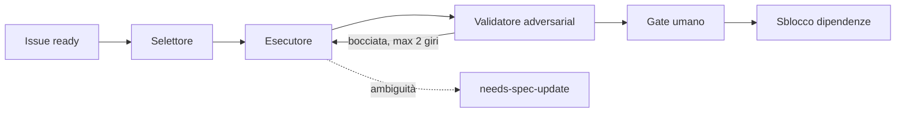

# MEN-B: migrare un brownfield COBOL a Java con una coda di specifiche e agenti AI

> Bozza in scrittura. Le sezioni marcate *(da compilare)* si riempiono a mano a mano che il passo corrispondente viene eseguito. Ogni numero riportato qui ha una fonte in `paper/data/` o un comando riproducibile.

## Abstract

*(da compilare a migrazione conclusa)*

## 1. Introduzione

Questo lavoro vuole insegnare, a chi deve farlo davvero, come modernizzare un sistema legacy con agenti AI. Non propone un metodo in astratto: segue una migrazione reale da COBOL a Java dall'inizio alla fine e riporta, per ogni passo, cosa si è fatto, perché, con quali comandi e istruzioni agli agenti, quanto tempo ha richiesto e cosa è andato storto.

Tre impegni verso il lettore:

- **Replicabile.** Issue, prompt, comandi e versioni sono pubblicati integralmente; l'unico prerequisito per rieseguire tutto è Docker.
- **Chiaro.** Non si presuppone esperienza di mainframe né di sviluppo agentico; i termini sono spiegati alla prima occorrenza.
- **Reale.** Tempi e costi sono misurati, non stimati; errori, rework e interventi umani sono riportati come sono avvenuti.

*(da completare: contesto del problema, lavori correlati, cosa questo lavoro misura e cosa no, come leggere il documento)*

## 2. Metodo

MEN-B ("Make Everything Now, Brownfield") tratta le GitHub Issues come coda di specifiche e separa quattro ruoli.

| Ruolo | Implementazione in questo lavoro | Compito |
| --- | --- | --- |
| Pianificatore / Selettore | Claude Fable 5.2 | Scrive le issue, verifica dipendenze e sovrapposizioni, avvia l'Esecutore |
| Esecutore | Claude Opus / Claude Sonnet (subagent, worktree isolato) | Implementa una sola issue e apre la PR |
| Validatore adversarial | Codex CLI 0.172, contesto pulito | Cerca di falsificare la PR; al massimo due giri |
| Gate umano | autore | Decide il merge |

La migrazione è ibrida: il comportamento da preservare è brownfield, lo stack target è greenfield. Servono quindi due Fasi 0 in sequenza (mappa e oracle, poi scheletro e CI) prima di qualsiasi logica di business.

## 3. Oggetto della migrazione

AWS CardDemo, repository `aws-samples/aws-mainframe-modernization-carddemo`, commit `59cc6c2`, licenza Apache-2.0. Applicazione mainframe di gestione carte di credito: online CICS con mappe BMS, batch COBOL orchestrati da JCL, dati su VSAM KSDS con alternate index, tre moduli opzionali (Db2, MQ, IMS).

**Tabella 1 — Dimensione del sorgente** (misurata con `wc -l` il 27 novembre 2026)

| Artefatto | File | Righe |
| --- | ---: | ---: |
| Programmi COBOL di base (`app/cbl`) | 31 | 20.650 |
| Programmi COBOL, inclusi i moduli opzionali | 44 | 30.175 |
| Copybook (`app/cpy`) | 30 | 2.786 |
| Mappe BMS (`app/bms`) | 17 | 4.472 |
| JCL (`app/jcl`) | 38 | 2.429 |

Le righe includono commenti e righe vuote; il conteggio per tipo di riga è previsto in Wave 0A.

Target: Java 21, Spring Boot, Spring Batch, PostgreSQL, Docker Compose. Il criterio di riuscita è un'applicazione containerizzata funzionante: `docker compose up` da clone pulito avvia database, servizio online, job batch e dati di esempio.

## 4. Strumenti: cosa si è riusato e cosa no

Principio: si scrive codice proprio solo per incollare strumenti esistenti.

**Ricognizione preliminare (27 novembre 2026, ricerca web, nessuno strumento ancora provato sul sorgente).** SonarQube analizza il COBOL solo a partire dalla Enterprise Edition; senza licenza resta utilizzabile per il Java. Non è emerso un analizzatore di qualità open source per il COBOL di maturità paragonabile: l'analisi preliminare va composta da strumenti più piccoli.

**Tabella 2 — Strumenti candidati**

| Esigenza | Candidato | Licenza / costo | Esito |
| --- | --- | --- | --- |
| Qualità COBOL | SonarQube | COBOL da Enterprise Edition | scartato: nessuna licenza |
| Compilazione, cross-reference, oracle batch | GnuCOBOL 3.2 | GPL | adottato |
| Grafi `CALL` / `COPY` | cobol-migration-toolkit | da verificare | *(Wave 0A)* |
| AST, CFG, gerarchia copybook | cobmix, ProLeap, Koopa | ProLeap AGPL-3; altri da verificare | *(Wave 0A)* |
| Copybook → schema e lettura record | cb2xml, JRecord | da verificare | *(Wave 0A)* |
| Analisi JCL | mapa | da verificare | *(Wave 0A)* |
| Metriche di base | scc | open source | *(Wave 0A)* |
| Esecuzione dei programmi CICS | nessun emulatore open source pronto all'uso individuato | — | oracle online = matrice di comportamento |
| Qualità Java | SonarQube Community Build, JaCoCo, SpotBugs, ArchUnit, PIT | open source | *(Wave 0B)* |

Tutti gli strumenti, l'oracle GnuCOBOL e l'applicazione migrata girano in container: l'unico prerequisito per riprodurre il lavoro è Docker.

*(da completare in Wave 0A/0B: per ogni strumento, comando eseguito, esito sul sorgente, motivo dell'adozione o dello scarto)*

## 5. Esecuzione

Ogni sottosezione segue lo stesso schema, così che il lettore possa rifare il passo: **cosa si fa e perché · issue aperte (testo integrale in appendice) · istruzioni date agli agenti · comandi · come si verifica · cosa è andato storto · tempi · cosa si trasferisce ad altri sistemi**.

### 5.1 Wave 0A — mappa e golden oracle
*(da compilare)*

### 5.2 Wave 0B — bootstrap Java
*(da compilare)*

### 5.3 Wave 1 — schema e loader
*(da compilare)*

### 5.4 Wave 2 — online
*(da compilare)*

### 5.5 Wave 3 — batch
*(da compilare)*

### 5.6 Wave 4 — moduli opzionali e parità end-to-end
*(da compilare)*

## 6. Risultati

### 6.1 Tempi
*(da compilare da `paper/data/timeline.csv`: per issue, tempo-agente, attesa del gate umano, tempo di calendario; aggregati per wave)*

### 6.2 Qualità e parità
*(da compilare: esiti dei test di parità, giri di validazione per PR, difetti trovati dal Validatore e non dall'Esecutore)*

### 6.3 Fallimenti e rework
*(da compilare: PR bocciate, `needs-spec-update`, specifiche riscritte)*

## 7. Come replicarlo sul proprio sistema

*(da compilare: percorso passo-passo generalizzato, lista di controllo per wave, cosa è specifico di CardDemo e cosa si trasferisce, prerequisiti e costi attesi)*

## 8. Limiti e minacce alla validità

Già noti prima di iniziare:

- CardDemo è un'applicazione dimostrativa: più piccola e più pulita di un portafoglio COBOL di produzione.
- Nessun mainframe disponibile. L'oracle eseguibile è GnuCOBOL e copre i batch; per i programmi CICS l'oracle è una matrice di comportamento ricavata dal sorgente.
- Un solo operatore umano al gate.

*(da estendere)*

## 9. Conclusioni

*(da compilare)*

## Appendice B — Materiali per la replica

*(da compilare: template di issue, prompt di Esecutore e Validatore, comandi, versioni di modelli e strumenti, link a issue e PR)*

## Appendice A — Registro dei passi

| Data | Passo | Esito |
| --- | --- | --- |
| 2026-11-27 | Lettura di metodo e piano, baseline del sorgente, contesto di riferimento in `CLAUDE.md` | completato |
| 2026-11-27 | Ricognizione degli strumenti open source di analisi COBOL; vincolo di containerizzazione totale | completato (candidati da provare in Wave 0A) |
