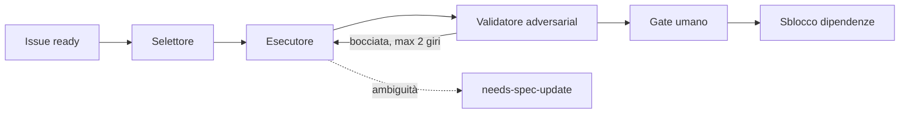

# MEN-B: migrare un brownfield COBOL a Java con una coda di specifiche e agenti AI

> Bozza in scrittura. Le sezioni marcate *(da compilare)* si riempiono a mano a mano che il passo corrispondente viene eseguito. Ogni numero riportato qui ha una fonte in `paper/data/` o un comando riproducibile.

## Abstract

*(da compilare a migrazione conclusa)*

## 1. Introduzione

Questo lavoro vuole insegnare, a chi deve farlo davvero, come modernizzare un sistema legacy con agenti AI. Non propone un metodo in astratto: segue una migrazione reale da COBOL a Java dall'inizio alla fine e riporta, per ogni passo, cosa si è fatto, perché, con quali comandi e istruzioni agli agenti, quanto tempo ha richiesto e cosa è andato storto.

Tre impegni verso il lettore:

- **Replicabile.** Issue, prompt, comandi e versioni sono pubblicati integralmente; l'unico prerequisito per rieseguire tutto è Docker.
- **Chiaro.** Non si presuppone esperienza di mainframe né di sviluppo agentico; i termini sono spiegati alla prima occorrenza.
- **Reale.** I tempi sono misurati passo per passo, non stimati; errori, rework e interventi umani sono riportati come sono avvenuti. I costi sono raccolti solo in parte (token consumati dagli agenti, con i limiti dichiarati in `paper/data/costi.md`): dove un dato manca lo si dice.

### 1.1 Il lavoro in parole semplici

Questa sezione è per chi vuole capire l'insieme prima dei dettagli. Tutto ciò che dice è ripreso, con comandi e misure, nelle sezioni successive.

**L'idea di fondo.** Tradurre un programma vecchio in uno nuovo è facile da fare male: "compila e sembra funzionare" non prova che faccia le stesse cose dell'originale. Per questo, prima di tradurre anche una sola riga, servono quattro cose: sapere esattamente com'è fatto il sistema vecchio; avere un modo per far girare i programmi originali e vedere che cosa producono; avere pronto il posto dove andrà il codice nuovo; avere controlli che si accorgano quando si sbaglia. La prima parte del lavoro, la più lunga, è stata costruire queste quattro cose. È la parte che di solito si salta.

**Che cosa si costruisce prima di tradurre.**

- *Una mappa del sistema vecchio.* Quali programmi esistono, chi chiama chi, quali file leggono e scrivono; com'è fatto ogni record di dati, campo per campo; come i byte di un campo diventano un numero o un testo; per i programmi a schermo, quali schermate mostrano e a quale programma passano il controllo.
- *Un "originale funzionante" in un container.* I programmi COBOL di elaborazione notturna (*batch*) si compilano e girano su un computer qualsiasi con un compilatore libero, senza mainframe. È il termine di paragone: il Java dovrà produrre gli stessi risultati. In questo lavoro lo chiamiamo *oracle*.
- *Lo scheletro dell'applicazione nuova.* Un'applicazione Java vuota che parte con un comando, con il suo database vero e con regole automatiche che impediscono errori tipici (per esempio usare numeri con la virgola imprecisi per gli importi).
- *I controlli.* Ogni pezzo ha un comando che risponde alla domanda "è ancora giusto?", e che gira da solo a ogni modifica.

**Come si lavora.** Ogni lavoro è piccolo e segue lo stesso giro, con tre ruoli affidati ad agenti AI e uno alla persona. Un agente scrive le istruzioni per un lavoro preciso. Un secondo lo esegue, da solo, in una copia separata. Un terzo, di un altro fornitore, prova a smontarlo: non legge le intenzioni, esegue i controlli e cerca un modo per far passare un lavoro sbagliato. Poi qualcuno decide se accettare, far correggere o respingere l'obiezione, e scrive il motivo in un registro. All'inizio decideva l'autore; a metà del primo giorno ha delegato la decisione al primo agente (passo 9), tenendo per sé il registro e il diritto di annullare.

**Che cosa si è imparato fin qui.**

- Il lavoro consegnato era quasi sempre giusto; i controlli che dovevano proteggerlo, no. Il terzo agente ha trovato più volte controlli che restavano verdi davanti a un errore. Senza qualcuno che prova ad aggirarli, non lo si vede.
- Si è evitato almeno un errore serio: il compilatore leggeva al contrario il segno di alcuni importi, e un debito diventava un credito. Un Java "identico all'originale" sarebbe stato identico a un errore (passo 15).
- Far criticare le istruzioni prima di eseguirle costa da tre a sei minuti e ne risparmia venti o trenta (passo 20).
- Un critico avversariale non si ferma da solo: serve una regola scritta su quante volte interviene e su quali obiezioni non contano (passi 16, 18, 22).

**Che cosa questo documento non è ancora.** Alla data dell'ultima revisione la preparazione non è conclusa e nessuna funzione dell'applicazione è stata tradotta. Le sezioni sulla traduzione sono vuote e lo dicono.

*(da completare: contesto del problema, lavori correlati, cosa questo lavoro misura e cosa no)*

## 2. Metodo

MEN-B ("Make Everything Now, Brownfield") tratta le GitHub Issues come coda di specifiche e separa quattro ruoli. Una *issue* è una scheda di lavoro su GitHub; qui ogni issue è una specifica completa, con un comando che dice se il lavoro è finito. Da ogni issue nasce una *pull request* (PR), cioè una proposta di modifica che qualcuno deve approvare prima che entri nel progetto.

| Ruolo | Implementazione in questo lavoro | Compito |
| --- | --- | --- |
| Pianificatore / Selettore | Claude Fable 5.2 | Scrive le issue, verifica dipendenze e sovrapposizioni, avvia l'Esecutore |
| Esecutore | Claude Opus / Claude Sonnet (subagent, worktree isolato) | Implementa una sola issue e apre la PR |
| Validatore adversarial | Codex CLI 0.172, contesto pulito | Cerca di falsificare la PR; al massimo due giri |
| Approvatore | all'inizio l'autore; dal passo 9 Claude Fable per delega, con registro | Decide il merge |

Il Validatore è volutamente un modello di un altro fornitore rispetto all'Esecutore: non ne condivide il contesto né le abitudini. Interviene due volte: sulla specifica, prima che il lavoro cominci, e sulla PR, a lavoro fatto.

*Brownfield* indica un sistema che esiste già e il cui comportamento va preservato; *greenfield* un sistema costruito da zero. Questa migrazione è entrambe le cose: il comportamento da preservare è brownfield, lo stack di arrivo è greenfield. Servono quindi due preparazioni ("Fasi 0") prima di qualsiasi logica di business: capire il legacy e costruire un riferimento con cui confrontarsi, e preparare lo scheletro del nuovo sistema. Il riferimento si chiama *oracle*: qualcosa che, dato un ingresso, dice quale deve essere l'uscita giusta.

Il piano completo, con le dipendenze tra le wave, è in `docs/piano-wave.md`.

## 3. Oggetto della migrazione

AWS CardDemo, repository `aws-samples/aws-mainframe-modernization-carddemo`, commit `59cc6c2`, licenza Apache-2.0. Applicazione mainframe di gestione carte di credito: online CICS con mappe BMS, batch COBOL orchestrati da JCL, dati su VSAM KSDS con alternate index, tre moduli opzionali (Db2, MQ, IMS).

**Tabella 1 — Dimensione del sorgente** (misurata con `wc -l` il 27 novembre 2026)

| Artefatto | File | Righe |
| --- | ---: | ---: |
| Programmi COBOL di base (`app/cbl`) | 31 | 20.650 |
| Programmi COBOL, inclusi i moduli opzionali | 44 | 30.175 |
| Copybook (`app/cpy`) | 30 | 2.786 |
| Mappe BMS (`app/bms`) | 17 | 4.472 |
| JCL (`app/jcl`) | 38 | 2.429 |

Le righe includono commenti e righe vuote; il conteggio per tipo di riga è previsto in Wave 0A. Dei 44 programmi, 5 hanno estensione `.CBL` maiuscola: un dettaglio che conta, come si vede nella sezione 5.0.

Target: Java 21, Spring Boot, Spring Batch, PostgreSQL, Docker Compose. Il criterio di riuscita è un'applicazione containerizzata funzionante: `docker compose up` da clone pulito avvia database, servizio online, job batch e dati di esempio.

## 4. Strumenti: cosa si è riusato e cosa no

Principio: si scrive codice proprio solo per incollare strumenti esistenti.

**Ricognizione preliminare (27 novembre 2026, ricerca web, nessuno strumento ancora provato sul sorgente).** SonarQube analizza il COBOL solo a partire dalla Enterprise Edition; senza licenza resta utilizzabile per il Java. Non è emerso un analizzatore di qualità open source per il COBOL di maturità paragonabile: l'analisi preliminare va composta da strumenti più piccoli.

**Tabella 2 — Strumenti: esito delle prove** (issue #1, PR #18; dettagli e comandi in `docs/legacy-map/strumenti.md`)

| Esigenza | Strumento | Licenza | Esito |
| --- | --- | --- | --- |
| Qualità COBOL | SonarQube | COBOL da Enterprise Edition | scartato prima della prova: nessuna licenza |
| File, righe totali, righe vuote | scc 4.1.0 | MIT | **adottato**: coincide con i conteggi a mano |
| Ripartizione codice / commenti | scc 4.1.0 | MIT | **scartato**: in un COBOL con numeri di sequenza vede 30 commenti su 51, in un assembler 0 su 16. Capacità non disponibile |
| Compilazione e diagnostica | GnuCOBOL 3.2 | GPL-3+ | **adottato**: 11 programmi batch senza errori; 3 batch con errori dovuti al sorgente; i 17 online non compilabili, come atteso |
| Inclusioni `COPY`, con riga e sostituzioni | cobol-migration-toolkit 0.8.0 | Apache-2.0 | **scartato** per questo uso: riporta solo i nomi (18 contro 56 occorrenze in un programma) |
| | cobmix 0.1.2 | non accertata | **scartato**: nessuna riga né sostituzioni |
| | ProLeap COBOL parser | MIT | **adottato**, tramite circa 60 righe di colla Java (è una libreria senza comando) |
| Chiamate `CALL` | cobol-migration-toolkit 0.8.0 | Apache-2.0 | **adottato** |
| Passaggi di controllo CICS (`XCTL`, `LINK`) | tutti i precedenti | — | **nessuno li vede**: serve un ripiego nell'issue #2 |
| Copybook → tracciato | cb2xml 1.01.08 | LGPL-2.1 | **adottato** |
| Analisi JCL | mapa | MIT | **adottato**; non riporta `PARM=` né i comandi in-stream |
| Riserve | Koopa, JRecord | — | non provati: non è servito |
| Qualità Java | SonarQube Community Build, JaCoCo, SpotBugs, ArchUnit, PIT | open source | *(Wave 0B)* |

Tre osservazioni per chi replica. Nessuno strumento ha coperto da solo un'esigenza intera: l'analisi si compone. Lo strumento più noto per i conteggi sbaglia proprio sul formato COBOL tradizionale, e lo si è scoperto solo contando a mano sei file. La ricognizione sul web aveva riportato una licenza sbagliata per ProLeap (quella di un progetto omonimo): le licenze vanno lette alla fonte.

Tutti gli strumenti, l'oracle GnuCOBOL e l'applicazione migrata girano in container: l'unico prerequisito per riprodurre il lavoro è Docker.

**Quanto codice proprio è servito, nonostante il principio.** Alla fine del primo giorno gli strumenti e i controlli scritti per questo progetto contano circa ventimila righe (misura del 27 novembre 2026, ore 21:30 UTC, su `main`: circa 13.300 nelle analisi del legacy, 5.100 nell'oracle, 1.100 nelle regressioni dei controlli Java, 1.000 nei quattro comandi principali; file di dati, attesi e documenti esclusi; comando e avvertenze in `docs/strumenti-creati.md`). Gli strumenti di terzi fanno l'analisi; il codice proprio li collega, ne rende confrontabili gli output e soprattutto ne controlla i risultati. Quanta parte sia collegamento e quanta controllo non è stato misurato. Il numero va tenuto presente da chi replica: "non reinventare" riduce il codice di analisi, non quello di verifica, e in questo lavoro il secondo è cresciuto a ogni obiezione del Validatore. L'elenco di ciò che è stato costruito, con il comando per lanciarlo, è in `docs/strumenti-creati.md`.

*(da completare in Wave 0A/0B: per ogni strumento, comando eseguito, esito sul sorgente, motivo dell'adozione o dello scarto)*

## 5. Esecuzione

Ogni sottosezione segue lo stesso schema, così che il lettore possa rifare il passo: **cosa si fa e perché · issue aperte (testo integrale in appendice) · istruzioni date agli agenti · comandi · come si verifica · cosa è andato storto · tempi · cosa si trasferisce ad altri sistemi**.

### 5.0 Preparazione: dal materiale di partenza a un piano contestato

Questa sezione racconta ciò che è stato fatto prima di aprire la prima issue, nell'ordine in cui è avvenuto. Tutto si è svolto il 27 novembre 2026 in una sola sessione di lavoro tra l'autore e il pianificatore (Claude Fable 5.2, usato da terminale con Claude Code).

**Passo 1 — Il punto di partenza.** Il lavoro è cominciato con tre cose già presenti in una cartella: una copia del repository CardDemo e due documenti scritti dall'autore. Il primo documento descrive il metodo (issue come coda di specifiche, quattro ruoli); il secondo è una prima idea di piano di migrazione. Entrambi sono nel repository, in `paper/`, così come erano. L'autore non li ha scritti a mano: li ha ottenuti interrogando un'AI, in circa cinque minuti. È un dato utile per chi replica: il materiale di partenza non richiede giorni di preparazione, ma proprio per questo va trattato come una proposta da verificare, ed è ciò che fanno i passi successivi.

**Passo 2 — Un contesto di riferimento per gli agenti.** Un agente non ricorda le sessioni precedenti. Perché ogni sessione parta dalle stesse regole, il pianificatore ha letto i due documenti e li ha condensati in un file, `CLAUDE.md`, che Claude Code carica automaticamente all'avvio. Contiene obiettivo, ruoli, regole non negoziabili, strumenti e criteri di scrittura di questo paper. Nello stesso passo è stata misurata la dimensione del sorgente (Tabella 1).

*Perché farlo:* senza un contesto scritto, ogni agente reinventa le regole. *Come si capisce che è riuscito:* una sessione nuova, senza altre istruzioni, sa dire cosa può e non può fare.

**Passo 3 — Quali strumenti esistono già.** L'autore ha chiesto di non riscrivere strumenti di analisi che esistono, citando SonarQube. La verifica sulla documentazione ha mostrato che SonarQube analizza il COBOL solo nelle edizioni a pagamento. Una ricerca sul web ha prodotto i candidati della Tabella 2, nessuno dei quali è stato ancora provato: la prova è il contenuto della prima issue.

**Passo 4 — Il repository.** È stato creato il repository pubblico `ltoscano/men-b-carddemo-java`, che contiene insieme codice, issue, dati e questo paper. Tre scelte, con il loro motivo:

- *Il sorgente COBOL è incluso come submodule Git*, cioè come riferimento a un commit preciso (`59cc6c2`) del repository originale, non come copia. Chi clona ottiene esattamente lo stesso sorgente, e resta evidente che quel codice non è nostro e non va modificato.
- *Paper e codice stanno insieme*, così ogni affermazione del testo può puntare a una issue, una PR o un file di dati.
- *Il repository è pubblico da subito*: la replicabilità richiede che issue e PR siano leggibili.

Un inciampo, piccolo ma reale: il primo `git push` è stato rifiutato da GitHub perché il commit conteneva l'indirizzo email personale dell'autore e il suo account ha attiva la protezione che lo impedisce. Si è risolto configurando per questo repository l'indirizzo anonimo fornito da GitHub. Chi replica con un account configurato allo stesso modo incontrerà lo stesso rifiuto.

**Passo 5 — Il piano delle wave, e la sua contestazione.** Una *wave* (ondata) è un gruppo di issue con uno scopo comune, che si chiude con una verifica. Il pianificatore ha riscritto il piano iniziale dell'autore in una prima versione e ha preparato le bozze delle otto issue della prima wave. Prima di proporre il piano all'autore, lo ha fatto contestare dal Validatore.

Il comando è una sola riga: si avvia Codex in sola lettura sul repository, con l'incarico esplicito di falsificare e non di aiutare (prompt integrale in `paper/data/reviews/2026-11-27-piano-wave/README.md`).

**Tabella 3 — Contestazione del piano, versione 1**

| | |
| --- | --- |
| Durata | 6 min 26 s |
| Token consumati | 152.899 |
| Rilievi | 23 |
| di cui bloccanti | 5 |
| di cui importanti | 17 |
| di cui minori | 1 |
| Affermazioni di fatto ricontrollate dal pianificatore sul sorgente | 9, tutte confermate |
| Rilievi accolti | 23 |

Tre esempi di ciò che il pianificatore non aveva visto e il Validatore sì:

- *Un controllo che passa anche a lavoro non fatto.* La bozza chiedeva che la compilazione dei programmi batch "coincidesse con l'esito registrato". Registrando tutti i programmi come "non compila", il controllo sarebbe risultato verde.
- *Un errore di conteggio nascosto nel nome dei file.* Cinque programmi hanno estensione `.CBL` maiuscola. I conteggi iniziali erano giusti perché fatti elencando le cartelle, ma le bozze di issue indicavano i programmi con il modello `*.cbl`: in un container Linux, dove maiuscole e minuscole sono distinte, quei programmi sarebbero spariti dall'analisi, compresi i due che producono gli estratti conto.
- *Dati di esempio che non mettono alla prova la logica.* Il calcolo degli interessi tronca al centesimo invece di arrotondare. Sui dati forniti con CardDemo la differenza potrebbe non emergere mai: un Java sbagliato sarebbe risultato "identico".

Il piano è stato quindi riscritto (versione 2, `docs/piano-wave.md`): la prima wave passa da 8 a 12 issue, i golden si costruiscono anche su dati preparati apposta, e ogni programma online avrà la propria matrice di comportamento approvata prima del codice.

*Cosa si trasferisce ad altri sistemi:* far contestare il piano, non solo il codice, da un modello diverso e senza contesto. Sei minuti di revisione hanno evitato cinque errori che sarebbero emersi dopo giorni di lavoro, o mai. Vale anche il contrario: i rilievi vanno ricontrollati sul sorgente prima di accoglierli, perché anche il revisore può sbagliare.

**Passo 6 — Approvazione, licenza, issue.** L'autore ha approvato il piano e scelto la licenza Apache-2.0, la stessa di CardDemo. Il pianificatore ha riscritto le specifiche tenendo conto dei rilievi: 12 issue per la Wave 0A e 4 per la 0B. Le 16 issue sono state aperte su GitHub in 44 secondi con un ciclo di comandi `gh issue create`, nell'ordine del piano, così che il numero dell'issue coincida con la sua posizione (#1–#12 Wave 0A, #13–#16 Wave 0B). Tutte nascono `blocked`: nessuna è pronta finché la sua specifica non è stata contestata.

**Passo 7 — Contestazione delle due specifiche di partenza, e venti minuti persi.** Le prime due issue da affidare a un Esecutore sono #1 (prova degli strumenti di analisi) e #13 (scheletro Java). Il primo lancio di Codex non ha prodotto nulla: il processo è rimasto fermo fin dall'avvio in attesa di input da tastiera, e il pianificatore se n'è accorto dopo 19 minuti e 59 secondi. La causa è banale: lanciato da uno script, `codex exec` aveva ancora un canale di input aperto. La correzione è aggiungere `< /dev/null` al comando. Il tempo perso è nel registro come tutto il resto.

*Cosa si trasferisce:* un agente lanciato senza supervisione va avviato con l'input chiuso e con un limite di tempo, e va controllato che stia davvero lavorando.

Il secondo lancio è durato 2 minuti e 51 secondi (72.056 token) e ha prodotto 12 rilievi: 2 bloccanti, 9 importanti, 1 minore, tutti accolti. Il più istruttivo riguarda un controllo che sembrava solido: la specifica chiedeva di confrontare l'elenco dei file sorgente contando quanti erano. Codex ha osservato che togliendo un file e duplicandone un altro i conti tornano lo stesso. Ora il controllo confronta l'elenco intero. Prompt, rilievi e specifiche prima e dopo sono in `paper/data/reviews/2026-11-27-specifiche-1-13/`.

Corrette le specifiche, le issue #1 e #13 sono passate da `blocked` a `ready`.

**Passo 8 — I primi due Esecutori.** Alle 10:04 UTC il pianificatore ha avviato due Esecutori (Claude Sonnet), uno per issue, ciascuno in un *worktree*: una seconda copia di lavoro dello stesso repository, in una cartella separata, così che i due non si pestino i piedi. L'etichetta delle issue è passata a `in-progress`. Il testo dato agli Esecutori è lo stesso per tutti, cambia solo il numero dell'issue: non contiene la specifica, che l'Esecutore legge da GitHub. È in `paper/data/prompts/esecutore.md`.

**Passo 9 — La prima PR, la prima bocciatura, e due cambi di regole.** L'Esecutore di #13 ha consegnato la PR #17 in 5 minuti e 47 secondi (95.783 token), dichiarando soddisfatti tutti e sei i criteri. La CI su GitHub era verde. Il pianificatore ha rifatto un clone pulito e rieseguito il comando di verifica: esito positivo in 33 secondi.

Tutto verde, dunque. Eppure il Validatore l'ha **bocciata**, in 2 minuti e 48 secondi (48.174 token), con un rilievo bloccante e tre importanti, tutti sullo script di verifica: poteva restare appeso per sempre se il servizio accettava la connessione senza rispondere; poteva controllare un file prodotto da una build precedente invece di quello appena costruito; considerava "sano" un servizio la cui risposta conteneva la parola giusta nel posto sbagliato. Nessuno di questi difetti si vede quando le cose vanno bene: emergono solo chiedendosi come il controllo potrebbe dare ragione a un lavoro sbagliato. La PR è tornata all'Esecutore per il primo dei due giri di correzione ammessi.

Durante questo passo l'autore ha cambiato due regole, ed è giusto dirlo perché cambiano il metodo descritto nella sezione 2:

- *Più autonomia al Validatore.* Nel primo giro Codex lavorava in sola lettura e riceveva il log dei comandi eseguiti dal pianificatore. Da ora lavora in un clone usa e getta in cui può scrivere e usare Docker, e i criteri di accettazione li esegue da sé. Non gli si dà l'accesso completo alla macchina.
- *Approvazione delegata.* Il metodo di partenza riservava il merge a una persona. L'autore ha scelto di delegarlo al pianificatore, per rendere il processo il più automatico possibile, a una condizione: un registro (`docs/registro-approvazioni.md`) in cui è scritto tutto ciò che viene approvato, con motivo ed evidenze. Le condizioni per un merge sono fissate per iscritto in `CLAUDE.md`: CI verde, criteri rieseguiti dal Validatore, nessun rilievo bloccante aperto, ogni rilievo con un esito scritto, al massimo due giri. Se il secondo giro fallisce, o se pianificatore e Validatore non concordano su un rilievo bloccante, la decisione torna all'autore.

Chi replica deve sapere cosa comporta questa scelta. Il pianificatore ha scritto la specifica, quindi non è un giudice indipendente: l'indipendenza resta affidata al Validatore, che è un modello di un altro fornitore. La persona non approva più ogni modifica una per una; controlla il registro e può annullare. È più veloce ed è meno prudente del metodo di partenza: la sezione sui limiti lo riprende.

**Passo 10 — La PR #17 fino al merge: tre validazioni, un'ora di attesa.** La PR dello scheletro Java ha richiesto più lavoro a essere validata che a essere scritta.

**Tabella 5 — Storia della PR #17** (ora UTC)

| Fase | Chi | Inizio | Durata | Esito |
| --- | --- | --- | ---: | --- |
| Implementazione | Esecutore (Sonnet) | 10:04:31 | 5 min 47 s | PR aperta, CI verde |
| Validazione 1 (sola lettura) | Codex | 10:11:28 | 2 min 48 s | bocciata: 1 bloccante, 3 importanti |
| Correzione 1 | Esecutore | 10:16 | 5 min 4 s | 4 difetti corretti |
| Validazione 2 (con Docker) | Codex | 10:20:26 | 9 min 8 s | bocciata: 2 importanti |
| Correzione 2 | Esecutore | 10:30:06 | 3 min 37 s | 2 difetti corretti |
| Validazione 3 (con Docker) | Codex | 10:34:06 | 6 min 33 s | bocciata: 1 importante, nuovo |
| Attesa della decisione dell'autore | autore | 10:40:59 | 61 min 35 s | merge, con issue per il difetto residuo |
| Merge | pianificatore | 11:42:37 | — | `main` a `789de0e` |

Dall'avvio dell'Esecutore al merge: 1 ora e 38 minuti. Di questi, 33 minuti di lavoro degli agenti (14 dell'Esecutore, 19 del Validatore) e 62 di attesa di una persona.

Tre cose da notare.

*Il Validatore con Docker trova cose che in sola lettura non si vedono.* Nel secondo giro Codex ha reso un file non cancellabile e ha osservato lo script di verifica proseguire, avviare un programma vecchio e dichiarare tutto a posto. Leggendo il codice lo aveva solo sospettato; eseguendolo lo ha dimostrato. Il prezzo è il tempo: da meno di 3 minuti a 9.

*Una correzione può introdurre un difetto.* Al terzo giro i due difetti erano chiusi, ma la correzione dell'arresto ne aveva creato uno nuovo: se il servizio impiega tra 9 e 10 secondi a fermarsi regolarmente, la verifica fallisce a torto. È un caso stretto, e sbaglia dal lato sicuro (segnala un errore che non c'è, non nasconde un errore che c'è).

*La regola dei due giri ha funzionato, e ha mostrato il suo costo.* Esauriti i due giri, la decisione è passata all'autore, che ha scelto di mergiare e di aprire una issue (#19) per il difetto residuo. La scelta ha richiesto pochi secondi; l'attesa che la persona tornasse disponibile, un'ora. È il dato più netto di questa giornata: **il tempo più lungo non è stato speso da un agente, ma aspettando una persona.**

Per questo l'autore ha allargato la delega: i contrasti che restano dopo il secondo giro li risolve il pianificatore con lo stesso criterio usato qui. Se ciò che resta non è bloccante e non può far passare per buono un lavoro sbagliato, si mergia e si apre una issue; altrimenti no. Ogni scelta va nel registro.

**Passo 11 — La PR #18: strumenti provati, controlli che non controllano.** L'Esecutore di #1 ha lavorato 31 minuti e 14 secondi (203 chiamate a strumenti, 125 file): cinque volte e mezzo lo scheletro Java. Provare strumenti poco documentati costa molto più che scrivere codice noto.

Ha adottato scc per i conteggi, GnuCOBOL per la diagnostica, ProLeap per le `COPY`, cobol-migration-toolkit per le `CALL`, cb2xml per i tracciati, mapa per il JCL. Ha scartato cobol-migration-toolkit per le `COPY` (in un programma vedeva 18 nomi dove il sorgente ha 56 inclusioni) e cobmix. I dettagli andranno nella sezione 4 quando la PR sarà mergiata.

Ha anche scoperto tre fatti che cambiano il lavoro a valle: tre programmi batch non compilano con GnuCOBOL (`CBEXPORT`, `CBIMPORT`, `CBSTM03A`); nessuno strumento provato vede i passaggi di controllo tra programmi online; e una licenza che il pianificatore aveva riportato sbagliata dalla ricerca iniziale.

Il Validatore (8 minuti e 13 secondi, con Docker) ha bocciato la PR. I comandi passavano tutti. Ma alterando gli output degli strumenti, quattro controlli restavano verdi: azzerando i conteggi di righe di codice, rinominando un campo in un tracciato, cambiando il tipo di un passo JCL, portando il numero di errori di compilazione da 39 a 9.999. Un banco di prova i cui controlli non si accorgono di un output sbagliato non prova nulla, ed è esattamente il difetto che questa issue doveva impedire. La PR è tornata all'Esecutore.

*Cosa si trasferisce:* un test verde dice poco finché nessuno ha provato a farlo restare verde con dati sbagliati. Il modo più economico di scoprirlo è chiederlo esplicitamente a chi valida: "altera l'output e guarda se il controllo se ne accorge".

Dopo due giri di correzione e tre validazioni la PR è stata approvata con riserve e mergiata. Nel terzo giro Codex ha provato 14 alterazioni: 13 facevano fallire il controllo. L'ultima (cancellare uno dei file di esito) no: è diventata l'issue #21.

**Tabella 6 — Storia della PR #18** (ora UTC)

| Fase | Chi | Inizio | Durata | Esito |
| --- | --- | --- | ---: | --- |
| Implementazione | Esecutore (Sonnet) | 10:04:29 | 31 min 14 s | PR aperta |
| Validazione 1 | Codex | 10:36:15 | 8 min 13 s | bocciata: 5 importanti, 1 minore |
| Attesa | — | 10:44:28 | 59 min 13 s | il pianificatore era fermo sulla decisione per la PR #17 |
| Correzione 1 | Esecutore | 11:43:41 | 8 min 29 s | 6 rilievi corretti |
| Validazione 2 | Codex | 11:52:14 | 12 min 17 s | bocciata: 1 importante, 2 minori |
| Correzione 2 | Esecutore | 12:05 | 10 min 45 s | 3 rilievi corretti; specifica modificata |
| Validazione 3 | Codex | 12:16:21 | 13 min 17 s | approvata con riserve |
| Merge | pianificatore | 12:30:19 | — | `main` a `d1ece0d` |

Dall'avvio al merge: 2 ore e 26 minuti. Lavoro degli agenti: 84 minuti (50 dell'Esecutore, 34 del Validatore). Attesa: 59 minuti, e non per questa PR: il pianificatore aspettava la risposta dell'autore su un'altra. È un secondo costo dell'attesa di una persona: blocca anche il lavoro che non la riguarda. Con la delega, la terza validazione e il merge sono distanti 41 secondi.

Un punto di metodo. Al secondo giro l'Esecutore aveva scoperto che scc sbaglia la ripartizione tra codice e commenti, e aveva risolto registrando l'errore come "atteso", così che il controllo passasse. Il Validatore lo ha respinto: un errore noto resta un errore. La soluzione corretta è stata cambiare la specifica, dividendo la capacità in due e dichiarando non disponibile la parte che lo strumento non sa fare. **Quando un controllo non passa, la tentazione è aggiustare l'atteso; va invece deciso, per iscritto, se cambia la richiesta.**

**Passo 12 — Specifiche che si dividono.** Con gli strumenti scelti, le tre issue successive della mappa (inventario, contratto dati, oracle) potevano partire. Prima di affidarle il pianificatore le ha riallineate a ciò che #1 aveva scoperto e le ha fatte contestare: 4 minuti e 36 secondi, 18 rilievi, 2 bloccanti. Sei rilievi dicevano la stessa cosa in modi diversi: ogni specifica conteneva più lavori indipendenti. Le tre issue sono diventate sette.

Due rilievi mostrano bene che cosa trova un revisore che legge il sorgente:

- Il programma degli estratti conto, `CBSTM03A`, non solo non compila per via di caratteri TAB in un copybook: una volta compilato non potrebbe comunque girare, perché nelle prime righe legge aree di memoria del sistema operativo del mainframe per stampare il nome del job. In un container quella memoria non esiste. Il pianificatore ha letto quelle 26 righe, ha verificato che servono solo a stampare a console, e ha autorizzato a neutralizzarle su una copia di compilazione, con registro e controllo. È la prima modifica di sorgente ammessa nel progetto, ed è delimitata per numero di riga.
- La specifica del contratto dati chiedeva "un record di prova con un valore diverso in ogni campo". Ma alcuni tracciati descrivono gli stessi byte in più modi (`REDEFINES`): un solo record con tutti i campi valorizzati non può esistere. Serve un record per ciascuna vista.

**Passo 13 — Un Esecutore che si ferma.** L'Esecutore dell'inventario (issue #2) ha cominciato provando lo strumento per il JCL su tutti i 46 file, non solo sui 4 usati per sceglierlo. Su tre file lo strumento falliva, in un caso senza alcun avviso: restituiva un job vuoto. In totale vedeva 112 passi su 119. L'Esecutore si è fermato dopo 6 minuti e mezzo senza scrivere codice, ha lasciato un commento tecnico sull'issue e ha applicato l'etichetta `needs-spec-update`.

Aveva due scorciatoie a portata di mano: scrivere in proprio un analizzatore di JCL, vietato dalla specifica, oppure registrare i tre file come "mancanti attesi", cioè il difetto già bocciato sulla PR #18. Non ne ha presa nessuna. Il pianificatore ha aggiornato la specifica e l'Esecutore è ripartito meno di un minuto dopo il fermo (due livelli dichiarati: lo strumento dove il suo risultato coincide con un conteggio indipendente, un estrattore minimo di schede a formato fisso per gli altri file).

La lezione riguarda la specifica di #1, non l'Esecutore: **provare uno strumento su 4 file su 46 non bastava per adottarlo.** Un campione serve a controllare la correttezza; la copertura va misurata su tutto.

**Passo 14 — La PR #20: l'applicazione parte, e un rilievo respinto.** L'issue #14 chiedeva che `docker compose up`, da clone pulito, avviasse database, servizio online e runner batch, con uno *smoke test*: uno script che avvia tutto, controlla che funzioni e ripulisce. Visti i tre giri della PR #17, il pianificatore ha affidato questa issue a Claude Opus anziché a Sonnet, chiedendo di leggere prima i rilievi già ricevuti dall'altro Esecutore.

**Tabella 7 — Storia della PR #20** (ora UTC)

| Fase | Chi | Inizio | Durata | Esito |
| --- | --- | --- | ---: | --- |
| Implementazione | Esecutore (Opus) | 11:48:19 | 40 min 25 s | PR aperta, CI verde |
| Validazione 1 | Codex | 12:29:33 | 9 min 47 s | bocciata: 1 bloccante (21 prove su 22 corrette) |
| Correzione 1 | Esecutore | 12:41 | 8 min 26 s | corretto; trovato e corretto un secondo difetto dello stesso tipo |
| Validazione 2 | Codex | 12:50:29 | 8 min 53 s | bocciata: 1 bloccante, respinto dall'Approvatore |
| Merge | pianificatore | 13:00:12 | — | `main` a `780692b` |

Dall'avvio al merge: 1 ora e 12 minuti, senza attese di persone. Lavoro degli agenti: 67 minuti.

Il confronto tra i due modelli sullo stesso genere di lavoro (script di shell che devono fallire quando qualcosa va storto) è questo: Sonnet ha consegnato in meno di 6 minuti e ha richiesto tre validazioni e due correzioni, per 14 minuti di lavoro suo in tutto; Opus ha consegnato in 40 minuti, con un solo difetto, e ha richiesto due validazioni e una correzione. È un caso solo per modello, su compiti non identici: non è una misura, è un'osservazione. Ma indica che il tempo di prima consegna dice poco, e che conta il tempo fino al merge.

Il rilievo respinto merita di essere raccontato, perché è il primo dissenso tra chi approva e chi valida. Al secondo giro il Validatore ha sostituito il comando `docker` con uno falso che rispondeva "nessuna risorsa presente", con esito positivo, mentre una risorsa c'era. Lo smoke test ha creduto alla risposta e ha dichiarato la pulizia riuscita. Per il Validatore era un falso verde bloccante.

Il pianificatore lo ha respinto, per iscritto, con tre motivi. Non è un errore che lo script ignora: è uno strumento che mente in modo plausibile. La correzione proposta, chiedere la stessa cosa a Docker per un'altra via, userebbe lo stesso strumento, che potrebbe mentire anche lì: non c'è un punto in cui ci si ferma. E l'attacco lo aveva chiesto il pianificatore stesso nelle istruzioni al Validatore, andando oltre la specifica. Ne è uscita una regola scritta: uno script deve accorgersi di uno strumento che fallisce o risponde in modo malformato; non gli si chiede di difendersi da uno strumento che restituisce dati falsi ma ben formati.

*Cosa si trasferisce:* un validatore avversariale non ha un freno proprio. Più gli si chiede di attaccare, più trova, e a un certo punto ciò che trova non riguarda più il lavoro ma i limiti di qualsiasi lavoro. Serve qualcuno che dica dove ci si ferma, e che lo scriva perché la stessa soglia valga la volta dopo. Qui lo ha fatto il pianificatore, che però aveva scritto anche la specifica: è il punto in cui l'approvazione delegata è più debole, e la voce del registro lo segnala all'autore.

Con questo merge il ramo principale contiene un'applicazione che parte. È vuota (nessuna funzione di CardDemo è ancora migrata), ma ogni passo da qui in avanti aggiunge qualcosa a un sistema che gira.

**Passo 15 — Cinque issue in parallelo.** Tra le 12:41 e le 13:07 UTC il pianificatore ha avviato cinque Esecutori su cinque issue con cartelle disgiunte: inventario delle dipendenze (#2), contratto dati (#3), oracle GnuCOBOL (#4), test con PostgreSQL reale (#15), completezza dei controlli e CI dell'analisi (#21). È la prima volta che il metodo lavora davvero in parallelo.

**Tabella 8 — Le cinque PR in parallelo** (stato alle 15:00 UTC; tempi di lavoro dal registro degli eventi)

| PR | Issue | Esecutore | Lavoro dell'Esecutore | Validazioni di Codex | Esito |
| --- | --- | --- | ---: | ---: | --- |
| #29 | #4 oracle GnuCOBOL | Opus | 97 min in 3 fasi | 3, per 40 min | mergiata alle 14:59, dopo 2 h 18 min |
| #33 | #15 test con PostgreSQL | Opus | 64 min in 3 fasi | 2, per 39 min | mergiata alle 14:51, dopo 1 h 45 min |
| #30 | #2 inventario | Sonnet | 74 min in 3 fasi | 2, per 64 min | secondo giro di correzione |
| #32 | #3 contratto dati | Opus | 88 min in 2 fasi | 2, per 47 min | secondo giro di correzione |
| #31 | #21 verdetti e CI | Sonnet | 52 min in 2 fasi | 2, per 60 min | secondo giro di correzione |

Cose osservate, utili a chi replica.

*Tutte e cinque le PR sono state bocciate alla prima validazione.* In quattro casi su cinque il contenuto consegnato era giusto: il Validatore ha ricalcolato a mano 87 campi del contratto dati e le dipendenze di undici oggetti dell'inventario, trovando una sola dipendenza mancante. I difetti stavano nei controlli che dovrebbero proteggere quel contenuto: controlli che contano senza guardare dove puntano gli archi, che prendono per vero un elenco scritto a mano, che ignorano l'errore di un comando. Un Esecutore produce volentieri molte prove; che quelle prove discriminino lo stabilisce solo qualcuno che prova ad aggirarle.

*La dipendenza mancante era del tipo previsto.* Un copybook, `CSUTLDPY`, contiene una chiamata a un altro programma; il programma che lo include eredita quella dipendenza, ma l'inventario cercava le chiamate solo nei programmi. Il piano aveva elencato "logica nascosta nei copybook" tra i rischi prima di cominciare: scriverlo non è bastato a evitarlo, è servito a riconoscerlo.

*Due Esecutori si sono fermati da soli su criteri irrealizzabili.* Oltre al caso del JCL (passo 13), l'Esecutore di #15 ha dimostrato con quattro prove che un criterio della specifica non poteva essere soddisfatto: quando un'immagine Docker è indicata con nome di versione e impronta insieme, Docker usa l'impronta e ignora il nome, quindi "un nome di versione inesistente deve far fallire la verifica" è falso per costruzione. La contestazione preventiva delle specifiche non aveva visto né l'uno né l'altro: sono errori che emergono solo provando.

*L'oracle leggeva i segni al contrario.* I file di esempio scrivono il segno degli importi con la convenzione del mainframe (l'ultima cifra porta il segno: `0000009190}` vale −919,00). Con le opzioni predefinite GnuCOBOL leggeva quell'importo come +919,00, e il programma che registra i movimenti sceglie quale saldo aggiornare proprio in base al segno. L'Esecutore lo aveva notato e proponeva di rinviare la decisione; il Validatore lo ha confermato leggendo i dati con il tracciato originale; l'Approvatore ha deciso di correggerlo subito, con un'opzione di compilazione e una prova automatica su quattro importi decodificati a mano dai byte. Se fosse sfuggito, ogni saldo negativo del riferimento sarebbe stato sbagliato, e un Java "identico al riferimento" lo sarebbe stato a un errore.

*Il parallelismo allunga le validazioni.* Con quattro o cinque validazioni contemporanee sulla stessa macchina, ciascuna è passata da 8–13 minuti a 25–35. Il calendario complessivo si accorcia comunque, ma il guadagno non è lineare.

*Due inconvenienti del lavoro in parallelo.* Due Esecutori hanno scritto un file di appoggio con lo stesso nome in una cartella condivisa, e uno ha sovrascritto quello dell'altro (se n'è accorto e l'ha rifatto): ora i nomi portano il numero dell'issue. E un Esecutore che si ferma senza modifiche si vede rimuovere la cartella di lavoro dall'ambiente: alla ripresa l'ha ricreata.

*Tre modi diversi di chiudere una validazione negativa*, tutti scritti nel registro. PR #33: approvata con riserve, il difetto residuo non può far passare un lavoro sbagliato, quindi merge e issue di seguito. PR #29 al secondo giro: il difetto residuo non era bloccante, ma poteva alterare il comportamento dei programmi di riferimento, quindi niente merge e un giro in più. PR #29 al terzo giro: ancora bocciata, ma per un difetto che non tocca il comportamento, quindi merge e issue di seguito. La regola è una sola (si può mergiare ciò che non rischia di far passare per buono un risultato sbagliato) e va applicata guardando che cosa protegge ciascun controllo.

**Passo 16 — Tre PR al terzo giro, e l'autore cambia le regole.** Alle 15:00 UTC tre delle cinque PR del passo 15 erano ancora aperte dopo due validazioni, ciascuna con rilievi nuovi. Il pianificatore ha concesso a tutte un terzo giro. Alle 15:31 l'autore, visti i tempi, ha posto un limite: **al massimo due validazioni avversariali per PR**. Le tre già partite sono state lasciate finire; la regola vale dalle PR successive.

La regola ha bisogno di una risposta alla domanda "e se la seconda validazione boccia ancora?". Quella scritta in `CLAUDE.md` è: se il difetto rimasto non può far passare per buono un lavoro sbagliato, si mergia e si apre una issue; se può (un *falso verde*: un controllo che resta verde davanti a un errore), l'Esecutore corregge quel solo punto e la correzione la verifica l'Approvatore, rieseguendo il controesempio del Validatore su un clone pulito, senza un terzo giro.

**Tabella 9 — Come sono finite le tre PR al terzo giro** (durate dal registro degli eventi)

| PR | Issue | Validazioni di Codex | Esito del terzo giro | Chiusura |
| --- | --- | --- | --- | --- |
| #31 | #21 verdetti e CI | 26 + 33 + 34 min | approvata, nessun rilievo | mergiata alle 15:51 |
| #32 | #3 contratto dati | 20 + 27 + 33 min | approvata con una riserva minore (una motivazione che cita la struttura sbagliata) | mergiata alle 15:57; riserva nella issue #41 |
| #30 | #2 inventario | 34 + 30 + 63 min | bocciata: tre falsi verdi nuovi | correzione mirata; mergiata alle 17:34 (passo 19) |

Due osservazioni. La prima: un terzo giro costa quanto il primo, perché il Validatore riparte da zero. La seconda riguarda la PR #30: a ogni giro il Validatore ha trovato rilievi nuovi dello stesso schema (un attributo della mappa delle dipendenze che il controllo non confronta con una fonte indipendente), alterando ogni volta un punto diverso del programma che costruisce la mappa. La mappa consegnata è giusta in tutti i campioni riletti a mano; è il controllo che non la proteggerebbe da una modifica futura. Un'issue che produce 268 file o un grafo con decine di attributi offre troppa superficie: andava divisa.

Prima di mergiare la PR #32 il pianificatore ha fatto una cosa non prevista dalle regole e che conviene prevedere: il merge della PR #31, sei minuti prima, aveva aggiunto alla CI un controllo nuovo, che sul ramo della #32 non era mai girato. Il ramo è stato riallineato a `main`, la CI è stata rieseguita (verde in 6 minuti), e solo allora la PR è stata mergiata. Due PR verdi ciascuna per conto suo non garantiscono un `main` verde.

**Passo 17 — Le prime due PR con la regola delle due validazioni.** Nel frattempo erano partite due issue nuove, preparate durante il passo 16: #24, la routine `COBDATFT`, e #26, le regole sul codice Java.

`COBDATFT` è un piccolo programma in assembler che converte una data da un formato all'altro; il batch pilota lo chiama. GnuCOBOL non esegue assembler, quindi l'oracle ha bisogno di un equivalente scritto in COBOL. La contestazione della specifica aveva già scoperto un'insidia: due istruzioni dell'assembler confrontano o copiano più byte di quanti ne contenga il valore scritto nel sorgente, e i byte in più dipendono da ciò che si trova in memoria accanto. Inventarli avrebbe falsificato il riferimento. La decisione (voce 42 del registro) è stata: riprodurre solo i casi interamente determinati dal sorgente, e fermarsi con un codice riconoscibile sugli altri.

L'Esecutore ha applicato la decisione in modo troppo prudente: ha dichiarato non determinato ogni ingresso con un trattino in una certa posizione. Il Validatore ha letto il manuale dell'assembler e ha mostrato che i byte "in più" del confronto non sono ignoti: i primi tredici sono il testo `INVALID INPUT`, che l'assembler colloca subito dopo. Quasi tutti quegli ingressi sono quindi determinati, e uno dei valori attesi scritti dall'Esecutore certificava il comportamento sbagliato. L'Approvatore ha riletto le righe 36-44 dell'assembler prima di accogliere il rilievo. Corretto in un giro; la seconda validazione ha approvato.

Le regole sul codice Java (#26) rendono automatici tre divieti: dipendenze tra moduli non previste, database in memoria al posto di PostgreSQL, numeri in virgola mobile dove passano importi. La prima validazione ha trovato cinque rilievi. Tre sono stati accolti; il più istruttivo: Java accetta `\u0064ouble` come modo alternativo di scrivere `double`, e il controllo sul testo non lo vedeva. Due sono stati respinti con motivo scritto, uno dei quali per un errore della specifica (chiedeva un limite di tempo su "ogni comando", anche su quelli che non possono restare in attesa). La seconda validazione ha chiuso i rilievi accolti tranne uno: il controllo sui database guardava solo le dipendenze di un modulo. È un falso verde, quindi la regola del passo 16 si è applicata per la prima volta: correzione mirata, verifica dell'Approvatore.

**Tabella 10 — Le due PR con al massimo due validazioni**

| PR | Issue | Esecutore | Lavoro dell'Esecutore | Validazione 1 | Validazione 2 | Esito |
| --- | --- | --- | ---: | ---: | ---: | --- |
| #39 | #24 routine `COBDATFT` | Opus | 23 min + 21 min di correzione | 14 min 38 s, bocciata (1 rilievo) | 7 min 16 s, approvata | mergiata alle 16:16, 68 minuti dopo l'affidamento |
| #40 | #26 regole sul codice Java | Sonnet | 58 min in 2 fasi + 20 min di correzione | 15 min 16 s, bocciata (5 rilievi) | 5 min 45 s, bocciata (1 rilievo) | correzione mirata; mergiata alle 16:50 (passo 19) |

L'Esecutore di #26 si era fermato una volta da solo (`needs-spec-update`): i controlli nuovi girano anche quando si costruiscono le immagini Docker, e lì il loro file di configurazione non veniva copiato. Aveva scartato da sé due scorciatoie, una delle quali avrebbe lasciato verde una verifica con il controllo spento.

**Passo 18 — "Come si può andare più veloci?"** Alle 15:58 l'autore ha posto la domanda. La risposta del pianificatore è partita dai dati del registro: il tempo va quasi tutto nelle validazioni (10-35 minuti l'una, e le successive alla prima duravano quanto la prima), e i rilievi bloccanti ricadono in quattro famiglie. L'autore ha approvato tre misure, in vigore dalle 16:00.

1. **Autocontrollo dell'Esecutore.** Prima di aprire la PR, l'Esecutore verifica e riporta quattro cose per ogni script o controllo che ha scritto: nessun esito di comando ignorato; nessun risultato rimasto da una corsa precedente che possa soddisfare un controllo; nessuna attesa senza limite di tempo; nessun controllo che non sia stato visto fallire. Sono i difetti che il Validatore ha trovato più spesso (testo in `paper/data/prompts/esecutore.md`).
2. **Seconda validazione ristretta.** Il Validatore riceve i propri rilievi del primo giro e il solo diff di correzione: riesegue i controesempi, cerca difetti introdotti dalla correzione, esegue una volta i criteri. Non rifà il resto.
3. **Validazione proporzionata al rischio.** Il Validatore resta obbligatorio per tutto ciò che tocca il riferimento, i dati, la logica, gli script di verifica, la CI, i container. Per le PR di solo testo o documentazione bastano CI verde, lettura integrale del diff e criteri rieseguiti dall'Approvatore su un clone pulito. La classe di rischio si scrive nell'issue; nel dubbio è rischio pieno.

**Tabella 11 — Prime misure dopo il cambio** (poche, da non generalizzare)

| Misura | Prima | Dopo |
| --- | --- | --- |
| Durata della seconda validazione | da 10 a 33 min (cinque PR del passo 15, forma completa) | 7 min 16 s (PR #39) e 5 min 45 s (PR #40), forma ristretta |
| PR di solo testo, dall'affidamento al merge | non applicabile: tutte passavano dal Validatore | 9 min 3 s (PR #42: Esecutore 1 min 54 s, il resto è CI e verifica dell'Approvatore) |
| Effetto dell'autocontrollo dell'Esecutore | — | misurato al passo 22: non riduce le bocciature alla prima validazione, cambia il tipo di rilievi |

La differenza sulla seconda validazione non dipende solo dalla forma ristretta: le due PR del passo 17 sono anche più piccole di quelle del passo 15, e nel frattempo giravano meno validazioni in parallelo.

Un errore dell'Approvatore, per completezza. In dieci voci del registro delle approvazioni l'ora era stata scritta a memoria ed era in anticipo fino a 14 minuti rispetto al registro degli eventi; in una voce una durata era stata scritta "a occhio" (15 minuti invece di 9). Entrambe le cose sono state rettificate con voci aggiunte, senza toccare le voci originali. È lo stesso errore già commesso e dichiarato per le voci 11-26 dello stesso registro: chi tiene un registro tende a ricostruire, e l'unica difesa è leggere l'orologio ogni volta.

**Passo 19 — Quando la seconda validazione boccia: la verifica dell'Approvatore.** La regola del passo 16 è stata applicata due volte nel giro di un'ora.

*PR #40 (regole sul codice Java).* Il difetto rimasto: il controllo che vieta i database in memoria guardava le dipendenze di un solo modulo. L'Esecutore lo ha spostato in un punto da cui gira per ogni modulo. L'Approvatore ha clonato il ramo, ha aggiunto a un modulo la libreria vera di un database in memoria nelle tre forme indicate dal Validatore, e ha osservato tre fallimenti per il motivo giusto; poi ha rieseguito i comandi di verifica. Sette minuti. Mergiata alle 16:50.

*PR #30 (inventario).* I tre falsi verdi del terzo giro sono stati corretti da un nuovo Esecutore (quello originale non era più disponibile: un agente non sopravvive alla sessione che lo ha avviato, ed è un motivo in più per tenere tutto scritto nelle PR). Il Validatore aveva lasciato sul disco gli script con cui aveva prodotto i falsi verdi; l'Approvatore li ha rieseguiti tali e quali sul ramo corretto: tre fallimenti dove prima c'erano tre successi, e successo senza mutazioni. Sette minuti. Mergiata alle 17:34, 4 ore e 54 minuti dopo l'affidamento: è stata la PR più costosa della giornata, con 127 minuti di sole validazioni.

Che cosa rende possibile questa verifica breve: il Validatore consegna controesempi *eseguibili* (un comando, un file modificato, l'esito osservato), non opinioni. Chi replica il metodo dovrebbe chiederlo esplicitamente nel prompt di validazione.

L'Esecutore subentrato sulla PR #30 ha anche trovato, senza che nessuno glielo chiedesse, la causa di una CI che diventava rossa a caso: in uno script di shell, `echo "$testo" | grep -q parola` può fallire anche quando la parola c'è, se lo script è in una modalità severa (`pipefail`) e `grep` chiude il canale appena trova la corrispondenza. È il genere di difetto che non si trova leggendo: si trova solo eseguendo molte volte.

**Passo 20 — La coda riparte: sei specifiche in tre ore.** Con le prime issue chiuse, altre sono diventate affidabili. Per ciascuna il pianificatore ha riscritto la bozza guardando ciò che le issue precedenti avevano prodotto, l'ha fatta contestare, e l'ha affidata.

**Tabella 12 — Le specifiche contestate tra le 16:18 e le 19:55 UTC** (durate dal registro degli eventi)

| Issue | Oggetto | Contestazione di Codex | Rilievi (bloccanti) | Effetto principale |
| --- | --- | ---: | ---: | --- |
| #25 | il batch degli estratti conto nell'oracle | 3 min 33 s | 5 (2) | tre delle 26 righe da neutralizzare sono vuote: il controllo scritto nella bozza era irrealizzabile |
| #23 | regole di codifica dei campi | 4 min 11 s | 10 (1) | la bozza chiedeva 658 valori scritti a mano: issue divisa in due |
| #27 | copertura dei test e analisi statica | 3 min 1 s | 6 (0) | un modulo compare nel rapporto di copertura anche con lo strumento spento |
| #22 | comandi CICS nella mappa | 5 min 35 s | 4 (1) | i controlli guardavano solo i collegamenti presenti, non quelli mancanti; issue divisa in due |
| #35 | controlli dell'oracle in CI | 4 min 35 s | 7 (1) | "una prova per comando" lasciava scoperte le invocazioni ripetute |
| #43 | record di prova per ogni tracciato | 3 min 21 s | 7 (1) | la bozza ordinava di fermarsi in una condizione già vera |

Trentanove rilievi in ventiquattro minuti di Validatore, tutti accolti. Tre errori erano di pura coerenza del pianificatore con il proprio repository (righe vuote, condizione già vera, un'affermazione sbagliata lasciata in un documento dalla PR precedente). Contestare una specifica costa da tre a sei minuti; una specifica irrealizzabile scoperta dall'Esecutore ne costa da venti a trenta, più la ripresa.

Due issue sono state divise *prima* di affidarle, applicando la lezione della PR #30: una cosa sola per issue, anche quando la seconda sembra il completamento naturale della prima.

**Passo 21 — Un riferimento che dà due risposte.** L'Esecutore delle regole di codifica (#23) aveva l'ordine di scrivere i valori attesi *prima* di interrogare l'oracle, e di fermarsi se l'oracle li smentiva. È successo una volta su 267. Un campo numerico binario di quattro byte, dichiarato per contenere al massimo nove cifre, può fisicamente contenere numeri più grandi. Con tutti i bit accesi, GnuCOBOL restituisce 4.294.967.295 se il campo viene copiato e −1 se viene sommato a qualcosa.

L'Esecutore non ha scelto: si è fermato e ha proposto tre alternative. L'Approvatore ha deciso (voce 63 del registro) che in quel caso la regola di codifica non assegna alcun valore: conserva i byte e marca il campo come "oltre il limite dichiarato"; ciò che l'oracle fa, operazione per operazione, è registrato a parte come osservazione. Il motivo: se il riferimento stesso dà due valori, sceglierne uno significa inventarlo. La conseguenza pratica per chi migra: un programma che fa aritmetica su un campo così va confrontato con l'oracle caso per caso, e non esiste una regola generale da applicare.

Più tardi l'Esecutore ha trovato la causa nel codice C che il compilatore genera: la funzione di somma riceve il valore come intero con segno. La causa non cambia la decisione, ma spiega perché copia e somma divergono.

**Passo 22 — Otto PR con al massimo due validazioni: che cosa si misura.** Alle 20:00 UTC, quattro ore e mezza dopo la regola delle due validazioni, lo stato è questo.

**Tabella 13 — PR aperte dopo la regola delle due validazioni** (stato alle 20:00 UTC)

| PR | Issue | Esecutore | Validazione 1 | Validazione 2 (ristretta) | Esito |
| --- | --- | --- | ---: | ---: | --- |
| #39 | #24 routine `COBDATFT` | Opus | 14 min 38 s, bocciata | 7 min 16 s, approvata | mergiata alle 16:16 |
| #40 | #26 regole sul codice Java | Sonnet | 15 min 16 s, bocciata | 5 min 45 s, bocciata | verifica dell'Approvatore (7 min); mergiata alle 16:50 |
| #42 | #41 una motivazione corretta | Sonnet | — (basso rischio) | — | verifica dell'Approvatore (2 min); mergiata alle 16:10 |
| #44 | #25 estratti conto nell'oracle | Opus | 11 min 32 s, bocciata | 5 min 11 s, approvata | mergiata alle 17:57 |
| #47 | #23 regole di codifica | Opus | 12 min 19 s, bocciata | 26 min 12 s, approvata | mergiata alle 19:50 |
| #48 | #27 copertura e analisi statica | Sonnet | 54 min 24 s, bocciata | — | giro di correzione |
| #49 | #35 oracle in CI | Opus | 31 min 17 s, bocciata | — | giro di correzione |
| #50 | #22 comandi CICS nella mappa | Opus | 31 min 43 s, bocciata | — | giro di correzione |

Che cosa dicono questi numeri, e che cosa no.

*Nessuna PR a rischio pieno è passata alla prima validazione.* Sette su sette bocciate. L'autocontrollo chiesto agli Esecutori dal passo 18 non ha cambiato questo dato: ha cambiato il tipo di rilievi. Nelle PR scritte dopo, il Validatore ha confermato per intero il contenuto (72 campi di un estratto conto ricostruiti a mano; 523 vettori di codifica su 524; 240 comandi CICS ricontati; 52 prove su 52 sulle acquisizioni di configurazione) e ha trovato i difetti un livello più in là: un controllo che pretende "almeno una riga" invece di tutte, una regola provata con un rappresentante invece che con ogni caso, un comando interno il cui fallimento nessuno guarda.

*La seconda validazione ristretta è breve solo se la correzione è piccola.* Tre volte è durata tra 5 e 7 minuti; una volta 26, più della prima, perché la correzione conteneva 218 valori nuovi che il Validatore ha riconfrontato uno per uno. "Ristretta" limita ciò che si riguarda, non quanto c'è da guardare.

*La validazione costa quanto costa eseguire i controlli.* I 54 minuti della PR #48 sono per 50 minuti l'esecuzione dello script di regressioni consegnato dalla PR stessa. Un controllo che dura cinquanta minuti verrà eseguito di rado: è un costo che la specifica avrebbe dovuto limitare.

*Tre volte l'Approvatore ha respinto un rilievo che il Validatore riteneva bloccante* (voci 25, 52 e 70 del registro), sempre per la stessa ragione: il controesempio richiedeva qualcuno che falsificasse apposta un dato ben formato, o che un controllo girasse dove tecnicamente non può. Ogni volta il motivo è scritto e il limite è dichiarato nella documentazione del progetto. Senza un criterio scritto su dove fermarsi, un Validatore avversariale non finisce mai: è il suo mestiere.

*Un agente in attesa costa.* Un Esecutore, finito il lavoro, è rimasto ad aspettare la CI riconsegnando più volte lo stesso rapporto. Da allora il prompt dice: una sola lettura dello stato della CI, un solo rapporto.

*(passi successivi: da compilare)*

**Come si misurano i tempi.** Su richiesta dell'autore, da questo punto ogni passaggio è cronometrato nel momento in cui avviene. Un piccolo script, `paper/data/tlog.sh`, aggiunge una riga con l'ora corrente al registro `paper/data/eventi.csv`; il registro non si modifica mai, si aggiunge soltanto. Per i passi precedenti i tempi sono stati ricostruiti da fonti verificabili (date dei commit, date di creazione su GitHub, date dei file) e ogni riga dichiara la propria fonte.

**Tabella 4 — Tempi della preparazione** (27 novembre 2026, ora UTC)

| Passo | Inizio | Fine | Durata | Fonte | Note |
| --- | --- | --- | ---: | --- | --- |
| 0. Materiale di partenza (autore) | 08:49:22 | 09:03:08 | 13 min 46 s | date dei file | dal clone di CardDemo all'ultimo salvataggio del piano; i due documenti sono stati generati interrogando un'AI, circa 5 minuti secondo l'autore (dato dichiarato, non misurato) |
| 1–3. Contesto, strumenti, scheletro del paper | ≥ 09:03:08 | 09:17:41 | ≤ 14 min 33 s | file, git | inizio della sessione non registrato; comprende le attese dell'autore |
| 4. Repository | — | 09:17:41 | compreso sopra | GitHub, git | |
| 5. Piano v1, contestazione, piano v2 | 09:17:41 | 09:30:05 | 12 min 24 s | git, orologio | di cui 6 min 26 s di Codex |
| 6. Approvazione, licenza, 16 specifiche, issue aperte | 09:30:21 | 09:49:35 | 19 min 14 s | git, GitHub | comprende l'attesa dell'approvazione |
| 7. Contestazione di #1 e #13, primo tentativo | 09:38:44 | 09:58:43 | 19 min 59 s | orologio | **tempo perso**; in parte sovrapposto al passo 6 |
| 7. Contestazione di #1 e #13, secondo tentativo | 09:59:29 | 10:02:20 | 2 min 51 s | orologio | 72.056 token |
| 7. Correzione delle due specifiche e passaggio a `ready` | 10:02:23 | 10:03:59 | 1 min 36 s | orologio | |

Il limite di questa tabella va detto: i primi quattro passi non hanno un inizio misurato, perché il cronometraggio sistematico è cominciato dopo. Dal passo 7 in poi ogni riga viene dall'orologio.

Dal clone di CardDemo (08:49:22) al momento in cui i primi due Esecutori hanno cominciato a lavorare (10:04:29) è passata **1 ora e 15 minuti** di calendario, di cui 20 minuti persi per il blocco di Codex.

### 5.1 Wave 0A — mappa e oracle

Stato al 27 novembre 2026, ore 21:30 UTC: in corso. Il racconto, nell'ordine in cui è avvenuto, è nei passi 7-22 della sezione 5.0; qui c'è che cosa esiste, con il comando per ottenerlo. Elenco completo in `docs/strumenti-creati.md`.

| Che cosa | Comando | Dove si legge il risultato | Passi |
| --- | --- | --- | --- |
| Prova degli strumenti di analisi | `./analysis/run.sh tools --check` | `docs/legacy-map/strumenti.md` | 8, 11 |
| Inventario e grafo delle dipendenze | `./analysis/run.sh inventory --check` | `docs/legacy-map/inventario.md` | 13, 15, 16, 19 |
| Comandi CICS dei programmi a schermo | `./analysis/run.sh inventory-cics --check` | `docs/legacy-map/inventario-cics.md` | 20, 22 |
| Contratto dati (posizione e tipo di ogni campo) | `./analysis/run.sh data-contract --check` | `docs/legacy-map/data-contract/` | 15, 16 |
| Regole di codifica dei campi | `./analysis/run.sh data-codec --check` | `docs/legacy-map/data-contract/codifica.md` | 20, 21 |
| Oracle: 12 programmi batch eseguibili | `./oracle/run.sh --all --check` | `oracle/README.md` | 15, 17, 20 |

Manca ancora, per chiudere la wave: i dati di prova, gli output di riferimento dei programmi (*golden*), il grafo dei flussi batch, la descrizione del comportamento dei programmi a schermo.

*(da completare alla chiusura della wave: issue, tempi aggregati, cosa si trasferisce ad altri sistemi)*

### 5.2 Wave 0B — scheletro Java in container

Stato al 27 novembre 2026, ore 21:30 UTC: quasi conclusa. Passi 8-10, 14, 15, 17, 19.

| Che cosa | Comando | Passi |
| --- | --- | --- |
| Cinque moduli Java, compilazione e test con PostgreSQL reale | `./verify.sh` | 9, 10, 15 |
| Applicazione avviata con Docker Compose e controllata | `./smoke.sh` | 14 |
| Regole automatiche sul codice | dentro `./verify.sh`; regressioni in `./quality/regressioni-regole.sh` | 17, 19 |

*(da completare alla chiusura della wave)*

### 5.3 Wave 1 — dati
*(da compilare)*

### 5.4 Wave 2 — pilota: una fetta batch e una online
*(da compilare)*

### 5.5 Wave 3 — online
*(da compilare)*

### 5.6 Wave 4 — batch
*(da compilare)*

### 5.7 Wave 5 — parità completa e rilascio
*(da compilare)*

### 5.8 Wave 6 — moduli opzionali
*(da compilare, se eseguita)*

## 6. Risultati

### 6.1 Tempi
*(da compilare da `paper/data/eventi.csv`: durata di ogni passo e di ogni issue; totale distinto in lavoro degli agenti, attesa e lavoro dell'autore, tempo perso, tempo di calendario; aggregati per wave)*

### 6.1b Costi
*(da compilare da `paper/data/costi.csv`. Oggi contiene i token delle sessioni del Validatore e i contatori degli Esecutori, con i limiti descritti in `paper/data/costi.md`; mancano la sessione principale e la conversione in denaro.)*

### 6.2 Qualità e parità
*(da compilare: esiti dei test di parità, giri di validazione per PR, difetti trovati dal Validatore e non dall'Esecutore)*

### 6.3 Fallimenti e rework
*(da compilare: PR bocciate, `needs-spec-update`, specifiche riscritte)*

## 7. Come replicarlo sul proprio sistema

*(da compilare: percorso passo-passo generalizzato, lista di controllo per wave, cosa è specifico di CardDemo e cosa si trasferisce, prerequisiti e costi attesi)*

## 8. Limiti e minacce alla validità

Già noti prima di iniziare:

- CardDemo è un'applicazione dimostrativa: più piccola e più pulita di un portafoglio COBOL di produzione.
- Nessun mainframe disponibile. L'oracle eseguibile è GnuCOBOL e copre i batch; per i programmi CICS l'oracle è una matrice di comportamento ricavata dal sorgente.
- Un solo operatore umano. Dal passo 9 l'approvazione delle PR è delegata al pianificatore: la persona controlla un registro invece di approvare ogni modifica. I risultati valgono per questo assetto.

*(da estendere)*

## 9. Conclusioni

*(da compilare)*

## Appendice B — Materiali per la replica

*(da compilare: template di issue, prompt di Esecutore e Validatore, comandi, versioni di modelli e strumenti, link a issue e PR)*

## Appendice A — Registro dei passi

| Data | Passo | Esito |
| --- | --- | --- |
| 2026-11-27 | Lettura di metodo e piano, baseline del sorgente, contesto di riferimento in `CLAUDE.md` | completato |
| 2026-11-27 | Ricognizione degli strumenti open source di analisi COBOL; vincolo di containerizzazione totale | completato (candidati da provare in Wave 0A) |
| 2026-11-27 | Creazione del repository pubblico; sorgente legacy come submodule | completato |
| 2026-11-27 | Piano delle wave v1, contestazione di Codex (23 rilievi), piano v2 | completato; in attesa di approvazione dell'autore |
