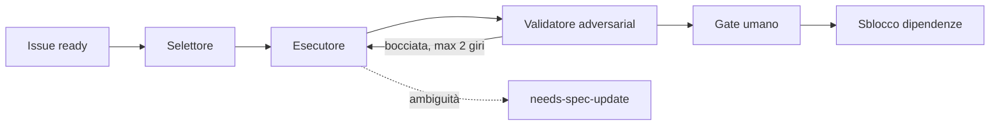

# MEN-B: migrare un brownfield COBOL a Java con una coda di specifiche e agenti AI

> Bozza in scrittura. Le sezioni marcate *(da compilare)* si riempiono a mano a mano che il passo corrispondente viene eseguito. Ogni numero riportato qui ha una fonte in `paper/data/` o un comando riproducibile.

## Abstract

*(da compilare a migrazione conclusa)*

## 1. Introduzione

Questo lavoro vuole insegnare, a chi deve farlo davvero, come modernizzare un sistema legacy con agenti AI. Non propone un metodo in astratto: segue una migrazione reale da COBOL a Java dall'inizio alla fine e riporta, per ogni passo, cosa si è fatto, perché, con quali comandi e istruzioni agli agenti, quanto tempo ha richiesto e cosa è andato storto.

Tre impegni verso il lettore:

- **Replicabile.** Issue, prompt, comandi e versioni sono pubblicati integralmente; l'unico prerequisito per rieseguire tutto è Docker.
- **Chiaro.** Non si presuppone esperienza di mainframe né di sviluppo agentico; i termini sono spiegati alla prima occorrenza.
- **Reale.** Tempi e costi sono misurati, non stimati; errori, rework e interventi umani sono riportati come sono avvenuti.

*(da completare: contesto del problema, lavori correlati, cosa questo lavoro misura e cosa no, come leggere il documento)*

## 2. Metodo

MEN-B ("Make Everything Now, Brownfield") tratta le GitHub Issues come coda di specifiche e separa quattro ruoli. Una *issue* è una scheda di lavoro su GitHub; qui ogni issue è una specifica completa, con un comando che dice se il lavoro è finito. Da ogni issue nasce una *pull request* (PR), cioè una proposta di modifica che qualcuno deve approvare prima che entri nel progetto.

| Ruolo | Implementazione in questo lavoro | Compito |
| --- | --- | --- |
| Pianificatore / Selettore | Claude Fable 5.2 | Scrive le issue, verifica dipendenze e sovrapposizioni, avvia l'Esecutore |
| Esecutore | Claude Opus / Claude Sonnet (subagent, worktree isolato) | Implementa una sola issue e apre la PR |
| Validatore adversarial | Codex CLI 0.172, contesto pulito | Cerca di falsificare la PR; al massimo due giri |
| Gate umano | autore | Decide il merge |

Il Validatore è volutamente un modello di un altro fornitore rispetto all'Esecutore: non ne condivide il contesto né le abitudini. Interviene due volte: sulla specifica, prima che il lavoro cominci, e sulla PR, a lavoro fatto.

*Brownfield* indica un sistema che esiste già e il cui comportamento va preservato; *greenfield* un sistema costruito da zero. Questa migrazione è entrambe le cose: il comportamento da preservare è brownfield, lo stack di arrivo è greenfield. Servono quindi due preparazioni ("Fasi 0") prima di qualsiasi logica di business: capire il legacy e costruire un riferimento con cui confrontarsi, e preparare lo scheletro del nuovo sistema. Il riferimento si chiama *oracle*: qualcosa che, dato un ingresso, dice quale deve essere l'uscita giusta.

Il piano completo, con le dipendenze tra le wave, è in `docs/piano-wave.md`.

## 3. Oggetto della migrazione

AWS CardDemo, repository `aws-samples/aws-mainframe-modernization-carddemo`, commit `59cc6c2`, licenza Apache-2.0. Applicazione mainframe di gestione carte di credito: online CICS con mappe BMS, batch COBOL orchestrati da JCL, dati su VSAM KSDS con alternate index, tre moduli opzionali (Db2, MQ, IMS).

**Tabella 1 — Dimensione del sorgente** (misurata con `wc -l` il 27 novembre 2026)

| Artefatto | File | Righe |
| --- | ---: | ---: |
| Programmi COBOL di base (`app/cbl`) | 31 | 20.650 |
| Programmi COBOL, inclusi i moduli opzionali | 44 | 30.175 |
| Copybook (`app/cpy`) | 30 | 2.786 |
| Mappe BMS (`app/bms`) | 17 | 4.472 |
| JCL (`app/jcl`) | 38 | 2.429 |

Le righe includono commenti e righe vuote; il conteggio per tipo di riga è previsto in Wave 0A. Dei 44 programmi, 5 hanno estensione `.CBL` maiuscola: un dettaglio che conta, come si vede nella sezione 5.0.

Target: Java 21, Spring Boot, Spring Batch, PostgreSQL, Docker Compose. Il criterio di riuscita è un'applicazione containerizzata funzionante: `docker compose up` da clone pulito avvia database, servizio online, job batch e dati di esempio.

## 4. Strumenti: cosa si è riusato e cosa no

Principio: si scrive codice proprio solo per incollare strumenti esistenti.

**Ricognizione preliminare (27 novembre 2026, ricerca web, nessuno strumento ancora provato sul sorgente).** SonarQube analizza il COBOL solo a partire dalla Enterprise Edition; senza licenza resta utilizzabile per il Java. Non è emerso un analizzatore di qualità open source per il COBOL di maturità paragonabile: l'analisi preliminare va composta da strumenti più piccoli.

**Tabella 2 — Strumenti candidati**

| Esigenza | Candidato | Licenza / costo | Esito |
| --- | --- | --- | --- |
| Qualità COBOL | SonarQube | COBOL da Enterprise Edition | scartato: nessuna licenza |
| Compilazione, cross-reference, oracle batch | GnuCOBOL 3.2 | GPL | adottato |
| Grafi `CALL` / `COPY` | cobol-migration-toolkit | da verificare | *(Wave 0A)* |
| AST, CFG, gerarchia copybook | cobmix, ProLeap, Koopa | ProLeap AGPL-3; altri da verificare | *(Wave 0A)* |
| Copybook → schema e lettura record | cb2xml, JRecord | da verificare | *(Wave 0A)* |
| Analisi JCL | mapa | da verificare | *(Wave 0A)* |
| Metriche di base | scc | open source | *(Wave 0A)* |
| Esecuzione dei programmi CICS | nessun emulatore open source pronto all'uso individuato | — | oracle online = matrice di comportamento |
| Qualità Java | SonarQube Community Build, JaCoCo, SpotBugs, ArchUnit, PIT | open source | *(Wave 0B)* |

Tutti gli strumenti, l'oracle GnuCOBOL e l'applicazione migrata girano in container: l'unico prerequisito per riprodurre il lavoro è Docker.

*(da completare in Wave 0A/0B: per ogni strumento, comando eseguito, esito sul sorgente, motivo dell'adozione o dello scarto)*

## 5. Esecuzione

Ogni sottosezione segue lo stesso schema, così che il lettore possa rifare il passo: **cosa si fa e perché · issue aperte (testo integrale in appendice) · istruzioni date agli agenti · comandi · come si verifica · cosa è andato storto · tempi · cosa si trasferisce ad altri sistemi**.

### 5.0 Preparazione: dal materiale di partenza a un piano contestato

Questa sezione racconta ciò che è stato fatto prima di aprire la prima issue, nell'ordine in cui è avvenuto. Tutto si è svolto il 27 novembre 2026 in una sola sessione di lavoro tra l'autore e il pianificatore (Claude Fable 5.2, usato da terminale con Claude Code).

**Passo 1 — Il punto di partenza.** Il lavoro è cominciato con tre cose già presenti in una cartella: una copia del repository CardDemo e due documenti scritti dall'autore. Il primo documento descrive il metodo (issue come coda di specifiche, quattro ruoli); il secondo è una prima idea di piano di migrazione. Entrambi sono nel repository, in `paper/`, così come erano.

**Passo 2 — Un contesto di riferimento per gli agenti.** Un agente non ricorda le sessioni precedenti. Perché ogni sessione parta dalle stesse regole, il pianificatore ha letto i due documenti e li ha condensati in un file, `CLAUDE.md`, che Claude Code carica automaticamente all'avvio. Contiene obiettivo, ruoli, regole non negoziabili, strumenti e criteri di scrittura di questo paper. Nello stesso passo è stata misurata la dimensione del sorgente (Tabella 1).

*Perché farlo:* senza un contesto scritto, ogni agente reinventa le regole. *Come si capisce che è riuscito:* una sessione nuova, senza altre istruzioni, sa dire cosa può e non può fare.

**Passo 3 — Quali strumenti esistono già.** L'autore ha chiesto di non riscrivere strumenti di analisi che esistono, citando SonarQube. La verifica sulla documentazione ha mostrato che SonarQube analizza il COBOL solo nelle edizioni a pagamento. Una ricerca sul web ha prodotto i candidati della Tabella 2, nessuno dei quali è stato ancora provato: la prova è il contenuto della prima issue.

**Passo 4 — Il repository.** È stato creato il repository pubblico `ltoscano/men-b-carddemo-java`, che contiene insieme codice, issue, dati e questo paper. Tre scelte, con il loro motivo:

- *Il sorgente COBOL è incluso come submodule Git*, cioè come riferimento a un commit preciso (`59cc6c2`) del repository originale, non come copia. Chi clona ottiene esattamente lo stesso sorgente, e resta evidente che quel codice non è nostro e non va modificato.
- *Paper e codice stanno insieme*, così ogni affermazione del testo può puntare a una issue, una PR o un file di dati.
- *Il repository è pubblico da subito*: la replicabilità richiede che issue e PR siano leggibili.

Un inciampo, piccolo ma reale: il primo `git push` è stato rifiutato da GitHub perché il commit conteneva l'indirizzo email personale dell'autore e il suo account ha attiva la protezione che lo impedisce. Si è risolto configurando per questo repository l'indirizzo anonimo fornito da GitHub. Chi replica con un account configurato allo stesso modo incontrerà lo stesso rifiuto.

**Passo 5 — Il piano delle wave, e la sua contestazione.** Una *wave* (ondata) è un gruppo di issue con uno scopo comune, che si chiude con una verifica. Il pianificatore ha riscritto il piano iniziale dell'autore in una prima versione e ha preparato le bozze delle otto issue della prima wave. Prima di proporre il piano all'autore, lo ha fatto contestare dal Validatore.

Il comando è una sola riga: si avvia Codex in sola lettura sul repository, con l'incarico esplicito di falsificare e non di aiutare (prompt integrale in `paper/data/reviews/2026-11-27-piano-wave/README.md`).

**Tabella 3 — Contestazione del piano, versione 1**

| | |
| --- | --- |
| Durata | 6 min 26 s |
| Token consumati | 152.899 |
| Rilievi | 23 |
| di cui bloccanti | 5 |
| di cui importanti | 17 |
| di cui minori | 1 |
| Affermazioni di fatto ricontrollate dal pianificatore sul sorgente | 9, tutte confermate |
| Rilievi accolti | 23 |

Tre esempi di ciò che il pianificatore non aveva visto e il Validatore sì:

- *Un controllo che passa anche a lavoro non fatto.* La bozza chiedeva che la compilazione dei programmi batch "coincidesse con l'esito registrato". Registrando tutti i programmi come "non compila", il controllo sarebbe risultato verde.
- *Un errore di conteggio nascosto nel nome dei file.* Cinque programmi hanno estensione `.CBL` maiuscola. I conteggi iniziali erano giusti perché fatti elencando le cartelle, ma le bozze di issue indicavano i programmi con il modello `*.cbl`: in un container Linux, dove maiuscole e minuscole sono distinte, quei programmi sarebbero spariti dall'analisi, compresi i due che producono gli estratti conto.
- *Dati di esempio che non mettono alla prova la logica.* Il calcolo degli interessi tronca al centesimo invece di arrotondare. Sui dati forniti con CardDemo la differenza potrebbe non emergere mai: un Java sbagliato sarebbe risultato "identico".

Il piano è stato quindi riscritto (versione 2, `docs/piano-wave.md`): la prima wave passa da 8 a 12 issue, i golden si costruiscono anche su dati preparati apposta, e ogni programma online avrà la propria matrice di comportamento approvata prima del codice.

*Cosa si trasferisce ad altri sistemi:* far contestare il piano, non solo il codice, da un modello diverso e senza contesto. Sei minuti di revisione hanno evitato cinque errori che sarebbero emersi dopo giorni di lavoro, o mai. Vale anche il contrario: i rilievi vanno ricontrollati sul sorgente prima di accoglierli, perché anche il revisore può sbagliare.

**Passo 6 — Approvazione, licenza, issue.** L'autore ha approvato il piano e scelto la licenza Apache-2.0, la stessa di CardDemo. Il pianificatore ha riscritto le specifiche tenendo conto dei rilievi: 12 issue per la Wave 0A e 4 per la 0B. Le 16 issue sono state aperte su GitHub in 44 secondi con un ciclo di comandi `gh issue create`, nell'ordine del piano, così che il numero dell'issue coincida con la sua posizione (#1–#12 Wave 0A, #13–#16 Wave 0B). Tutte nascono `blocked`: nessuna è pronta finché la sua specifica non è stata contestata.

**Passo 7 — Contestazione delle due specifiche di partenza, e venti minuti persi.** Le prime due issue da affidare a un Esecutore sono #1 (prova degli strumenti di analisi) e #13 (scheletro Java). Il primo lancio di Codex non ha prodotto nulla: il processo è rimasto fermo fin dall'avvio in attesa di input da tastiera, e il pianificatore se n'è accorto dopo 19 minuti e 59 secondi. La causa è banale: lanciato da uno script, `codex exec` aveva ancora un canale di input aperto. La correzione è aggiungere `< /dev/null` al comando. Il tempo perso è nel registro come tutto il resto.

*Cosa si trasferisce:* un agente lanciato senza supervisione va avviato con l'input chiuso e con un limite di tempo, e va controllato che stia davvero lavorando.

*(esito della contestazione: da compilare)*

**Come si misurano i tempi.** Su richiesta dell'autore, da questo punto ogni passaggio è cronometrato nel momento in cui avviene. Un piccolo script, `paper/data/tlog.sh`, aggiunge una riga con l'ora corrente al registro `paper/data/eventi.csv`; il registro non si modifica mai, si aggiunge soltanto. Per i passi precedenti i tempi sono stati ricostruiti da fonti verificabili (date dei commit, date di creazione su GitHub, date dei file) e ogni riga dichiara la propria fonte.

**Tabella 4 — Tempi della preparazione** (27 novembre 2026, ora UTC)

| Passo | Inizio | Fine | Durata | Fonte | Note |
| --- | --- | --- | ---: | --- | --- |
| 0. Materiale di partenza (autore) | 08:49:22 | 09:03:08 | ≥ 13 min 46 s | date dei file | limite inferiore: la scrittura dei due documenti può essere cominciata prima |
| 1–3. Contesto, strumenti, scheletro del paper | ≥ 09:03:08 | 09:17:41 | ≤ 14 min 33 s | file, git | inizio della sessione non registrato; comprende le attese dell'autore |
| 4. Repository | — | 09:17:41 | compreso sopra | GitHub, git | |
| 5. Piano v1, contestazione, piano v2 | 09:17:41 | 09:30:05 | 12 min 24 s | git, orologio | di cui 6 min 26 s di Codex |
| 6. Approvazione, licenza, 16 specifiche, issue aperte | 09:30:21 | 09:49:35 | 19 min 14 s | git, GitHub | comprende l'attesa dell'approvazione |
| 7. Contestazione di #1 e #13, primo tentativo | 09:38:44 | 09:58:43 | 19 min 59 s | orologio | **tempo perso**; in parte sovrapposto al passo 6 |

Il limite di questa tabella va detto: i primi quattro passi non hanno un inizio misurato, perché il cronometraggio sistematico è cominciato dopo. Dal passo 7 in poi ogni riga viene dall'orologio.

### 5.1 Wave 0A — mappa e golden oracle
*(da compilare)*

### 5.2 Wave 0B — bootstrap Java
*(da compilare)*

### 5.3 Wave 1 — schema e loader
*(da compilare)*

### 5.4 Wave 2 — online
*(da compilare)*

### 5.5 Wave 3 — batch
*(da compilare)*

### 5.6 Wave 4 — moduli opzionali e parità end-to-end
*(da compilare)*

## 6. Risultati

### 6.1 Tempi
*(da compilare da `paper/data/eventi.csv`: durata di ogni passo e di ogni issue; totale distinto in lavoro degli agenti, attesa e lavoro dell'autore, tempo perso, tempo di calendario; aggregati per wave)*

### 6.2 Qualità e parità
*(da compilare: esiti dei test di parità, giri di validazione per PR, difetti trovati dal Validatore e non dall'Esecutore)*

### 6.3 Fallimenti e rework
*(da compilare: PR bocciate, `needs-spec-update`, specifiche riscritte)*

## 7. Come replicarlo sul proprio sistema

*(da compilare: percorso passo-passo generalizzato, lista di controllo per wave, cosa è specifico di CardDemo e cosa si trasferisce, prerequisiti e costi attesi)*

## 8. Limiti e minacce alla validità

Già noti prima di iniziare:

- CardDemo è un'applicazione dimostrativa: più piccola e più pulita di un portafoglio COBOL di produzione.
- Nessun mainframe disponibile. L'oracle eseguibile è GnuCOBOL e copre i batch; per i programmi CICS l'oracle è una matrice di comportamento ricavata dal sorgente.
- Un solo operatore umano al gate.

*(da estendere)*

## 9. Conclusioni

*(da compilare)*

## Appendice B — Materiali per la replica

*(da compilare: template di issue, prompt di Esecutore e Validatore, comandi, versioni di modelli e strumenti, link a issue e PR)*

## Appendice A — Registro dei passi

| Data | Passo | Esito |
| --- | --- | --- |
| 2026-11-27 | Lettura di metodo e piano, baseline del sorgente, contesto di riferimento in `CLAUDE.md` | completato |
| 2026-11-27 | Ricognizione degli strumenti open source di analisi COBOL; vincolo di containerizzazione totale | completato (candidati da provare in Wave 0A) |
| 2026-11-27 | Creazione del repository pubblico; sorgente legacy come submodule | completato |
| 2026-11-27 | Piano delle wave v1, contestazione di Codex (23 rilievi), piano v2 | completato; in attesa di approvazione dell'autore |
