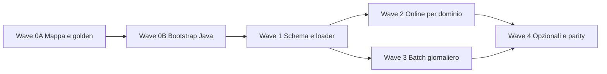

# Piano operativo: da CardDemo COBOL a Java in container

Ispezione in sola lettura del repository [aws-samples/aws-mainframe-modernization-carddemo](https://github.com/aws-samples/aws-mainframe-modernization-carddemo), branch `main`, commit `59cc6c2fd7ebd7ef7925cad552a01a4b8b6e4d5e`. Nessuna issue, PR o modifica è stata creata sul repository. Tutti i nomi di programmi, copybook, mappe BMS, JCL e file dati che seguono sono stati verificati direttamente sui sorgenti.

---

## Inventario verificato (punto di partenza)

Struttura principale sotto `app/`:

| Cartella | Contenuto reale |
| --- | --- |
| `app/cbl/` | 31 programmi COBOL di base (online CICS, batch e utility) |
| `app/cpy/` | 30 copybook di dati, COMMAREA, menu, messaggi e utility |
| `app/cpy-bms/` | copybook generati dalle mappe BMS di base |
| `app/bms/` | 17 mappe BMS di base |
| `app/jcl/` | 38 job JCL di base |
| `app/data/ASCII/` e `app/data/EBCDIC/` | file di esempio |
| `app/asm/`, `app/maclib/` | `COBDATFT.asm`, `MVSWAIT.asm` e relative macro |
| `app/proc/`, `app/csd/`, `app/ctl/`, `app/catlg/`, `app/scheduler/` | procedure (`REPROC.prc`, `TRANREPT.prc`), CSD, catalogo, schedulazioni CA7 e Control-M |
| `app/app-authorization-ims-db2-mq/` | modulo opzionale autorizzazioni (IMS, Db2, MQ) |
| `app/app-transaction-type-db2/` | modulo opzionale tipi transazione (Db2) |
| `app/app-vsam-mq/` | modulo opzionale inquiry via MQ |
| `samples/`, `scripts/`, `diagrams/` | JCL di compilazione, runtime di esempio AWS M2, script di batch |

### Programmi CICS di base (`app/cbl/`)

| Transazione | Mappa BMS | Programma | Funzione dichiarata nel sorgente |
| --- | --- | --- | --- |
| CC00 | COSGN00 | `COSGN00C` | Signon |
| CM00 | COMEN01 | `COMEN01C` | Menu utente |
| CAVW | COACTVW | `COACTVWC` | Account View |
| CAUP | COACTUP | `COACTUPC` | Account Update |
| CCLI | COCRDLI | `COCRDLIC` | Credit Card List |
| CCDL | COCRDSL | `COCRDSLC` | Credit Card View |
| CCUP | COCRDUP | `COCRDUPC` | Credit Card Update |
| CT00 | COTRN00 | `COTRN00C` | Transaction List |
| CT01 | COTRN01 | `COTRN01C` | Transaction View |
| CT02 | COTRN02 | `COTRN02C` | Transaction Add |
| CR00 | CORPT00 | `CORPT00C` | Stampa report transazioni sottomettendo un job batch |
| CB00 | COBIL00 | `COBIL00C` | Bill Payment (saldo in full + transazione di pagamento) |
| CA00 | COADM01 | `COADM01C` | Admin Menu |
| CU00–CU03 | COUSR00–03 | `COUSR00C`–`COUSR03C` | List / Add / Update / Delete utenti su `USRSEC` |

Utility di base nello stesso albero: `CSUTLDTC` (conversione date via `CEEDAYS`, chiamato da `COTRN02C` e `CORPT00C`) e `COBSWAIT` (attesa in centesimi di secondo, chiama `MVSWAIT`; job `WAITSTEP`).

### Programmi batch di base (`app/cbl/`) e JCL

| Programma | Funzione dichiarata nel sorgente | JCL verificato che lo lancia |
| --- | --- | --- |
| `CBTRN02C` | Post dei record dal file transazioni giornaliero | `POSTTRAN.jcl` |
| `CBACT04C` | Interest calculator | `INTCALC.jcl` (`PARM='2022071800'`) |
| `CBSTM03A` + sub `CBSTM03B` | Statement dalle transazioni; `CBSTM03A` chiama `CBSTM03B` | `CREASTMT.JCL` |
| `CBTRN03C` | Transaction detail report | `TRANREPT.jcl` |
| `CBACT01C` | Lettura account file e scrittura in output (chiama anche `COBDATFT`) | `READACCT.jcl` |
| `CBACT02C` | Lettura e stampa card file | `READCARD.jcl` |
| `CBACT03C` | Lettura e stampa cross-reference | `READXREF.jcl` |
| `CBCUS01C` | Lettura e stampa customer file | `READCUST.jcl` |
| `CBEXPORT` / `CBIMPORT` | Export/import dati cliente per *branch migration* | `CBEXPORT.jcl` / `CBIMPORT.jcl` |
| `CBTRN01C` | Stessa funzione dichiarata di `CBTRN02C` | Nessun JCL in `app/jcl/` lo esegue — da chiarire in Wave 0 |

### Copybook di dominio principali (`app/cpy/`)

| Copybook | Entità | RECLN | Chiave VSAM verificata nel JCL di `DEFINE` |
| --- | --- | --- | --- |
| `CSUSR01Y` | User security | 80 | `KEYS(8,0)` in `DUSRSECJ.jcl` (`SEC-USR-ID`) |
| `CVACT01Y` | Account | 300 | `KEYS(11 0)` in `ACCTFILE.jcl` (`ACCT-ID`) |
| `CVACT02Y` | Card | 150 | `KEYS(16 0)` + AIX `KEYS(11 16)` `NONUNIQUEKEY` in `CARDFILE.jcl` |
| `CVACT03Y` | Card/customer/account xref | 50 | `KEYS(16 0)` + AIX `KEYS(11,25)` `NONUNIQUEKEY` in `XREFFILE.jcl` |
| `CVCUS01Y` | Customer | 500 | `KEYS(9 0)` in `CUSTFILE.jcl` |
| `CVTRA05Y` | Transazione online (`TRAN-RECORD`) | 350 | `KEYS(16 0)` + AIX `KEYS(26 304)` su timestamp di processing (`TRANFILE.jcl` / `TRANIDX.jcl`) |
| `CVTRA06Y` | Daily transaction (`DALYTRAN-RECORD`) | 350 | file PS, non KSDS |
| `CVTRA01Y` | Transaction category balance | 50 | `KEYS(17 0)` in `TCATBALF.jcl` |
| `CVTRA02Y` | Disclosure group | 50 | `KEYS(16 0)` in `DISCGRP.jcl` |
| `CVTRA03Y` | Transaction type | 60 | `KEYS(2 0)` in `TRANTYPE.jcl` |
| `CVTRA04Y` | Transaction category type | 60 | `KEYS(6 0)` in `TRANCATG.jcl` |
| `COCOM01Y` | `CARDDEMO-COMMAREA` (stato CICS) | — | non un file VSAM |
| `CVEXPORT` | Tracciato export multi-record (`COMP`/`COMP-3` e `REDEFINES`) | 500 | usato da `CBEXPORT`/`CBIMPORT` |

---

## 1. Perché è una migrazione ibrida (brownfield → greenfield)

Il comportamento da preservare vive già in COBOL, VSAM, JCL e mappe BMS, mentre lo stack target (**Java 21 + Spring Boot + Spring Batch + PostgreSQL + Docker Compose**) va fondato da zero. Servono quindi **due Fasi 0** prima di scrivere una sola riga di logica di business:

- **Fase 0 brownfield (sola lettura):** mappa completa di programmi, copybook, chiavi VSAM/AIX, grafo dei JCL e *golden fixture* ricavate dai file in `app/data/ASCII/` e `EBCDIC/` (più gli output dei job COBOL come oracle, se si esegue il pacchetto `samples/m2/`).
- **Fase 0 greenfield (bootstrap):** scheletro del repository Java, Docker Compose, tabelle PostgreSQL derivate dai copybook, contratti condivisi e CI verde.

---

## 2. Architettura target in container (mappatura 1:1)

| Pezzo reale di CardDemo | Componente Java in container |
| --- | --- |
| CICS + mappe `app/bms/` + `app/cpy-bms/` | API REST (ed eventuale UI sottile) per transazione (`CC00`, `CM00`, …); campi BMS → DTO, PF-key/AID (`CVCRD01Y`) → comandi espliciti. |
| Programmi CICS `CO*` (`COSGN00C`, `COACTVWC`, `COBIL00C`, …) | Servizi di dominio Spring (1 programma = 1 unità di lavoro). |
| `CARDDEMO-COMMAREA` (`COCOM01Y`: `CDEMO-PGM-ENTER` / `REENTER`, utente, tipo `A`/`U`, ID correnti) | Oggetto di conversazione persistito/serializzato tra chiamate, non stato in thread. |
| File VSAM KSDS + AIX (`CVACT01Y`…`CVTRA06Y`, `CSUSR01Y`) | Tabelle PostgreSQL 1:1 con PK allineate ai `KEYS(...)` dei `DEFINE CLUSTER` e indici sugli alternate index (`CARDFILE`, `XREFFILE`, `TRANFILE`/`TRANIDX`). |
| COBOL batch `CB*` + JCL (`app/jcl/`) | Job Spring Batch (1 `EXEC PGM=` di business = 1 step; `SORT` → step di ordinamento; `DEFINE`/`REPRO` `IDCAMS` → loader di Wave 1). |
| `CLOSEFIL` / `OPENFIL` (`SDSF` + CICS) | *Job fence* / lock di batch che blocca scritture online durante il ciclo giornaliero. |
| GDG (`DEFGDGB`, `DALYREJS`, `SYSTRAN(+1)`, backup) | Tabelle o artefatti versionati per `jobExecutionId`. |
| RACF + `USRSEC` | Spring Security con seed da `DUSRSECJ.jcl` / `AWS.M2.CARDDEMO.USRSEC.PS`. |
| Assembler `COBDATFT`, `MVSWAIT` e utility `CSUTLDTC` | Utility Java equivalenti con test di parità prima dei chiamanti (`CBACT01C`, `COBSWAIT`, `COTRN02C`, `CORPT00C`). |
| Moduli opzionali (Db2, MQ, IMS) | Schema Postgres dedicato (`TRNTYPE.ddl`, `TRNTYCAT.ddl`, `AUTHFRDS.ddl`), broker MQ in Compose, modello relazionale/JSONB per DBD/PSB IMS (Wave 4). |

---

## 3. Piano a ondate (backlog di GitHub Issues)

Etichette e ruoli invariati (`bootstrap`, `ready`, `in-progress`, `in-review`, `blocked`, `needs-spec-update` + `wave-0`…`wave-4`; **Selettore → Esecutore → Validatore adversarial → Gate umano**).



### Wave 0 — Discovery & Golden Oracle + Bootstrap Java (sequenziale)

- **0.A (Brownfield):**
  1. Inventario vivo e grafo `COPY` / `CALL` / `EXEC PGM=`. Qui si registra esplicitamente che `CBTRN01C` dichiara la stessa funzione di `CBTRN02C` ma nessun JCL in `app/jcl/` lo esegue: va chiarito con `needs-spec-update` se portarlo o escluderlo.
  2. Contratto dati campo per campo dai copybook: `DISPLAY`/`COMP`/`COMP-3`, `REDEFINES`/`OCCURS`, chiavi VSAM e AIX dai `DEFINE` JCL, padding (`cardxref.txt` ha 36 caratteri utili contro `RECORDSIZE(50)` di `CVACT03Y`).
  3. Parser e *golden fixture* da `app/data/ASCII/` (gestendo newline miste LF/CRLF e overpunch zoned, es. `{` su `ACCT-CURR-BAL` in `acctdata.txt`) + seed `USRSEC` da `DUSRSECJ.jcl`.
  4. Grafo del ciclo giornaliero allineato al README e a `app/scheduler/` (CA7 / Control-M).
- **0.B (Greenfield, dopo il congelamento di 0.A):**
  5. Scheletro Java 21 / Spring Boot / Spring Batch / PostgreSQL / Docker Compose + CI verde.
  6. Moduli vuoti ma importabili: `carddemo-domain`, `carddemo-loader`, `carddemo-online`, `carddemo-batch`, `carddemo-parity`.
  7. Scaffale di sicurezza e `COMMAREA`, più `CLAUDE.md` con invarianti (`BigDecimal` obbligatorio, divieto di refactor fuori perimetro, comando di verifica unico).

### Wave 1 — Modello dati e loader fixture (parallelizzabile per copybook)

- Una issue per tracciato/tabella (`account`, `card`, `card_xref`, `customer`, `transaction`, `daily_transaction`, `tran_cat_balance`, `disclosure_group`, `tran_type`, `tran_category`, `usrsec`) con PK e indici AIX esatti (`CARD-ACCT-ID` offset 16 len 11, `XREF-ACCT-ID` offset 25 len 11, `TRAN-PROC-TS` offset 304 len 26).
- Issue finale di integrazione: loader che carica `app/data/ASCII/*` + `USRSEC`, con checksum sui campi numerici e test di round-trip. (`CVEXPORT`, che usa `COMP`/`COMP-3` e `REDEFINES`, resta con `CBEXPORT`/`CBIMPORT` in Wave 3.)

### Wave 2 — Servizi online (programmi CICS `CO*`)

1. **Base sequenziale:** `COSGN00C` (CC00) + `COCOM01Y` + ruoli `A`/`U`, utility `CSUTLDTC`, menu `COMEN01C` e `COADM01C` (opzioni da `COMEN02Y`/`COADM02Y`, con le voci Db2 disabilitate fino a Wave 4).
2. **Letture in parallelo (cartelle disgiunte):** `COACTVWC` (account), `COCRDLIC` / `COCRDSLC` (carte), `COTRN00C` / `COTRN01C` (transazioni), `COUSR00C` (utenti).
3. **Scritture (regola del Selettore: mai due issue `in-progress` sulla stessa tabella):** `COACTUPC` (dipende anche da `CSLKPCDY`, `CSSETATY`, `CSUTLDPY`), `COCRDUPC`, `COTRN02C`, `COBIL00C`, `COUSR01C`–`03C`, e `CORPT00C` (che lancia `TRANREPT`: bloccata fino a `CBTRN03C` oppure dietro seam di accodamento job).

### Wave 3 — Job batch (programmi `CB*` e JCL → Spring Batch)

1. **Ciclo giornaliero in sequenza stretta** (ogni step muta lo stato letto dal successivo):
   - Fence online/batch (equivalente di `CLOSEFIL`/`OPENFIL`)
   - `POSTTRAN` (`CBTRN02C`) → posting transazioni + reject `DALYREJS`
   - `INTCALC` (`CBACT04C`, con `PARM` data es. `2022071800`) → interessi e `SYSTRAN`
   - `TRANBKP` → snapshot/export versionato
   - `COMBTRAN` → `SORT` + merge nel master
   - `CREASTMT` (`CBSTM03A` + `CBSTM03B`) → estratti conto testo e HTML
   - `TRANIDX` → ricostruzione indice su `TRAN-PROC-TS`
   - `TRANREPT` (`CBTRN03C`) → report dettagliato, invocabile anche da `CORPT00C`
2. **Utility e I/O laterali in parallelo:** `READACCT`/`READCARD`/`READCUST`/`READXREF`, `WAITSTEP`/`COBSWAIT`, `CBEXPORT`/`CBIMPORT` (con decoder packed `CVEXPORT`), più una issue esplicita di triage (“portare / emulare / escludere”) per i job puramente mainframe (`FTPJCL`, `TXT2PDF1`, `INTRDRJ1/2`, `ESDSRRDS`, `CBADMCDJ`).

### Wave 4 — Moduli opzionali reali + Parity testing end-to-end

Tre filoni indipendenti, parallelizzabili:
- **Transaction Type Db2** (`app-transaction-type-db2`): `COTRTUPC`, `COTRTLIC`, `COBTUPDT` (`MNTTRDB2`), `TRANEXTR`, DDL `TRNTYPE.ddl` / `TRNTYCAT.ddl`.
- **VSAM + MQ** (`app-vsam-mq`): `CODATE01` (CDRD), `COACCT01` (CDRA).
- **Authorizations IMS/Db2/MQ** (`app-authorization-ims-db2-mq`): `COPAUA0C`, `COPAUS0C`, `COPAUS1C`, `COPAUS2C`, purge `CBPAUP0C`/`CBPAUP0J`, `AUTHFRDS.ddl`.

Chiusura con suite di parità end-to-end (login → update → add transaction → bill payment → ciclo batch completo → statement/report) contro i golden fixture di Wave 0.

---

## 4. Due esempi concreti di Issue pronte

### Issue A — Online: `COBIL00C` (CB00, Bill Payment)

```markdown
## Obiettivo
Tradurre il programma CICS `COBIL00C` (transazione `CB00`, mappa `COBIL00`) nel
servizio Java di bill payment: saldo del conto in full e inserimento della
relativa transazione con la stessa semantica del COBOL.

## Dipendenze e perimetro
- Dipende da: Wave 0, Wave 1 (`account`, `card_xref`, `transaction`, loader),
  `COSGN00C`, `COMEN01C`, `COACTVWC`.
- Non eseguibile in parallelo a issue che scrivono `account` o `transaction`
  (`COACTUPC`, `COTRN02C`).
- Sorgenti COBOL di riferimento: `app/cbl/COBIL00C.cbl`, `app/bms/COBIL00.bms`,
  `app/cpy-bms/COBIL00.CPY`, `app/cpy/COCOM01Y.cpy`, `CVACT01Y.cpy`,
  `CVACT03Y.cpy`, `CVTRA05Y.cpy`, `CSDAT01Y.cpy`, `CSMSG01Y.cpy`, `COTTL01Y.cpy`.
- Target Java: `carddemo-online` (bill payment), `carddemo-parity`.
- Fuori ambito: altre transazioni CICS, job batch, moduli opzionali.

## Specifica
- L’utente autenticato (`COCOM01Y`) richiede il pagamento del saldo.
- Applica le stesse regole di `COBIL00C` su conto, saldo, xref carta/conto e
  scrittura della transazione su `transaction` (`CVTRA05Y`).
- Riproduce i due tempi CICS (`CDEMO-PGM-ENTER` / `CDEMO-PGM-REENTER`): prima
  chiamata = presentazione stato, seconda = conferma ed effetto.

## Invarianti di parità
- Stesso effetto su `account` e `transaction` a parità di fixture Wave 1.
- Aritmetica esclusivamente con `BigDecimal`, identica al centesimo.
- Chiave transazione conforme a `KEYS(16 0)` e AIX su `TRAN-PROC-TS`.
- Nessuna scrittura parziale in caso di conto inesistente o errore di validazione.

## Criteri di accettazione (verificabili)
- [ ] Test di parità su `acctdata.txt` e `cardxref.txt`: verifica saldo finale
      e record transazione inserito.
- [ ] Test re-enter: prima chiamata non persiste, conferma sì.
- [ ] Test negativo su conto inesistente / condizione d'errore di `COBIL00C`.
- [ ] `./mvnw test` e lint verdi, nessun file fuori perimetro.

## Limiti per l'agente
- Se `COBIL00C` contraddice un contratto di Wave 1, fermarsi e applicare
  `needs-spec-update`.
```

### Issue B — Batch: `POSTTRAN` / `CBTRN02C`

```markdown
## Obiettivo
Tradurre il job `POSTTRAN` (`app/jcl/POSTTRAN.jcl`, `PGM=CBTRN02C`) in un job
Spring Batch (`posttranJob`) che esegue il posting delle transazioni giornaliere
con la stessa semantica di accettazione e scarto del COBOL.

## Dipendenze e perimetro
- Dipende da: Wave 0, Wave 1 completa.
- Va mergiata prima di `INTCALC` (`CBACT04C`), `COMBTRAN` e `CREASTMT`.
- Sorgenti di riferimento: `app/jcl/POSTTRAN.jcl`, `app/cbl/CBTRN02C.cbl`,
  `CVACT01Y.cpy`, `CVACT03Y.cpy`, `CVTRA01Y.cpy`, `CVTRA05Y.cpy`, `CVTRA06Y.cpy`;
  dati `app/data/ASCII/dailytran.txt` e `app/data/EBCDIC/AWS.M2.CARDDEMO.DALYTRAN.PS`.
- DD JCL coperti: `TRANFILE`, `DALYTRAN`, `XREFFILE`, `DALYREJS`, `ACCTFILE`, `TCATBALF`.
- Fuori ambito: `CBTRN01C`, `INTCALC`, `CREASTMT`, `CLOSEFIL`/`OPENFIL` (fence).

## Specifica
- Legge le daily transaction (`CVTRA06Y`), risolve il conto via `card_xref`
  (`CVACT03Y`), aggiorna `transaction`, `account` e `tran_cat_balance` (`CVTRA01Y`),
  e scrive gli scarti su dataset/tabella versionata equivalente a `DALYREJS(+1)`.

## Invarianti di parità
- Stesso insieme di transazioni postate e scartate, stessi `TRAN-ID` e stessi
  saldi al centesimo rispetto all’oracle di Wave 0 (o matrice recensita su `CBTRN02C`).
- Chiavi conformi a `KEYS(16 0)` e AIX `TRAN-PROC-TS`.
- Comportamento su riesecuzione identico al COBOL (nessuna idempotenza inventata).

## Criteri di accettazione (verificabili)
- [ ] Test di parità su fixture Wave 1 con confronto record-per-record su
      `account`, `transaction`, `tran_cat_balance` e `DALYREJS`.
- [ ] Almeno un caso di reject verificato (es. chiave xref assente).
- [ ] Zero `double`/`float` sui campi `PIC S9…V99`; solo `BigDecimal`.
- [ ] `./mvnw test` e lint verdi, PR limitata a `carddemo-batch` e `carddemo-parity`.

## Limiti per l'agente
- Non fondere `CBTRN01C` e `CBTRN02C`; su rami ambigui fermarsi con `needs-spec-update`.
```

---

## 5. I 4 rischi COBOL → Java su cui tarare il Validatore adversarial

1. **Aritmetica decimale e overpunch (non solo `COMP-3`).** Nei copybook VSAM di base gli importi sono `PIC S9…V99` in *display* (zoned) con overpunch di segno nei file ASCII (es. `{` in `acctdata.txt`), mentre `COMP`/`COMP-3` entrano in `CVEXPORT.cpy`, nella working storage di `CBSTM03A` e nei moduli opzionali. Il Validatore deve bocciare ogni `double`/`float`, ogni parser che ignori overpunch/filler e ogni scostamento anche di un centesimo su interessi o saldi (`BigDecimal` con scala e arrotondamento COBOL espliciti).
2. **Stato pseudo-conversazionale CICS (`COMMAREA`).** Quasi tutti i `CO*` copiano `COCOM01Y` (`CDEMO-PGM-ENTER` vs `REENTER`, transazione from/to, utente, ID correnti). Un endpoint REST "stateless" che scrive al primo POST rompe la semantica di `COACTUPC`, `COBIL00C` e `COUSR01C`. Il Validatore pretende test espliciti sui due tempi e sul passaggio di stato tra transazioni.
3. **Chiavi e ordinamenti VSAM/AIX.** I listing (`COCRDLIC`, `COTRN00C`, `COUSR00C`) e i batch (`CBACT04C` sul path AIX di `XREFFILE`; `TRANIDX` su `TRAN-PROC-TS`) dipendono dall’ordine di chiave (`STARTBR`/`READNEXT`), non da una `SELECT` non ordinata. Il Validatore boccia output “giusti nei contenuti ma in ordine diverso” o scritture che disallineano gli indici AIX.
4. **Logica nascosta nei `COPY`.** In CardDemo diversi copybook contengono comportamento, non solo dati: `COMEN02Y`/`COADM02Y` (routing menu), `CSLKPCDY` (validazione area code/stato in `COACTUPC`), `CSSETATY`/`CSSTRPFY` (attributi mappa e PF-key), `CSUTLDPY` (utility usata da `COACTUPC`), `CVCRD01Y` (AID e `REDEFINES`), `CVTRA07Y`/`COSTM01` (layout report/statement). Il Validatore verifica per ogni PR che tutti i `COPY` del programma sorgente abbiano un corrispondente tradotto o esplicitamente escluso.
